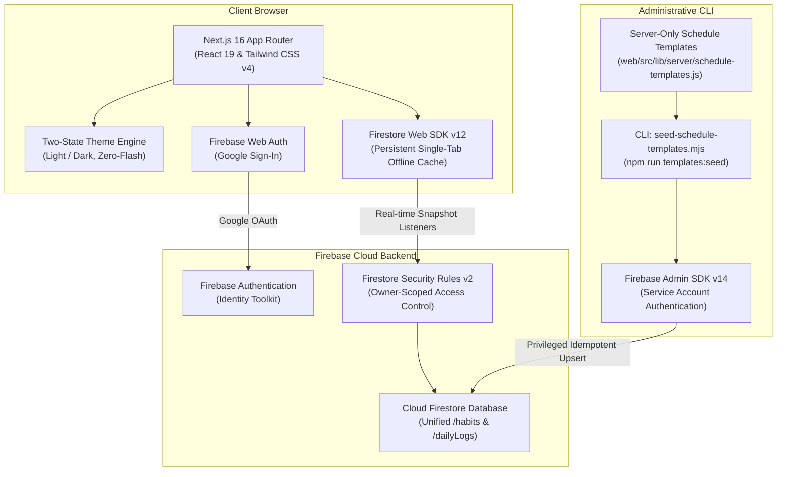

# Vritta Architecture & System Design

**Document Role:** Architecture & Explanation (Diátaxis)  
**System:** Vritta — Personal Routine Companion  
**Stack:** Next.js 16 (App Router), React 19, Tailwind CSS v4, Firebase Web SDK v12, Firebase Admin SDK v14  

---

## 1. System Overview

Vritta (वृत्त — classical Sanskrit for mindful rhythm, conduct, and cyclical observance) is a mobile-first Progressive Web Application (PWA). It provides an accessible, calm environment for daily personal practices, physical conditioning, language learning, and reflection.

The application operates as a client-side single-page application (SPA) powered by the Next.js App Router, backed by Cloud Firestore with offline persistence, and synchronized administratively via the Firebase Admin SDK.



---

## 2. Directory Structure & Modular Responsibilities

The codebase enforces strict separation of concerns across presentation, domain logic, and backend infrastructure:

```
root/
├── docs/                 # Authoritative project documentation
├── scripts/              # Administrative Node.js maintenance scripts
│   ├── seed-schedule-templates.mjs  # CLI schedule templates seed tool
│   ├── backup-personal-plan.mjs     # Disaster-recovery backup tool
│   └── restore-personal-plan.mjs    # Disaster-recovery restore tool
└── web/                  # Next.js web application package
    ├── public/           # Static PWA assets, icons, and web manifest
    ├── tests/            # Automated Node.js unit and integration test suites
    └── src/
        ├── app/          # Next.js App Router routes and page layouts
        │   ├── (auth)/   # Unauthenticated route group (Login)
        │   ├── (protected)/ # Authenticated route group (Dashboard, Habits, Analytics)
        │   ├── globals.css # Tailwind CSS v4 theme variables and global styles
        │   └── layout.js # Root layout with zero-flash theme blocking script
        ├── components/   # Modular React components
        │   ├── habits/   # Interactive routine cards (Movement, Workbook, Osho, etc.)
        │   └── ui/       # Presentation components (TopNav, BottomNav, ThemeToggle)
        ├── contexts/     # Application React Context providers (Auth, Data, Theme, Toast, Sound, Timer)
        ├── hooks/        # Reusable domain hooks (useHabits, useDailyLogs, useStreak)
        └── lib/          # Utilities, configuration, and data fixtures
            ├── constants/# Category configurations and brand definitions
            ├── firebase/ # Client-side Firebase SDK initialization
            ├── fixtures/ # Exercise schedules and Osho discourse catalog
            └── server/   # Server-only Firebase Admin SDK and sync services
```

---

## 3. Brand Identity & Design System

The visual identity of Vritta embodies intentional calm, clarity, and discipline, completely avoiding gratuitous gradients or decorative animations.

### 3.1 Authoritative Palette & Semantic Tokens

| Token | Swatch | CSS Value | Purpose & Usage |
| :--- | :---: | :--- | :--- |
| **Deep Obsidian** | `■` | `#090D16` | Dark mode background canvas and primary light text |
| **Luminous Teal** | `■` | `#14B8A6` | Primary brand accent, active navigation, completion badges |
| **Warm Amber** | `■` | `#D97706` | Secondary accent, streak indicator, theme toggle icon |
| **Accessible Teal** | `■` | `#0F766E` | Light-mode high-contrast brand mark variant (WCAG AAA >= 7:1) |
| **Light Canvas** | `■` | `#F8FAFC` | Light mode background canvas |
| **Light Surface** | `■` | `#FFFFFF` | Light mode card background |
| **Dark Surface** | `■` | `#111827` | Dark mode card background |

### 3.2 The Guiding Sutra Logo
The logo represents an unbroken thread connecting daily practices, centered around a grounding anchor:
- **Geometry:** A continuous monoline ribbon loop with Bezier curve precision (`viewBox="0 0 200 200"`).
- **Implementation:** Centered in [`web/src/components/ui/Logo.js`](../web/src/components/ui/Logo.js).
- **Accessibility:** Labeled with `role="img"` and descriptive `aria-label`.

---

## 4. Two-State Theme Engine

The theme architecture is strictly binary: **Light** or **Dark**. The legacy "System" preference and runtime `matchMedia` listeners have been completely removed to guarantee deterministic rendering and eliminate theme flashes.

```
┌─────────────────────────────────────────────────────────────┐
│ 1. HTML Request (<head>)                                    │
│    └── Synchronous Blocking Script                          │
│        └── Reads localStorage('vritta-theme')               │
│        └── if 'dark' -> adds .dark; else -> removes .dark   │
│        └── ZERO flash of unstyled content (FOUC)            │
├─────────────────────────────────────────────────────────────┤
│ 2. Client Hydration                                         │
│    └── ThemeProvider (useSyncExternalStore)                 │
│        └── Defaults safely to 'light' (migrates legacy val) │
│        └── Listens for cross-tab storage synchronization    │
├─────────────────────────────────────────────────────────────┤
│ 3. User Interaction                                         │
│    └── ThemeToggle Component                                │
│        └── Touch target >= 44×44px (WCAG 2.2 Level AAA)     │
│        └── Alternates Sun/Moon icons in Warm Amber          │
│        └── Zero visible text; dynamic accessible aria-label │
└─────────────────────────────────────────────────────────────┘
```

- **Pre-Paint Blocking Script (`web/src/app/layout.js`):**
  Executes synchronously in `<head>` before body parsing. If `localStorage.getItem('vritta-theme') === 'dark'`, it applies `.dark` to `document.documentElement`; otherwise, it removes `.dark`.
- **State Store (`web/src/contexts/ThemeContext.js`):**
  Subscribes to external storage changes using `useSyncExternalStore`. Safely migrates null, invalid, or legacy `'system'` values to `'light'`.
- **Component (`web/src/components/ui/ThemeToggle.js`):**
  Meets WCAG 2.2 SC 2.5.5 Level AAA touch target standards (`min-h-[44px]`).

---

## 5. Routine Architecture & Schedule Isolation

Vritta enforces a strict architectural boundary between universal foundation routines and proprietary personalized routines:

### 5.1 Consolidated Schedule Templates Catalog
All reusable schedule blueprints, foundation wellness routines, and discipline plans are consolidated into:
- **Authoritative Catalog (`web/src/lib/server/schedule-templates.js`):**
  Strictly server-side module defining reusable templates with stable IDs, general-purpose categories, and atomic feature slots.
- **Seeding Pipeline (`scripts/seed-schedule-templates.mjs`):**
  Seeds shared templates into the `/scheduleTemplates` Firestore collection without touching user-owned documents or private logs. User routine documents are stored separately under `/habits`.

### 5.2 Routine Subsystems & Interactive Cards
Each routine type maps 1:1 to an interactive card component on `/dashboard`:

| Card Component | Routine Type | Core Behavior |
| :--- | :--- | :--- |
| **`WorkbookCard`** | Word Power Made Easy | Stepper tracking Sessions 1 & 2; requires previous-work review before completion. |
| **`MovementCard`** | 12-Week Conditioning | Weekday-adaptive (Mon/Wed/Fri workout, Tue/Thu/Sat walk, Sun rest). |
| **`OshoCard`** | Contemplative Focus | 30-discourse library modal across 6 thematic categories with progress tracking. |
| **`ReadingCard`** | Bedtime Reading | 30-minute bedtime countdown timer with pause/resume and completion logging. |
| **`SpeakingCard`** | Language Mastery | ChatGPT voice practice prompt with binary completion toggle. |
| **`DiaryCard`** | Private Reflection | Daily reflection modal with 5 rotating prompts; private per user. |

### 5.3 Scheduling Philosophy
- **Soft Timing Over Hard Deadlines:** Timing indicates preferred periods (Afternoon, Before Bed, Anytime), not punitive deadlines. Activities completed later in the day count fully.
- **Rest Day Preservation:** Planned rest days (e.g., Sunday movement) are excluded from the denominator in completion rates, eliminating artificial streak failures.

---

## 6. Database Models & Firestore Architecture

All user data resides in a single Cloud Firestore database under owner-scoped security rules:

### 6.1 Collections Schema

```
Firestore Root
├── /habits/{habitId}
│   ├── userId: string (Owner UID)
│   ├── title: string
│   ├── category: string ('English Learning' | 'Movement & Strength' | 'Listening & Awareness' | 'Reading' | 'Communication' | 'Reflection')
│   ├── timing: string ('Anytime' | 'Afternoon' | 'Before Bed')
│   ├── frequency: array [0..6] (Active weekdays)
│   ├── stableKey: string (Deterministic routine identifier)
│   ├── seedOrigin: 'personal_preset' | 'foundation' | 'custom'
│   └── isSystemSeed: boolean
│
├── /dailyLogs/{logId}  (Document ID format: {userId}_{YYYY-MM-DD})
│   ├── userId: string
│   ├── date: string ('YYYY-MM-DD' local calendar date)
│   ├── habits: map { [habitId]: boolean }
│   ├── workbookProgress: map { sessions: number, reviewed: boolean }
│   ├── readingProgress: map { durationMinutes: number }
│   └── diaryEntry: map { text: string, promptIndex: number }
│
└── /users/{userId}
    ├── email: string
    ├── displayName: string
    ├── lastActive: timestamp
    └── createdAt: timestamp
```

### 6.2 Security Rules Model (`web/firestore.rules`)
- **Version:** Rules v2.
- **Authentication:** All read and write requests require `request.auth != null`.
- **Owner Scope:** Users can only read and write their own documents (`request.auth.uid == resource.data.userId`).
- **Category Validation:** Validates `category` against the canonical category whitelist.
- **Protected Paths:** Disallows client writes to server-reserved paths.

---

## 7. Interactive Sound Architecture & Procedural Synthesis

Vritta features a native, zero-dependency interactive audio system powered directly by the Web Audio API (`web/src/utils/audio-chime.js`).

### 7.1 Design Principles & Performance
- **Zero Asset Overhead:** All audio cues are synthesized dynamically in code using Web Audio oscillators and exponential gain ramps. No MP3, WAV, or OGG audio files are downloaded over the network.
- **Harmonic Musical Palette:** Cues utilize a unified Pentatonic scale (C5, D5, E5, G5, A5, C6) to produce warm, tranquil, meditative chimes that evoke focus without startle or auditory fatigue.
- **Micro-Decay Envelopes:** Sound durations are tightly bounded: ticks (45ms), navigational clicks (25ms), and timer completions (1.8s exponential decay).

### 7.2 Sound Interaction Map

| Interaction | Trigger / Component | Acoustic Profile | Musical Pitch & Envelope |
| :--- | :--- | :--- | :--- |
| **Timer Start** | `ReadingCard`, `TimerModal` | Gentle rising chime | C5 (523Hz) → E5 (659Hz) → G5 (784Hz), 450ms |
| **Timer Pause** | `ReadingCard`, `TimerModal` | Soft descending transition | G5 (784Hz) → E5 (659Hz), 200ms |
| **Timer Resume** | `ReadingCard`, `TimerModal` | Bright upward step | E5 (659Hz) → A5 (880Hz), 200ms |
| **Timer Reset** | `ReadingCard`, `TimerModal` | Restrained grounding cue | E5 (659Hz) → C5 (523Hz), 180ms |
| **Timer Completion** | `TimerContext` | Resonant tri-tone bell | C5 (523Hz) + G5 (784Hz) + C6 (1046Hz) chord, 1.8s decay, mixed sine/triangle oscillators |
| **Checklist Step Toggle** | `StepItem`, `OshoLibraryModal` | Crisp micro-tick | 880Hz / 659Hz, 45ms, gentle attack/decay |
| **Habit Completion** | Habit Cards, Checkbox | Celebratory arpeggio | C5 → E5 → G5 → C6 harmonic sweep, 500ms |
| **Tab Navigation** | `BottomNav` | Subdued wooden/bamboo click | Bandpass filtered noise/impulse, 25ms, < -18dB |
| **Action Success** | `OshoLibraryModal`, `MovementCard` | Warm affirmation chord | F5 → A5 → C6 chord, 250ms |

### 7.3 State, Provider Hierarchy & Autoplay Governance
- **Provider Ordering (`web/src/app/layout.js`):**
  `SoundProvider` is mounted at the root provider layer, above `TimerProvider` and `DataProvider`. This ensures timer callbacks, habit toggles, and modal dialogues can consume sound dispatches without circular dependencies.
- **Autoplay Policy Handling:** The browser's native `AudioContext` is lazily instantiated and automatically resumed on the first user interaction (touch or click), avoiding browser console autoplay warnings.
- **Persistence & User Control:**
  - Volume (default 0.7) and mute state are persisted in `localStorage('vritta-sound-volume')` and `localStorage('vritta-sound-muted')`.
  - Accessible `SoundControl` toggle in `TopNav` provides instantaneous mute/unmute with screen-reader friendly status.

---

## 8. Resilient Background Timer Subsystem

The timer engine (`web/src/contexts/TimerContext.js` and `web/src/hooks/use-timer.js`) is architected for strict wall-clock accuracy, resilient background tab operation, and seamless recovery across page reloads.

### 8.1 Wall-Clock Timestamp Synchronization
Unlike naive timer implementations that decrement an interval counter every 1000ms, Vritta strictly derives remaining time from wall-clock timestamps:
```javascript
const diffMs = targetEndTime - Date.now();
const secondsRemaining = Math.max(0, Math.ceil(diffMs / 1000));
```
- **Interval Drift Immunity:** Throttling or background tab freezes cannot cause time drift. When the browser resumes, the remaining time instantly recalculates to the exact wall-clock second.
- **Elimination of `00:01` Stranding:** If `targetEndTime <= Date.now()`, the timer immediately yields `0` seconds and executes completion, preventing timers from freezing at `00:01`.

### 8.2 Web Worker Background Dispatch
Browser engines aggressively throttle `setInterval` in inactive or minimized background tabs (often to once per minute). Vritta circumvents this via an inline Blob Web Worker (`createTimerWorker` in `web/src/contexts/TimerContext.js`):
- The Web Worker operates on a separate background thread unaffected by DOM throttling, emitting unthrottled 500ms pulses.
- In addition to worker pulses, `TimerContext` binds native `focus`, `visibilitychange`, and `pageshow` event listeners to immediately reconcile state whenever the user switches back to the application tab.

### 8.3 Concurrency & Reload Recovery Guarantees
- **Atomic Completion Guard:** Completion callbacks and sound dispatches are protected by `completedSessionsRef` keyed by `${timerId}_${targetEndTime}` and `finishingTimersRef`. Even if the Web Worker pulse, main thread timeout, and `visibilitychange` fire simultaneously, the completion callback and audio chime execute exactly once.
- **Silent Reload Recovery:** If a timer session expires while the browser tab was closed or navigating, the session is reconciled on reload. It records the completed duration to Cloud Firestore once `authLoading` resolves, but suppresses the audio chime (`isSilent = true`) to prevent alarming unexpected sound playback upon launch.
- **Platform Boundaries:** Procedural Web Audio API sound playback requires the browser application process to be running. If the operating system puts the device into deep sleep or terminates the browser process, the timer session accurately self-heals and logs upon the next launch.

---

## 9. Dynamic Analytics Engine & Rest-Day Guarantees

The analytics subsystem (`web/src/app/(protected)/analytics/page.js` and `web/src/hooks/useStreak.js`) translates raw daily logs into clear, actionable rhythm metrics.

### 9.1 Multi-Granular Metrics
- **Rolling 7-Day View:** Daily completion percentages, active habit tallies, and rest-day indicators.
- **Rolling 30-Day View:** Monthly consistency score, category distribution chart, and total completed sessions.

### 9.2 Rest-Day Preservation Principle
A core philosophy of Vritta is guilt-free consistency. Habits scheduled with specific rest periods (e.g., the Sunday recovery day in the 12-Week Movement Plan) are dynamically excluded from the denominator in completion rate calculations:
- Planned rest days maintain continuity without penalizing user streaks.
- Rest days are visually distinguished with amber recovery icons rather than incomplete status badges.
