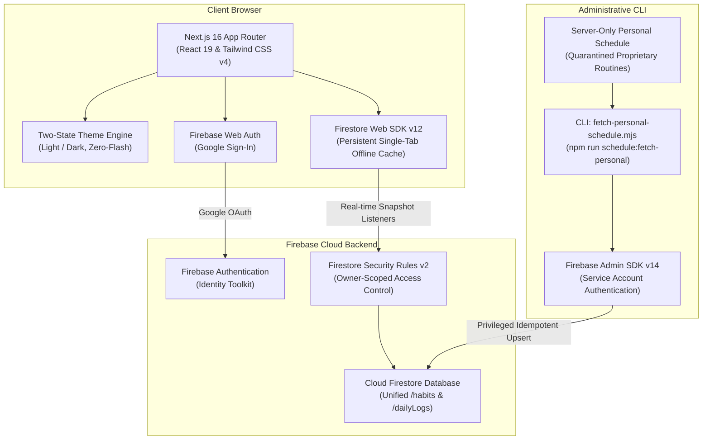

# Vritta Architecture & System Design

**Document Role:** Architecture & Explanation (Diátaxis)  
**System:** Vritta — Personal Routine Companion  
**Stack:** Next.js 16 (App Router), React 19, Tailwind CSS v4, Firebase Web SDK v12, Firebase Admin SDK v14  

---

## 1. System Overview

Vritta (वृत्त — classical Sanskrit for mindful rhythm, conduct, and cyclical observance) is a mobile-first Progressive Web Application (PWA). It provides an accessible, calm environment for daily personal practices, physical conditioning, language learning, and reflection.

The application operates as a client-side single-page application (SPA) powered by the Next.js App Router, backed by Cloud Firestore with offline persistence, and synchronized administratively via the Firebase Admin SDK.



---

## 2. Directory Structure & Modular Responsibilities

The codebase enforces strict separation of concerns across presentation, domain logic, and backend infrastructure:

```
root/
├── docs/                 # Authoritative project documentation
├── scripts/              # Administrative Node.js maintenance scripts
│   └── fetch-personal-schedule.mjs  # CLI schedule synchronization tool
└── web/                  # Next.js web application package
    ├── public/           # Static PWA assets, icons, and web manifest
    ├── tests/            # Automated Node.js unit and integration test suites
    └── src/
        ├── app/          # Next.js App Router routes and page layouts
        │   ├── (auth)/   # Unauthenticated route group (Login)
        │   ├── (protected)/ # Authenticated route group (Dashboard, Habits, Analytics)
        │   ├── globals.css # Tailwind CSS v4 theme variables and global styles
        │   └── layout.js # Root layout with zero-flash theme blocking script
        ├── components/   # Modular React components
        │   ├── habits/   # Interactive routine cards (Movement, Workbook, Osho, etc.)
        │   └── ui/       # Presentation components (TopNav, BottomNav, ThemeToggle)
        ├── contexts/     # Application React Context providers (Auth, Data, Theme, Toast)
        ├── hooks/        # Reusable domain hooks (useHabits, useDailyLogs, useStreak)
        └── lib/          # Utilities, configuration, and data fixtures
            ├── constants/# Category configurations and brand definitions
            ├── firebase/ # Client-side Firebase SDK initialization
            ├── fixtures/ # Exercise schedules and Osho discourse catalog
            └── server/   # Server-only Firebase Admin SDK and sync services
```

---

## 3. Brand Identity & Design System

The visual identity of Vritta embodies intentional calm, clarity, and discipline, completely avoiding gratuitous gradients or decorative animations.

### 3.1 Authoritative Palette & Semantic Tokens

| Token | Swatch | CSS Value | Purpose & Usage |
| :--- | :---: | :--- | :--- |
| **Deep Obsidian** | `■` | `#090D16` | Dark mode background canvas and primary light text |
| **Luminous Teal** | `■` | `#14B8A6` | Primary brand accent, active navigation, completion badges |
| **Warm Amber** | `■` | `#D97706` | Secondary accent, streak indicator, theme toggle icon |
| **Accessible Teal** | `■` | `#0F766E` | Light-mode high-contrast brand mark variant (WCAG AAA >= 7:1) |
| **Light Canvas** | `■` | `#F8FAFC` | Light mode background canvas |
| **Light Surface** | `■` | `#FFFFFF` | Light mode card background |
| **Dark Surface** | `■` | `#111827` | Dark mode card background |

### 3.2 The Guiding Sutra Logo
The logo represents an unbroken thread connecting daily practices, centered around a grounding anchor:
- **Geometry:** A continuous monoline ribbon loop with Bezier curve precision (`viewBox="0 0 200 200"`).
- **Implementation:** Centered in [`web/src/components/ui/Logo.js`](../web/src/components/ui/Logo.js).
- **Accessibility:** Labeled with `role="img"` and descriptive `aria-label`.

---

## 4. Two-State Theme Engine

The theme architecture is strictly binary: **Light** or **Dark**. The legacy "System" preference and runtime `matchMedia` listeners have been completely removed to guarantee deterministic rendering and eliminate theme flashes.

```
┌─────────────────────────────────────────────────────────────┐
│ 1. HTML Request (<head>)                                    │
│    └── Synchronous Blocking Script                          │
│        └── Reads localStorage('vritta-theme')               │
│        └── if 'dark' -> adds .dark; else -> removes .dark   │
│        └── ZERO flash of unstyled content (FOUC)            │
├─────────────────────────────────────────────────────────────┤
│ 2. Client Hydration                                         │
│    └── ThemeProvider (useSyncExternalStore)                 │
│        └── Defaults safely to 'light' (migrates legacy val) │
│        └── Listens for cross-tab storage synchronization    │
├─────────────────────────────────────────────────────────────┤
│ 3. User Interaction                                         │
│    └── ThemeToggle Component                                │
│        └── Touch target >= 44×44px (WCAG 2.2 Level AAA)     │
│        └── Alternates Sun/Moon icons in Warm Amber          │
│        └── Zero visible text; dynamic accessible aria-label │
└─────────────────────────────────────────────────────────────┘
```

- **Pre-Paint Blocking Script (`web/src/app/layout.js`):**
  Executes synchronously in `<head>` before body parsing. If `localStorage.getItem('vritta-theme') === 'dark'`, it applies `.dark` to `document.documentElement`; otherwise, it removes `.dark`.
- **State Store (`web/src/contexts/ThemeContext.js`):**
  Subscribes to external storage changes using `useSyncExternalStore`. Safely migrates null, invalid, or legacy `'system'` values to `'light'`.
- **Component (`web/src/components/ui/ThemeToggle.js`):**
  Meets WCAG 2.2 SC 2.5.5 Level AAA touch target standards (`min-h-[44px]`).

---

## 5. Routine Architecture & Schedule Isolation

Vritta enforces a strict architectural boundary between universal foundation routines and proprietary personalized routines:

### 5.1 Foundation Routines vs. Server-Quarantined Routines
1. **Foundation Routines (`web/src/lib/seed-data.js`):**
   Public, generic routines bundled with the client application. Available to any new authenticated user via the in-app "Sync Foundation Routines" flow.
2. **Personalized Routines (`web/src/lib/server/personal-schedule.js`):**
   Proprietary routines (e.g., Word Power Made Easy workbook, 12-Week Progressive Movement plan, 30-discourse Osho catalog).
   - **Quarantine Guarantee:** Quarantined in `web/src/lib/server/`. Never imported into client bundles. Client bundles remain 100% leak-free.
   - **Synchronization Channel:** Exclusively synchronized via the administrative CLI tool (`scripts/fetch-personal-schedule.mjs`) using the Firebase Admin SDK.

### 5.2 Routine Subsystems & Interactive Cards
Each routine type maps 1:1 to an interactive card component on `/dashboard`:

| Card Component | Routine Type | Core Behavior |
| :--- | :--- | :--- |
| **`WorkbookCard`** | Word Power Made Easy | Stepper tracking Sessions 1 & 2; requires previous-work review before completion. |
| **`MovementCard`** | 12-Week Conditioning | Weekday-adaptive (Mon/Wed/Fri workout, Tue/Thu/Sat walk, Sun rest). |
| **`OshoCard`** | Contemplative Focus | 30-discourse library modal across 6 thematic categories with progress tracking. |
| **`ReadingCard`** | Bedtime Reading | 30-minute bedtime countdown timer with pause/resume and completion logging. |
| **`SpeakingCard`** | Language Mastery | ChatGPT voice practice prompt with binary completion toggle. |
| **`DiaryCard`** | Private Reflection | Daily reflection modal with 5 rotating prompts; private per user. |

### 5.3 Scheduling Philosophy
- **Soft Timing Over Hard Deadlines:** Timing indicates preferred periods (Afternoon, Before Bed, Anytime), not punitive deadlines. Activities completed later in the day count fully.
- **Rest Day Preservation:** Planned rest days (e.g., Sunday movement) are excluded from the denominator in completion rates, eliminating artificial streak failures.

---

## 6. Database Models & Firestore Architecture

All user data resides in a single Cloud Firestore database under owner-scoped security rules:

### 6.1 Collections Schema

```
Firestore Root
├── /habits/{habitId}
│   ├── userId: string (Owner UID)
│   ├── title: string
│   ├── category: string ('English Learning' | 'Movement & Strength' | 'Listening & Awareness' | 'Reading' | 'Communication' | 'Reflection')
│   ├── timing: string ('Anytime' | 'Afternoon' | 'Before Bed')
│   ├── frequency: array [0..6] (Active weekdays)
│   ├── stableKey: string (Deterministic routine identifier)
│   ├── seedOrigin: 'personal_preset' | 'foundation' | 'custom'
│   └── isSystemSeed: boolean
│
├── /dailyLogs/{logId}  (Document ID format: {userId}_{YYYY-MM-DD})
│   ├── userId: string
│   ├── date: string ('YYYY-MM-DD' local calendar date)
│   ├── habits: map { [habitId]: boolean }
│   ├── workbookProgress: map { sessions: number, reviewed: boolean }
│   ├── readingProgress: map { durationMinutes: number }
│   └── diaryEntry: map { text: string, promptIndex: number }
│
└── /users/{userId}
    ├── email: string
    ├── displayName: string
    ├── lastActive: timestamp
    └── createdAt: timestamp
```

### 6.2 Security Rules Model (`web/firestore.rules`)
- **Version:** Rules v2.
- **Authentication:** All read and write requests require `request.auth != null`.
- **Owner Scope:** Users can only read and write their own documents (`request.auth.uid == resource.data.userId`).
- **Category Validation:** Validates `category` against the canonical category whitelist.
- **Protected Paths:** Disallows client writes to server-reserved paths.
