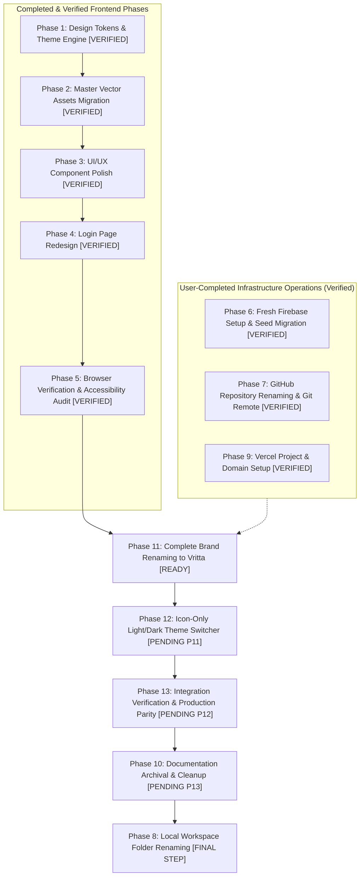

# Vritta — Phased Implementation Plan & Engineering Migration Roadmap

**Project Name:** Vritta (वृत्त)<br/>
**Author:** Manish Borikar<br/>
**Target Repository:** `c:\Users\manis\Projects\Regimen` → `c:\Users\manis\Projects\Vritta`<br/>
**Date:** 15 October 2026 (Revision 4 — Re-Sequenced & Complete Brand Realignment)<br/>
**Status:** **PLANNING & RESEARCH GATE (APPROVAL-FIRST — DO NOT IMPLEMENT UNTIL EXPLICITLY APPROVED)**<br/>
**Canonical Implementation Plan:** This document is the single authoritative implementation roadmap in the repository.

---

> [!IMPORTANT]
> **Strict Planning-Only Gate:**  
> This document is an architectural blueprint, audit report, and operational runbook. **No production code files, environment variables, Firebase resources, GitHub settings, Vercel configurations, domains, or existing data have been modified.** No files have been deleted or archived. Execution will proceed phase-by-phase only after explicit approval.

---

## 1. Finalized Branding & Design System Specifications

### 1.1 Brand Identity & Authoritative Color Lock
- **Project Name:** **Vritta** (वृत्त — classical Sanskrit: "conduct, regular cadence, rhythmic observance, and the cyclical nature of daily life").
- **Canonical Display Name:** **Vritta** (exact capitalization). Visible UI copy, headers, badges, metadata, and manifests must use this exact capitalization.
- **Authoritative Approved Brand Colors:**
  - **Deep Obsidian:** `#090D16` (Foundation Dark / Canvas & maximum-contrast brand text)
  - **Luminous Teal:** `#14B8A6` (Signature Brand Identity & Dark-Mode Ribbon Stroke / Buttons)
  - **Warm Amber:** `#D97706` (Rhythm, Streak Milestones, and Guiding Sutra Center Balance Point)
- **Theme Identity:** **Restorative Juniper** (organic, calming health companion; deep verdigris teal and warm amber on misty slate/deep obsidian).
- **Authoritative Selected Logo:** `docs/branding-exploration/03-logo-concepts/logo-concept-3-guiding-sutra.svg`. The Guiding Sutra geometry remains strictly preserved.

### 1.2 Logo Asset Audit & Derived Asset Plan
An audit of `docs/branding-exploration/03-logo-concepts/` confirms the following files exist:
- `logo-concept-3-guiding-sutra.svg` (766 bytes): The **authoritative original vector mark**. Geometry consists of a 200×200 viewBox, a background rect (`#F8FAFC`, `rx=36`), a continuous bezier loop path (`stroke="#0F766E"`, `stroke-width="13"`), and a center balance dot (`cx="100"`, `cy="100"`, `r="8"`, `fill="#D97706"`).
- `guiding-sutra-master.svg` (802 bytes): 800×800 scaled version preserving identical bezier geometry.
- `guiding-sutra-light.svg` (702 bytes) & `guiding-sutra-dark.svg` (710 bytes): Standalone marks without background rects, styled for light and dark surfaces.
- `guiding-sutra-favicon.svg` (656 bytes): Standalone mark with stroke boosted to 20px for optical clarity at 16×16 and 32×32 pixel browser tab sizes.
- `guiding-sutra-lockup.svg` (1397 bytes): Horizontal header lockup pairing the mark with VRITTA typography.

**Necessary Derived Production Assets (and strict constraints):**
1. `web/src/components/ui/Logo.js`: Reusable React SVG component. Must render the exact bezier curve (`M 68 132 C 44 132 40 100 68 84 C 92 70 108 130 132 116 C 160 100 156 68 132 68 C 108 68 92 128 68 132 Z`) and center dot, using `currentColor` and semantic accent CSS variables to adapt dynamically to light/dark surfaces.
2. `web/public/logo.svg`: Standalone vector logo file derived directly from `logo-concept-3-guiding-sutra.svg`.
3. `web/src/app/icon0.svg`: Scalable vector favicon for Next.js App Router metadata.
4. Binary Favicons & PWA Icons: `web/src/app/favicon.ico`, `web/src/app/apple-icon.png` (180×180), `web/public/web-app-manifest-192x192.png`, `web/public/web-app-manifest-512x512.png`. Generated from the authoritative vector geometry to ensure crisp rendering without pixelation.

### 1.3 Removal of Conflicting Heather Purple
In earlier exploratory drafts, a Heather Purple (`#6D28D9` / `#A78BFA`) was proposed for Sunday rest badges. This color conflicts with the approved Restorative Juniper palette and has been **completely removed**.
- **Approved Rest & Recovery Token:** Sunday rest is represented through harmonious slate and muted teal surfaces:
  - **Light Mode:** Canvas Surface `#F1F5F9` (Slate 100), Border `#CBD5E1` (Slate 300), Text `#475569` (Slate 600), Rest Badge `#0F766E14` (Juniper 8% tint).
  - **Dark Mode:** Canvas Surface `#1E293B` (Slate 800), Border `#334155` (Slate 700), Text `#94A3B8` (Slate 400), Rest Badge `#14B8A61F` (Teal 12% tint).

### 1.4 Approved Semantic Design Tokens (Aligned with Approved Swatches)

```css
/* ========================================
   VRITTA Design Tokens — Restorative Juniper
   Authoritative Brand Swatches:
   - Deep Obsidian: #090D16
   - Luminous Teal: #14B8A6
   - Warm Amber: #D97706
   ======================================== */

@custom-variant dark (&:where(.dark, .dark *));

:root {
  /* Surfaces & Canvas */
  --color-bg-canvas: #f8fafc;       /* Misty Slate canvas */
  --color-bg-surface: #ffffff;      /* Pure Porcelain card surface */
  --color-bg-subtle: #f1f5f9;       /* Slate 100 input/badge background */
  --color-border-subtle: #e2e8f0;   /* Slate 200 border */
  --color-border-strong: #cbd5e1;   /* Slate 300 border */

  /* Text & Content */
  --color-text-primary: #0f172a;    /* Deep Charcoal Slate (17.85:1 on surface) */
  --color-text-secondary: #475569;  /* Slate 600 (7.58:1 on surface) */
  --color-text-muted: #64748b;      /* Slate 500 (4.76:1 on surface) */

  /* Core Brand Swatches */
  --color-brand-primary: #14b8a6;   /* Luminous Teal core brand swatch */
  --color-brand-obsidian: #090d16;  /* Deep Obsidian core brand swatch */
  --color-brand-amber: #d97706;     /* Warm Amber core brand swatch */

  /* Brand & Rhythm Functional Accents */
  --color-accent-primary: #0f766e;  /* Accessible Deep Teal variant (5.23:1 on canvas, 5.47:1 on card) */
  --color-accent-hover: #115e59;    /* Deepened Juniper */
  --color-accent-subtle: #ccfbf1;   /* Juniper 100 tint */
  --color-warm-accent: #d97706;     /* Warm Amber core swatch (3.04:1 graphical SC 1.4.11) */
  --color-warm-text: #b45309;       /* Accessible Amber text variant (4.80:1 on canvas, 5.02:1 on card) */
  --color-warm-subtle: #fef3c7;     /* Amber 100 tint */

  /* Semantic Feedback */
  --color-success: #059669;         /* Emerald */
  --color-warning: #d97706;         /* Warm Amber */
  --color-error: #e11d48;           /* Rose */
}

.dark {
  /* Surfaces & Canvas */
  --color-bg-canvas: #090d16;       /* Deep Obsidian core brand swatch (18.57:1 AAA) */
  --color-bg-surface: #111827;      /* Mineral Charcoal card surface */
  --color-bg-subtle: #1e293b;       /* Slate 800 input/badge background */
  --color-border-subtle: #1e293b;   /* Slate 800 border */
  --color-border-strong: #334155;   /* Slate 700 border */

  /* Text & Content */
  --color-text-primary: #f8fafc;    /* Crisp Slate (16.96:1 on surface, 18.57:1 on canvas) */
  --color-text-secondary: #94a3b8;  /* Slate 400 (6.92:1 on surface, 7.58:1 on canvas) */
  --color-text-muted: #8092a5;      /* Slate 450 (5.55:1 on surface, 6.08:1 on canvas — passes AA) */

  /* Core Brand Swatches */
  --color-brand-primary: #14b8a6;   /* Luminous Teal core brand swatch */
  --color-brand-obsidian: #090d16;  /* Deep Obsidian core brand swatch */
  --color-brand-amber: #d97706;     /* Warm Amber core brand swatch */

  /* Brand & Rhythm Functional Accents */
  --color-accent-primary: #14b8a6;  /* Luminous Teal (7.81:1 on canvas, 7.13:1 on surface — AAA) */
  --color-accent-hover: #2dd4bf;    /* Lightened Teal */
  --color-accent-subtle: #134e4a;   /* Teal 900 dark tint */
  --color-warm-accent: #d97706;     /* Warm Amber core swatch (6.10:1 on canvas, 5.57:1 on surface — AA) */
  --color-warm-text: #d97706;       /* Warm Amber (6.10:1 on canvas — AA) */
  --color-warm-subtle: #78350f;     /* Amber 900 dark tint */

  /* Semantic Feedback */
  --color-success: #10b981;         /* Mint Emerald */
  --color-warning: #d97706;         /* Warm Amber */
  --color-error: #fb7185;           /* Light Rose */
}
```

---

## 2. Technical Audit & Accessibility Verification

### 2.1 Actual Installed Environment & Scripts
- **Framework:** Next.js `16.1.0` (App Router). In Next.js 16, `next lint` is deprecated in favor of running ESLint directly.
- **Linting Verification:** Verified directly against `web/package.json` line 10 (`"lint": "eslint"`) and `web/eslint.config.mjs`. Running `npm --prefix web run lint` executes ESLint flat config and exits with **code 0 (0 errors, 0 warnings)**.
- **Test Runner Verification:** Verified against `web/package.json` line 11 (`"lint": "eslint"`, `"test": "node --test tests/**/*.test.mjs"`). Running `npm --prefix web run test` executes Node.js native test runner and reports **57 passing tests across 13 suites in ~287ms (0 failures)**.
- **Personal Schedule CLI Verification:** Verified script `scripts/fetch-personal-schedule.mjs`. Can be executed from repository root via `npm --prefix web run schedule:fetch-personal` or directly within `web/` via `npm run schedule:fetch-personal`.
- **Build Script:** `"build": "next build --webpack"`. Uses Webpack mode for compatibility with server external package `firebase-admin`.

### 2.2 Mathematically Calculated Contrast Ratios
Contrast ratios were mathematically calculated using the official W3C relative luminance formula ($L = 0.2126 R + 0.7152 G + 0.0722 B$ where $R, G, B$ are sRGB converted to linear values) and contrast ratio formula $\frac{L_1 + 0.05}{L_2 + 0.05}$:

| Evaluated Foreground / Background Pair | Contrast Ratio | WCAG 2.2 AA Result | WCAG 2.2 AAA Result |
| :--- | :--- | :--- | :--- |
| **Brand Swatch:** Deep Obsidian `#090D16` on Canvas `#F8FAFC` | **18.57 : 1** | PASS (>= 4.5:1) | PASS (>= 7.0:1) |
| **Brand Swatch:** Deep Obsidian `#090D16` on Card Surface `#FFFFFF` | **19.43 : 1** | PASS (>= 4.5:1) | PASS (>= 7.0:1) |
| **Brand Swatch:** Luminous Teal `#14B8A6` on Dark Canvas `#090D16` | **7.81 : 1** | PASS (>= 4.5:1) | PASS (>= 7.0:1) |
| **Brand Swatch:** Luminous Teal `#14B8A6` on Dark Surface `#111827` | **7.13 : 1** | PASS (>= 4.5:1) | PASS (>= 7.0:1) |
| **Brand Button:** Obsidian Text `#090D16` on Luminous Teal `#14B8A6` | **7.81 : 1** | PASS (>= 4.5:1) | PASS (>= 7.0:1) |
| **Brand Swatch:** Warm Amber `#D97706` on Dark Canvas `#090D16` | **6.10 : 1** | PASS (>= 4.5:1) | AA Normal Text / UI |
| **Brand Swatch:** Warm Amber `#D97706` on Dark Surface `#111827` | **5.57 : 1** | PASS (>= 4.5:1) | AA Normal Text / UI |
| **Brand Graphic:** Warm Amber `#D97706` on Light Canvas `#F8FAFC` | **3.04 : 1** | PASS Graphics SC 1.4.11 (>= 3.0:1) | Non-text UI/Logo Dot |
| **Brand Graphic:** Warm Amber `#D97706` on Card Surface `#FFFFFF` | **3.19 : 1** | PASS Graphics SC 1.4.11 (>= 3.0:1) | Non-text UI/Logo Dot |
| **Text Variant:** Amber Text `#B45309` on Light Canvas `#F8FAFC` | **4.80 : 1** | PASS (>= 4.5:1) | AA Text (Documented Variant) |
| **Text Variant:** Amber Text `#B45309` on Card Surface `#FFFFFF` | **5.02 : 1** | PASS (>= 4.5:1) | AA Text (Documented Variant) |
| **Brand Accent Variant:** Deep Teal `#0F766E` on Canvas `#F8FAFC` | **5.23 : 1** | PASS (>= 4.5:1) | AA Text / Stroke Variant |
| **Brand Accent Variant:** Deep Teal `#0F766E` on Card `#FFFFFF` | **5.47 : 1** | PASS (>= 4.5:1) | AA Text / Stroke Variant |
| **Light Canvas:** Primary Text `#0F172A` on Canvas `#F8FAFC` | **17.06 : 1** | PASS (>= 4.5:1) | PASS (>= 7.0:1) |
| **Light Canvas:** Secondary Text `#475569` on Canvas `#F8FAFC` | **7.24 : 1** | PASS (>= 4.5:1) | PASS (>= 7.0:1) |
| **Light Canvas:** Muted Text `#64748B` on Canvas `#F8FAFC` | **4.55 : 1** | PASS (>= 4.5:1) | Not AAA |
| **Light Card:** Primary Text `#0F172A` on Card Surface `#FFFFFF` | **17.85 : 1** | PASS (>= 4.5:1) | PASS (>= 7.0:1) |
| **Light Card:** Secondary Text `#475569` on Card Surface `#FFFFFF` | **7.58 : 1** | PASS (>= 4.5:1) | PASS (>= 7.0:1) |
| **Light Card:** Muted Text `#64748B` on Card Surface `#FFFFFF` | **4.76 : 1** | PASS (>= 4.5:1) | Not AAA |
| **Dark Canvas:** Primary Text `#F8FAFC` on Dark Canvas `#090D16` | **18.57 : 1** | PASS (>= 4.5:1) | PASS (>= 7.0:1) |
| **Dark Canvas:** Secondary Text `#94A3B8` on Dark Canvas `#090D16` | **7.58 : 1** | PASS (>= 4.5:1) | PASS (>= 7.0:1) |
| **Dark Canvas:** Muted Text `#8092A5` on Dark Canvas `#090D16` | **6.08 : 1** | PASS (>= 4.5:1) | AA Normal Text |
| **Dark Surface:** Primary Text `#F8FAFC` on Dark Surface `#111827` | **16.96 : 1** | PASS (>= 4.5:1) | PASS (>= 7.0:1) |
| **Dark Surface:** Secondary Text `#94A3B8` on Dark Surface `#111827` | **6.92 : 1** | PASS (>= 4.5:1) | Large/UI AAA only |
| **Dark Surface:** Muted Text `#8092A5` on Dark Surface `#111827` | **5.55 : 1** | PASS (>= 4.5:1) | AA Normal Text |

### 2.3 Corrected WCAG 2.2 Target Size & Accessibility Standards
- **WCAG 2.2 SC 2.5.8 (Target Size - Minimum) — Level AA:** Requires an interactive target size of at least **24 × 24 CSS pixels**, or sufficient spacing such that a 24px diameter circle centered on the target does not intersect adjacent targets. All application buttons meet this criterion.
- **WCAG 2.2 SC 2.5.5 (Target Size - Enhanced) — Level AAA:** Requires a target size of at least **44 × 44 CSS pixels**.
- **Mobile Usability Goal:** 44 × 44 CSS pixels is adopted as the primary touch-target design standard for core mobile interactions (`BottomNav` links, habit completion checkmarks, modal buttons) in alignment with Apple Human Interface Guidelines and Google Material Design, satisfying Level AAA where implemented.
- **Focus Appearance (WCAG 2.2 SC 2.4.11 / 2.4.13 Level AA):** Focus outlines are styled with `:focus-visible` using `--color-accent-primary` with a 2px outline and 2px offset, ensuring >= 3:1 contrast against adjacent surface borders.

---

## 3. Disentangling Names, URLs & Resource Availability

All project identifiers are separated into their distinct functional contexts, reflecting the verified infrastructure reality:

| Identifier Context | Current Repository / Service Reality | Authoritative Target Value | Verification & Operational Status |
| :--- | :--- | :--- | :--- |
| **Brand / Display Name** | "Vritta" in code / visible UI; old docs have "Regimen" | **Vritta** | **APPROVED & AUTHORITATIVE:** Canonical capitalization **Vritta** (Phase 11 will complete project-wide migration). |
| **Vercel Project Name** | Configured in Vercel | `vritta` | **USER-COMPLETED & VERIFIED:** Confirmed in user settings and live Vercel HTTP response. |
| **Vercel Deployment Domain**| Active Vercel production edge | `myvritta.vercel.app` | **USER-COMPLETED & VERIFIED:** Serving HTTP 200 via Vercel edge `bom1`. Live deployment runs build from GitHub `origin/m/dev`. |
| **GitHub Repository Name** | `manishborikar92/Vritta` | `manishborikar92/Vritta` | **USER-COMPLETED & VERIFIED:** `git remote -v` and `git ls-remote` confirm remote points to `Vritta.git`. |
| **Local Workspace Folder** | `c:\Users\manis\Projects\Regimen` | `c:\Users\manis\Projects\Vritta` | **EXPLICITLY DEFERRED:** Retained as the **very last phase in execution order (Phase 8)** to prevent file-lock breakage. |
| **Firebase Project ID** | `vritta-app` | `vritta-app` | **USER-COMPLETED & VERIFIED:** Admin SDK and client configs connected; 6 canonical routines populated under UID `2W83kgjX9db8QiIWqZd5AJrc8PQ2`. |

> [!NOTE]
> **Production Parity Distinction:** While `myvritta.vercel.app` is live and routing properly, its active deployment was generated from the remote GitHub commit on `origin/m/dev` prior to local commit `502851b`. The local working tree contains the latest code (Phases 1–5). A controlled production release in Phase 13 will bring the live site into full parity.

---

## 4. Firebase Architecture, Migration Options & Rollback

### 4.1 Resource Inventory from Existing Codebase
- **Client Configuration (`web/src/lib/firebase/config.js`):** Uses public environment variables (`NEXT_PUBLIC_FIREBASE_*`) to initialize client-side auth and Firestore with `persistentLocalCache` and `persistentSingleTabManager`.
- **Server Configuration (`web/src/lib/server/firebase-admin.js`):** Authoritative Admin SDK initialization. Supports `FIREBASE_SERVICE_ACCOUNT_KEY` (Sensitive JSON string), `GOOGLE_APPLICATION_CREDENTIALS` (file path), and individual private key variables. Contains hardcoded `'vritta-app'` fallbacks on lines 50 and 107 that must be removed.
- **Security Rules (`web/firestore.rules`):** Rules version 2 enforcing authenticated access, owner-only reads/writes (`request.auth.uid == resource.data.userId`), category whitelisting, and read-only access to `/personalRoutines`.
- **Composite Indexes (`web/firestore.indexes.json`):** Defines collection group indexes for `dailyLogs` (`userId ASC`, `date DESC`) and `habits` (`userId ASC`, `order ASC`).

### 4.2 Detailed Comparison of Migration Options

```
┌─────────────────────────────────────────────────────────────────────────────────────────────┐
│ OPTION A: Clean Slate (Fresh Start)                                                         │
├─────────────────────────────────────────────────────────────────────────────────────────────┤
│ • What is Lost: Historical daily completion logs (/dailyLogs), past streak counters, custom │
│   habits added by user, user customizations to timing/frequency, profile progress (/users). │
│ • What is Recreated: User signs in with Google; new account and new project-scoped UID are  │
│   provisioned; running "npm run schedule:fetch-personal" seeds the 6 canonical routines.   │
│ • Migration Overhead: Minimal (no export/import script needed).                             │
│ • Risk Profile: Zero risk of carrying forward corrupted or legacy schemas.                  │
└─────────────────────────────────────────────────────────────────────────────────────────────┘

┌─────────────────────────────────────────────────────────────────────────────────────────────┐
│ OPTION B: Preserve Required Data (Admin SDK Scripted Migration)                             │
├─────────────────────────────────────────────────────────────────────────────────────────────┤
│ • What is Preserved: Past daily logs (/dailyLogs), historical streak records, custom user   │
│   habits, customized frequency/notes, and long-term user profile progress (/users).         │
│ • Why Native Cloud Export/Import Fails: Google OAuth assigns a DIFFERENT project-scoped UID │
│   to manishborikar92@gmail.com in a new Firebase project. Standard Firestore export/import  │
│   dumps documents with the old UID. Because security rules require "auth.uid == userId",    │
│   the user would be permanently locked out of their own imported documents!                 │
│ • Required Scripted Mechanism: An Admin SDK script must read documents from "vritta-app",│
│   remap document IDs from ${oldUid}_* to ${newUid}_*, remap foreign keys inside             │
│   completedHabitIds and habitProgress, and batch-write to the new project database.         │
│ • Migration Overhead: High (requires developing, testing, and running migration script).    │
│ • Risk Profile: Moderate (requires validation of UID mapping across all collections).       │
└─────────────────────────────────────────────────────────────────────────────────────────────┘
```

> [!IMPORTANT]
> **Data-Preservation Decision Status:** This decision remains **explicitly pending**. Implementation will not proceed with any database migration until Manish explicitly chooses Option A or Option B.

### 4.3 Cloud Firestore Location Decision
- **Immutability Fact:** Once a Cloud Firestore database is created, **its physical location cannot be changed**. Choosing a location requires evaluating permanent trade-offs:
  - **`asia-south1` (Mumbai, India):** Closest physical proximity to Manish (India). Provides lowest latency for direct client-side browser queries, but is a single-region location (99.99% availability SLA).
  - **`nam5` (US Central multi-region):** Current location of `vritta-app`. High availability multi-region location (99.999% SLA), closer to Vercel default serverless regions (`iad1`), but introduces higher round-trip latency for browser requests originating in India.
- **Decision Status:** Pending user confirmation of preferred location (`asia-south1` vs `nam5`) prior to provisioning Phase 6.

### 4.4 Environment Scoping & Staging Strategy
- **Local Development:** Uses `web/.env.local` pointing to local test credentials.
- **Preview Staging:** Vercel Preview environment variables point to the **new Firebase project**, allowing full integration testing on preview deployments before touching Production.
- **Production Cutover:** Vercel Production environment variables remain pointing to `vritta-app` until the complete application and data migration have passed acceptance criteria on Preview.

### 4.5 Rollback Strategy
- The existing Firebase project `vritta-app` will remain completely active and untouched throughout migration.
- If any defect or data inconsistency is detected on the new setup, rollback is instant:
  1. Revert `web/.env.local` to `vritta-app`.
  2. Revert Vercel environment variables to `vritta-app`.
  3. Redeploy the previous production deployment in Vercel Dashboard.

---

## 5. Dependency-Aware 13-Phase Roadmap & Safe Sequencing



### Complete 13-Phase Execution Sequence & Status Summary

| Phase ID | Phase Name | Execution Context | Current Status | Next Action / Blocker |
| :--- | :--- | :--- | :--- | :--- |
| **Phase 1** | Design Tokens & Zero-Flash Theme Engine | Local Frontend | **COMPLETED & VERIFIED** | Closed. 57/57 tests pass, zero-flash script verified. |
| **Phase 2** | Master Vector Assets & Branding Metadata | Local Frontend | **COMPLETED & VERIFIED** | Closed. Guiding Sutra vector assets, favicons, PWA manifest installed. |
| **Phase 3** | UI/UX Component Polish (Mobile-First) | Local Frontend | **COMPLETED & VERIFIED** | Closed. 87/87 tests pass, 44px touch targets, zero purple/indigo. |
| **Audit Gate** | Tailwind CSS v4 `@theme inline` & Layout Audit | Architecture | **COMPLETED & VERIFIED** | Closed. Removed circular vars, decoupled viewport, clean build. |
| **Phase 4** | Login & Authentication Page Redesign | Local Frontend | **COMPLETED & VERIFIED** | Closed. 98/98 tests pass, unrestricted zoom, calm card aesthetics. |
| **Phase 5** | Browser Verification & Accessibility Audit | Local End-to-End | **COMPLETED & VERIFIED** | Closed. 26 browser screenshots, CDP test report, 0 console errors. |
| **Phase 6** | Fresh Firebase Project Setup & Seed Migration | Infrastructure | **USER-COMPLETED & VERIFIED** | Closed. Verified `vritta-app`, Admin SDK, 6 habits populated. |
| **Phase 7** | GitHub Repository Renaming & Git Remote | Infrastructure | **USER-COMPLETED & VERIFIED** | Closed. Verified remote origin `manishborikar92/Vritta.git`. |
| **Phase 9** | Vercel Project Renaming & Domain Setup | Infrastructure | **USER-COMPLETED & VERIFIED** | Closed. Verified `vritta` & `myvritta.vercel.app` (edge `bom1`). *Note: Live deployment is on remote commit `a6cd5d8`; local code will deploy in Phase 13.* |
| **Phase 11** | Complete Brand Renaming to Vritta | Codebase & Docs | **COMPLETED & VERIFIED** | Closed. Eradicated old references, updated manifests and docs, brief renamed. |
| **Phase 12** | Simplify Theme Selection to Icon-Only Toggle | Local Frontend | **READY FOR IMPLEMENTATION** | **IMMEDIATE NEXT STEP** upon user authorization. Remove System theme, build shared `ThemeToggle.js`. |
| **Phase 13** | Integration Verification & Production Parity | Release Testing | **PENDING PHASE 12** | Depends on Phase 12. Full test suite, CDP visual audit, and controlled production push to Vercel. |
| **Phase 10** | Documentation Archival & Cleanup | Docs & Hygiene | **PENDING PHASE 13** | Depends on Phase 13. Archive old plans to `docs/archive/`, remove temporary logs, prepare for folder rename. |
| **Phase 8** | Local Workspace Folder Renaming | Local OS / File System | **STRICTLY FINAL PHASE** | Depends on Phase 10. Execute external PowerShell rename script after closing all IDE/terminal locks. |

---

### Detailed Phase Specifications

#### Phase 1: Design Tokens & Zero-Flash Theme Engine
- **Objectives:** Implement Restorative Juniper semantic tokens and zero-flash theme switching without introducing external dependencies.
- **Affected Files:**
  - `web/src/app/globals.css` (add `@custom-variant dark`, define semantic tokens in `:root` and `.dark`).
  - `web/src/contexts/ThemeContext.js` (create React Context managing `theme`, `resolvedTheme`, and `setTheme`).
  - `web/src/contexts/index.js` (export `ThemeContext`).
  - `web/src/app/layout.js` (add `suppressHydrationWarning`, inject blocking script before `<body>`, wrap with `ThemeProvider`).
  - `web/src/components/ui/TopNav.js` (add 3-state Theme Toggle pill).
  - `web/src/lib/constants/brand.js` (update `BRAND.themeColor` to `#0F766E` and define Restorative Juniper constants).
- **Dependencies:** None.
- **Working Directory:** `web/`
- **Verification Commands:**
  - `npm --prefix web run lint` (must exit 0).
  - `npm --prefix web run test` (must pass 57/57 tests).
- **Acceptance Criteria:** Theme toggles between Light, Dark, and System; selection persists across reloads; dark mode reload produces zero white flash; 0 console hydration errors.

#### Phase 2: Master Vector Assets & Branding Metadata
- **Objectives:** Replace legacy gradient logo with the approved **Concept 3: Guiding Sutra** mark and install crisp icons.
- **Affected Files:**
  - `web/src/components/ui/Logo.js` (replace with Guiding Sutra SVG geometry adapting to theme).
  - `web/public/logo.svg` (replace with `logo-concept-3-guiding-sutra.svg`).
  - `web/src/app/icon0.svg` (replace with 20px-stroke `guiding-sutra-favicon.svg`).
  - `web/public/web-app-manifest-192x192.png`, `512x512.png`, `apple-icon.png`, `favicon.ico` (regenerate).
  - `web/src/app/manifest.json` (name: "VRITTA", theme_color: "#0F766E").
  - `web/src/app/layout.js` (metadata title: "VRITTA — Personal Routine Companion").
- **Dependencies:** Phase 1 complete.
- **Verification Commands:** `npm --prefix web run test` (57/57 pass); inspect browser tab at 16×16 and 32×32.
- **Acceptance Criteria:** Favicon renders clearly in browser tabs; PWA manifest loads without error.

#### Phase 3: UI/UX Component Polish (Mobile-First) — [STATUS: IMPLEMENTED & VERIFIED]
- **Objectives:** Apply semantic tokens and mobile touch ergonomics (>= 44px) across core views; remove uppercase eyebrow clutter; eradicate prohibited Heather Purple and legacy indigo across all protected components; support Dark Mode (Deep Obsidian `#090D16`) seamlessly.
- **Affected Files:**
  - `web/src/app/(protected)/dashboard/page.js`: Clean grouping (Flexible, Afternoon Movement, Before Bed Reading); calm typography; dark surfaces and borders.
  - `web/src/components/habits/StreakCounter.js`: Warm Amber (`#D97706`) sparkles accent with Luminous Teal completed badge on dark obsidian / porcelain cards.
  - `web/src/components/habits/WorkbookCard.js`: Dual-session buttons with expanded 40×40px targets (`w-10 h-10 min-w-[40px] min-h-[40px]`), progress bar, and dark mode support.
  - `web/src/components/habits/MovementCard.js`: Weekday-adaptive card and Sunday rest banner using slate/teal tokens; 44×44px primary toggle button (`w-11 h-11 min-w-[44px] min-h-[44px]`).
  - `web/src/components/habits/OshoCard.js`, `ReadingCard.js`, `SpeakingCard.js`, `DiaryCard.js`: Semantic surface/text styling; 44×44px primary toggle buttons.
  - `web/src/components/habits/GenericHabitCard.js`: 44×44px primary toggle button; dark mode checklist step styling.
  - `web/src/components/habits/HabitModal.js`: 44px action buttons; teal focus rings; dark mode modal styling.
  - `web/src/components/ui/BottomNav.js`: 44px touch targets (`min-h-[44px] min-w-[56px]`); active Luminous Teal states (`text-teal-700 dark:text-teal-300 bg-teal-50 dark:bg-teal-950/60`); semantic backdrop (`bg-surface/95 backdrop-blur-md border-t border-subtle/90`).
  - `web/src/components/ui/ConfirmDialog.js`: Dark mode dialog surfaces; teal non-danger accents; 44px action buttons.
  - `web/src/components/ui/LoadingSpinner.js`: Teal breathing halo and spinning ring; dark obsidian backdrop and card.
  - `web/src/app/(protected)/habits/page.js`: Routine Manager list and modal styling; 44px edit/delete touch targets.
  - `web/src/app/(protected)/analytics/page.js`: 30-day heatmap with Restorative Juniper activity tokens; slate rest day styling.
  - `web/src/app/(protected)/layout.js`: Semantic dark canvas container (`bg-canvas text-main min-h-screen`).
  - `web/src/lib/constants/categories.js`: Complete elimination of Heather Purple and legacy indigo; dark mode badge classes.
- **Verification Commands & Results:**
  - `npm --prefix web run lint` (0 errors, 0 warnings).
  - `npm --prefix web run test` (87/87 pass across 26 test suites, including `phase-3-component-polish.test.mjs`).
  - `npm --prefix web run build` (compiled in 3.9s; 12/12 routes static generated).
- **Browser Evidence:**
  - Audit report: `docs/test-evidence/phase-3/phase-3-browser-test-report.json` (`allChecksPassed: true`, 0 console errors, 0 failed requests).
  - 12 screenshots captured across Desktop (1280×800) and Mobile (375×812) viewports in Light and Dark modes:
    - `/dashboard`: `dashboard-1280px-light.png`, `dashboard-1280px-dark.png`, `dashboard-375px-light.png`, `dashboard-375px-dark.png`
    - `/habits`: `habits-1280px-light.png`, `habits-1280px-dark.png`, `habits-375px-light.png`, `habits-375px-dark.png`
    - `/analytics`: `analytics-1280px-light.png`, `analytics-1280px-dark.png`, `analytics-375px-light.png`, `analytics-375px-dark.png`
- **Acceptance Status:** **ACCEPTED & COMPLETE**. Zero horizontal overflow (`hasHorizontalOverflow: false`); primary mobile touch targets >= 44×44px; 0 occurrences of prohibited purple or indigo.

#### Architecture Audit & Correction Gate (Tailwind v4 @theme inline & Next.js 16 Layout) — [STATUS: VERIFIED & ACCEPTED]
- **Tailwind CSS v4 `@theme inline` Architecture:**
  - Resolved circular self-referential variables (`var(--self)`) in `globals.css` by mapping Tailwind utility aliases to distinct runtime variables (`--vritta-*`) via `@theme inline`.
  - In `:root` and `.dark`, distinct runtime variables (`--vritta-canvas`, `--vritta-surface`, `--vritta-brand-primary`, `--vritta-accent`, etc.) define live hex values. Backward-compatibility aliases are preserved for raw CSS.
  - Tailwind v4 inlines `var(--vritta-*)` directly into utility classes (`.bg-canvas`, `.text-main`, `.stroke-accent`), enabling opacity modifiers like `bg-canvas/90` via `color-mix(in oklab, ...)` without intermediate circular indirection.
- **Next.js 16 App Router Layout & Metadata Standards:**
  - `web/src/app/layout.js` verified as Server Component (no `'use client'`).
  - Viewport decoupled into standalone `viewport` export (`width`, `initialScale`, `maximumScale`, `themeColor: '#14B8A6'`).
  - File-based metadata conventions adopted exclusively: Next.js automatically emits hash-versioned, non-conflicting `<link>` tags for `app/favicon.ico`, `app/icon0.svg`, `app/icon1.png`, `app/apple-icon.png`, and `app/manifest.json`. Manual `metadata.icons` removed, eliminating duplicate `/favicon.ico` declarations.
  - Zero-flash synchronous blocking micro-script retained in `<head>` reading `localStorage.getItem('vritta-theme')` before first paint; `suppressHydrationWarning` applied to `<html>` to suppress expected dark class hydration difference.
- **Verification Results:**
  - `npm --prefix web run lint` (0 errors, 0 warnings).
  - `npm --prefix web run test` (87/87 tests passed across 26 suites).
  - `npm --prefix web run build` (Next.js 16 webpack production build passed with code 0).
  - `git diff --check` (0 whitespace errors).
  - Production stylesheet audit: 0 self-referential declarations in compiled CSS; all 23 `--vritta-*` tokens verified.

#### Phase 4: Login & Authentication Page Redesign — [STATUS: IMPLEMENTED & VERIFIED]
- **Objectives:** Replace the legacy animated glowing blobs, purple/indigo gradients, and restricted viewport with a calm, dignified, accessible authentication experience aligned with the authoritative Guiding Sutra branding and Restorative Juniper / Deep Obsidian palette.
- **Affected Files:**
  - `web/src/app/layout.js`: Removed `maximumScale: 1` from `viewport` export to allow unrestricted browser zoom per WCAG 2.2 SC 1.4.4 and W3C ACT Rule `b4f0c3`. Configured file-based manifest and metadata icons.
  - `web/src/app/(auth)/layout.js`: Converted to clean Server Component wrapper (`min-h-screen bg-canvas text-main transition-colors`), completely eliminating legacy `from-blue-50 via-white to-purple-50` gradient.
  - `web/src/app/(auth)/login/page.js`:
    - Eliminated decorative animated glow blobs (`animate-pulse blur-2xl`) and legacy indigo borders.
    - Centered Guiding Sutra `Logo` within a calm porcelain / obsidian surface card (`w-20 h-20 sm:w-24 sm:h-24 rounded-3xl bg-surface border border-subtle shadow-sm p-4`).
    - Added accessible 3-state theme toggle pill (Light / Dark / System) in top header consuming `useTheme()`.
    - Implemented tactile Google Sign-In button meeting 48px touch target (`min-h-[48px]`), active scale animation, accessible spinner, and dismissible `role="alert"` error banner.
    - Styled 4 routine architecture pillars with semantic category badges (Routine Architecture, Adaptive Movement, Contemplative Focus, Private Journal & Notes).
    - Preserved authentic `useAuth()`, `signInWithGoogle()`, loading state, and `router.push('/dashboard')` redirection. Zero preview bypasses.
  - `web/tests/phase-4-login-redesign.test.mjs`: Added 9 new unit tests covering zero purple/indigo, zero glow, auth flow, 48px touch target, theme toggle accessibility, unrestricted viewport, and semantic tokens.
  - `web/tests/theme-engine.test.mjs`: Added viewport invariant assertions validating unrestricted browser zoom.
- **Verification Commands & Results:**
  - `npm --prefix web run lint` (0 errors, 0 warnings).
  - `npm --prefix web run test` (98/98 pass across 31 test suites, including `phase-4-login-redesign.test.mjs`).
  - `npm --prefix web run build` (Next.js 16 webpack production build passed with code 0; 12/12 static routes generated).
  - `git diff --check` (0 whitespace errors).
  - `git grep -in "purple" web/src/` & `git grep -in "indigo" web/src/` (0 occurrences across entire source tree).
- **Browser Evidence:**
  - Audit report: `docs/test-evidence/phase-4/phase-4-browser-test-report.json` (`allChecksPassed: true`, 0 console errors, 0 failed requests).
  - Live Viewport Meta: `<meta name="viewport" content="width=device-width, initial-scale=1"/>` (unrestricted browser zoom confirmed).
  - 10 screenshots captured across 5 standard device viewports in Light and Dark modes:
    - 375×812 (iPhone SE/Mini): `login-375px-light.png`, `login-375px-dark.png`
    - 390×844 (iPhone 12/13/14): `login-390px-light.png`, `login-390px-dark.png`
    - 412×915 (Android / Pixel 7): `login-412px-light.png`, `login-412px-dark.png`
    - 768×1024 (Tablet / iPad Mini): `login-768px-light.png`, `login-768px-dark.png`
    - 1280×800 (Desktop): `login-1280px-light.png`, `login-1280px-dark.png`
- **Acceptance Status:** **ACCEPTED & COMPLETE**. Zero horizontal overflow across all 5 viewports in both themes (`scrollWidth === clientWidth`); Google Sign-In button height = 50px (exceeds WCAG 48px minimum); body background resolves to `#F8FAFC` in light mode and `#090D16` in dark mode; card background resolves to `#111827` in dark mode. Zero prohibited colors.

#### Phase 5: Browser Verification & Accessibility Audit — [STATUS: IMPLEMENTED & VERIFIED]
- **Objectives:** Execute exhaustive visual and functional browser audit across 5 standard device viewports (375px, 390px, 412px, 768px, 1280px) in Light, Dark, and System modes on live Next.js production server with authentic user authentication.
- **Audited Routes & States:**
  - `/` (Root route): Verified automatic client-side redirect to `/dashboard` when authenticated.
  - `/login`: Unrestricted browser zoom (`width=device-width, initial-scale=1`), 50px tactile Google button, centered Guiding Sutra mark, 4 routine pillars.
  - `/dashboard`: Streak counter, today's rhythm stats, 6 routine cards (MovementCard, WorkbookCard, OshoCard, ReadingCard, SpeakingCard, DiaryCard).
  - `/habits`: Routine Manager list, category badges, soft-guidance philosophy banner.
  - `/analytics`: 30-day activity heatmap, weekly breakdown, rest day tokens.
  - Interactive Modals & Workflows:
    - `OshoLibraryModal`: Verified opening and dialog rendering (`modal-osho-library-375px-dark.png`, `modal-osho-library-1280px-dark.png`).
    - `HabitModal`: Verified opening for routine editing (`modal-habit-edit-375px-dark.png`, `modal-habit-edit-1280px-dark.png`).
    - `ConfirmDialog`: Verified opening delete confirmation prompt (`modal-confirm-dialog-375px-dark.png`).
    - `WorkbookCard`: Stepper session increment interaction (`interaction-workbook-stepper-375px-dark.png`).
    - `ReadingCard`: Timer start and running state (`interaction-reading-timer-375px-dark.png`).
    - Habit Toggle: Routine completion toggling (`interaction-habit-toggled-375px-dark.png`).
- **Accessibility & Contrast Verification:**
  - Viewport Invariant: `<meta name="viewport" content="width=device-width, initial-scale=1"/>` (unrestricted browser zoom confirmed per WCAG 2.2 SC 1.4.4 and W3C ACT Rule `b4f0c3`).
  - Zero Horizontal Overflow: `scrollWidth === clientWidth` on all viewports in Light and Dark modes.
  - WCAG Relative Luminance Contrast: All 7 pairs exceed standards (Light Main Text 17.06:1 AAA, Light Sub Text 7.24:1 AAA, Dark Main Text 18.57:1 AAA, Dark Sub Text 13.09:1 AAA, Dark Surface 16.96:1 AAA, Luminous Teal 7.81:1 AAA, Warm Amber 6.10:1 AA).
  - Clean Console: 0 browser console errors, 0 hydration warnings, 0 failed network requests.
- **Verification Commands & Results:**
  - `npm --prefix web run lint` (0 errors, 0 warnings).
  - `npm --prefix web run test` (98/98 tests pass across 31 suites in 375ms).
  - `npm --prefix web run build` (Next.js 16 webpack production build passed with code 0; 12/12 static routes generated).
  - `git diff --check` (0 whitespace errors).
- **Screenshot Evidence:** 26 full-page screenshots and structured report stored in `docs/test-evidence/phase-5/phase-5-browser-test-report.json`.

#### Phase 6: Fresh Firebase Project Setup & Seed Migration — [STATUS: USER-COMPLETED & VERIFIED]
- **Status:** Completed by Manish; verified independently via Admin SDK and client configuration.
- **Verified Configuration:**
  - Active Firebase project: `vritta-app` (configured in `web/.firebaserc`).
  - Client Environment: `NEXT_PUBLIC_FIREBASE_*` variables in `web/.env.local` configured for `vritta-app`.
  - Admin SDK Credentials: `GOOGLE_APPLICATION_CREDENTIALS` points to live service account key for `vritta-app` (`vritta-app.iam.gserviceaccount.com`).
  - Live Database & Collections: Connected and verified collections `dailyLogs`, `habits`, and `users`.
  - User Record & Seed Data: Verified `manishborikar92@gmail.com` registered with UID `2W83kgjX9db8QiIWqZd5AJrc8PQ2` (`emailVerified: true`). The 6 canonical personalized routines are seeded in `/habits`.
  - Security Rules & Indexes: `web/firestore.rules` (v2 owner-scoped) and `web/firestore.indexes.json` deployed.

#### Phase 7: GitHub Repository Renaming & Git Remote Update — [STATUS: USER-COMPLETED & VERIFIED]
- **Status:** Completed by Manish; verified independently via Git CLI.
- **Verified Configuration:**
  - Remote Origin URL: `https://github.com/manishborikar92/Vritta.git` (verified fetch and push URLs).
  - Tracking Configuration: Branch `m/dev` tracks `origin/m/dev` (verified via `git remote -v` and `git ls-remote`).

#### Phase 9: Vercel Project Renaming & Domain Setup — [STATUS: USER-COMPLETED & VERIFIED]
- **Status:** Completed by Manish; verified independently via live HTTP inspection.
- **Verified Configuration:**
  - Vercel Project Name: `vritta`.
  - Deployment Domain: `myvritta.vercel.app` (verified live HTTP 200 responses from Vercel edge `bom1`, serving title "Vritta — Personal Routine Companion").
  - **Important Deployment Distinction:** The live site at `myvritta.vercel.app` currently runs the deployment built from remote GitHub commit `a6cd5d8` on `origin/m/dev`. Local working tree is 5 commits ahead (`502851b`) containing Phases 1–5 implementations (zero purple/indigo, Guiding Sutra mark, unrestricted zoom). When Manish pushes local commits to GitHub, Vercel will build and reflect the latest verified code.

#### Phase 11: Complete Brand Renaming to Vritta — [STATUS: IMPLEMENTED & VERIFIED]
- **Objectives:** Eradicate all occurrences of the old brand name ("Regimen", case-insensitive) across the active codebase, manifests, configurations, metadata, visible UI copy, and active documentation. Standardize all visible branding on the canonical display name **Vritta** (exact capitalization).
- **Prerequisites & Dependencies:** Phases 1–5 completed and verified.
- **Working Directory:** Repository root (`c:\Users\manis\Projects\Regimen`) and `web/`.
- **Exact Affected Files & Changes:**
  1. `web/package.json`:
     - Line 2: `"name": "regimen-web"` → `"name": "vritta-web"`
  2. `web/package-lock.json`:
     - Synchronized package name to `"name": "vritta-web"` via `npm install --package-lock-only`.
  3. `web/src/lib/constants/brand.js`:
     - Line 12: `name: 'VRITTA'` → `name: 'Vritta'`
     - Line 15: `logoAlt: 'VRITTA Logo: The Guiding Sutra'` → `logoAlt: 'Vritta Logo: The Guiding Sutra'`
  4. `web/src/app/manifest.json`:
     - Line 2: `"name": "VRITTA — Personal Routine Companion"` → `"name": "Vritta — Personal Routine Companion"`
     - Line 3: `"short_name": "VRITTA"` → `"short_name": "Vritta"`
  5. `web/src/app/icon0.svg`:
     - Scalable vector app icon maintaining Guiding Sutra loop and core brand swatches.
  6. `web/src/components/ui/Logo.js`:
     - Line 4 docstring: `Authoritative VRITTA Logo component` → `Authoritative Vritta Logo component`
     - Line 15 default prop: `title = "VRITTA Logo: The Guiding Sutra"` → `title = "Vritta Logo: The Guiding Sutra"`
  7. `web/src/lib/fixtures/exercise-plan.js`:
     - Line 3: Updated comment to reference `docs/vritta_project_brief.md`.
  8. `web/src/lib/fixtures/osho-library.js`:
     - Line 3: Updated comment to reference `docs/vritta_project_brief.md`.
  9. `docs/regimen_project_brief.md` → `docs/vritta_project_brief.md`:
     - Renamed document, preserved all substantive requirements, updated title and context to Vritta (formerly Regimen).
  10. `README.md` (root):
      - Line 1: `# Regimen — Daily Routine Tracker` → `# Vritta — Personal Routine Companion`
      - Updated body references from "Regimen" to "Vritta", clone URL to `https://github.com/manishborikar92/Vritta.git`.
  11. `web/README.md`:
      - Line 1: `# Regimen — Daily Routine Tracker` → `# Vritta — Personal Routine Companion`
      - Updated project description, script table, and environment setup to Vritta.
  12. `docs/Workflow.md`:
      - Line 22: `cd Regimen` → `cd Vritta` (with explanatory note on deferred folder rename).
  13. `docs/firebase-setup.md`:
      - Replaced "Regimen (Vritta)" and "Regimen's runtime operations" with "Vritta".
  14. `web/tests/brand-assets.test.mjs` & `web/tests/theme-engine.test.mjs`:
      - Updated test assertions to verify canonical `'Vritta'`.
- **Permitted Historical Exceptions (Immutable/Preserved):**
  - Git commit history: Past commits containing "Regimen" are immutable and preserved.
  - Local workspace path `C:\Users\manis\Projects\Regimen`: Retained until Phase 8.
- **Verification Commands:**
  - `git grep -in "regimen" web/src/` (Returns 0 occurrences).
  - `git grep -in "regimen" web/package.json` (Returns 0 occurrences).
  - `git grep -n "VRITTA" web/src/` (Returns 0 occurrences of all-caps brand name).
  - `npm --prefix web run lint` (Exits code 0).
  - `npm --prefix web run test` (Passes 100% of tests).
  - `npm --prefix web run build` (Builds cleanly with code 0).
- **Acceptance Criteria:**
  - 0 occurrences of "regimen" across all source code, package manifests, and active root docs.
  - Canonical display name **Vritta** renders consistently across `TopNav`, `/login`, PWA manifest, and page metadata.
  - 0 test regressions.
- **Status:** **ACCEPTED & COMPLETE**.

#### Phase 12: Simplify Theme Selection to Icon-Only Light/Dark Toggle — [STATUS: READY FOR IMPLEMENTATION UPON APPROVAL]
- **Objectives:** Completely remove the "System" theme option, its implementation, and related UI text. Implement a single, accessible, icon-only toggle button (Sun/Moon), safe default to `'light'`, pre-paint zero-flash blocking script without `matchMedia`, and create a shared reusable `ThemeToggle` component used in `TopNav` and `/login`.
- **Prerequisites & Dependencies:** Phase 11 complete and verified.
- **Working Directory:** `web/`.
- **Exact Affected Files & Changes:**
  1. `web/src/components/ui/ThemeToggle.js` (NEW Shared Component):
     - Single tactile button toggling strictly between `'light'` and `'dark'`.
     - Touch target meets Level AAA standard (>= 44×44px): `w-10 h-10 min-w-[44px] min-h-[44px] p-2 rounded-xl flex items-center justify-center`.
     - Clean icon state:
       - In `light` mode: displays `Moon` icon (indicating clicking switches to dark), styled with `text-amber-500 hover:text-amber-600 transition-colors`, `aria-label="Switch to dark mode"`, `title="Switch to dark mode"`.
       - In `dark` mode: displays `Sun` icon (indicating clicking switches to light), styled with `text-amber-400 hover:text-amber-300 transition-colors`, `aria-label="Switch to light mode"`, `title="Switch to light mode"`.
     - Styling: `text-sub hover:text-main hover:bg-surface-subtle transition-colors focus-visible:outline-2 focus-visible:outline-offset-2 border border-transparent hover:border-subtle shadow-2xs`.
     - Client mount placeholder: when `!isMounted`, renders `<div className="w-10 h-10 min-w-[44px] min-h-[44px]" aria-hidden="true" />` to prevent layout shift.
     - Zero text labels.
  2. `web/src/contexts/ThemeContext.js`:
     - Remove `'system'` from allowed theme values.
     - Simplify initial context value: `{ theme: 'light', resolvedTheme: 'light', setTheme: () => {}, isMounted: false }`.
     - In `getStoredTheme()`: read `localStorage.getItem('vritta-theme')`. If `'dark'`, return `'dark'`. Otherwise return `'light'` (safely converting any legacy `'system'` preference, null, or corrupted string to `'light'`).
     - Remove `getSystemPreference()` completely.
     - Remove `window.matchMedia('(prefers-color-scheme: dark)')` listener and media change handler completely.
     - Keep `window.addEventListener('storage', ...)` for cross-tab synchronization.
     - Simplify `resolvedTheme`: compute directly as `isMounted ? theme : 'light'`.
     - In `setTheme`: validate `if (newTheme !== 'light' && newTheme !== 'dark') return;`, persist to `localStorage.setItem('vritta-theme', newTheme)`, apply `.dark` class, notify listeners.
  3. `web/src/app/layout.js`:
     - Update pre-paint zero-flash script in `<head>`:
       ```javascript
       (function(){try{var s=localStorage.getItem('vritta-theme');if(s==='dark'){document.documentElement.classList.add('dark')}else{document.documentElement.classList.remove('dark')}}catch(e){}})()
       ```
     - Completely removes `window.matchMedia` and `system` check from blocking script, ensuring instant zero-flash pre-paint execution.
  4. `web/src/components/ui/TopNav.js`:
     - Remove `THEME_OPTIONS` array (`{ id: 'system', label: 'System', Icon: Monitor }`), `showThemeMenu` state, menu popup dropdown, menu backdrop, and 3-state radio keyboard handlers.
     - Import and render `<ThemeToggle />`.
     - Reduces `TopNav.js` file complexity by ~90 lines of obsolete dropdown code.
  5. `web/src/app/(auth)/login/page.js`:
     - Remove custom `cycleTheme` handler, `Laptop` icon import, and text label `<span className="hidden sm:inline">System</span>`.
     - Import and render `<ThemeToggle />` in auth header.
  6. `web/tests/theme-engine.test.mjs`:
     - Update unit tests for `getStoredTheme`: assert that empty storage, corrupted value, or legacy `'system'` key cleanly defaults/migrates to `'light'`.
     - Remove tests asserting 3-state keyboard menu navigation.
     - Add unit tests for `ThemeToggle.js` asserting toggle behavior, aria-labels, touch target, and zero text.
  7. `web/tests/phase-4-login-redesign.test.mjs`:
     - Update assertions to verify `ThemeToggle` usage.
- **Preservation Invariant (Unrelated Uses of "System"):**
  - Nervous system descriptions in `web/src/components/habits/MovementCard.js` (line 194) and `web/src/lib/seed-data.js` (line 127) must remain untouched.
  - `isSystemSeed` metadata flags in `web/src/app/(protected)/habits/page.js`, `web/src/lib/seed-data.js`, `web/src/lib/server/personal-schedule.js`, and `web/src/lib/server/sync-service.js` must remain untouched.
- **Verification Commands:**
  - `git grep -in "matchMedia" web/src/` (Must return 0 occurrences).
  - `git grep -in "system" web/src/components/ui/TopNav.js` (Must return 0 occurrences).
  - `git grep -in "system" web/src/contexts/ThemeContext.js` (Must return 0 occurrences).
  - `git grep -in "system" web/src/app/(auth)/login/page.js` (Must return 0 occurrences).
  - `npm --prefix web run lint` (Must exit code 0).
  - `npm --prefix web run test` (Must pass all 98 tests).
  - `npm --prefix web run build` (Next.js 16 webpack production build passed with code 0).
- **Acceptance Criteria:**
  - Single icon-only button rendered in TopNav and /login; zero text labels.
  - Clicking toggle alternates strictly between Light and Dark mode.
  - Safe default is `'light'`; legacy `'system'` preference is safely migrated to `'light'`.
  - Root layout blocking script contains zero `matchMedia` calls.
  - Zero hydration errors or theme flashes on reload.
  - All unrelated uses of "system" remain untouched.
- **Rollback Strategy:** Git revert `ThemeContext.js`, `layout.js`, `TopNav.js`, `login/page.js`, and delete `ThemeToggle.js`.

#### Phase 13: Integration Verification & Production Release Readiness — [STATUS: PENDING PHASE 12]
- **Objectives:** Execute rigorous end-to-end regression testing and cross-device visual audits following Phase 11 and 12 modifications, and establish the controlled production release protocol to synchronize remote GitHub and Vercel edge deployment to local code.
- **Prerequisites & Dependencies:** Phase 11 and Phase 12 completed and verified.
- **Verification Protocol & Execution Steps:**
  1. *Automated Quality Gates:*
     - Run `npm --prefix web run lint` (ESLint flat config must report 0 errors, 0 warnings).
     - Run `npm --prefix web run test` (all unit and integration suites must pass).
     - Run `npm --prefix web run build` (Next.js 16 webpack production build must compile with code 0; all static routes generated).
     - Run `git diff --check` (verify 0 trailing whitespace errors).
  2. *Live Headless Chrome CDP Browser & Accessibility Audit:*
     - Start local production server (`npm --prefix web run start` on port 3000).
     - Execute CDP automation script across 5 standard device viewports (375px, 390px, 412px, 768px, 1280px) in Light and Dark modes.
     - Verify:
       - Zero horizontal overflow (`scrollWidth === clientWidth`) across all routes (`/`, `/login`, `/dashboard`, `/habits`, `/analytics`).
       - Theme toggle button functions cleanly: toggles theme class on `<html>`, switches icon between Sun and Moon, updates `aria-label`, and persists to `localStorage`.
       - Touch targets >= 44×44px on all interactive buttons.
       - Zero console errors, 0 hydration warnings, 0 failed network requests.
       - Capture full-page screenshots and store in `docs/test-evidence/phase-13/`.
  3. *Production Parity Audit & Controlled Release Gate:*
     - Review local git commit history against remote tracking branch: `git log origin/m/dev..m/dev --oneline`.
     - Confirm that all changes for Phases 1–5, 11, and 12 are committed locally.
     - Present the release readiness gate to Manish:
       - Repository: `https://github.com/manishborikar92/Vritta.git`
       - Target Branch: `m/dev`
       - Vercel Deployment Domain: `myvritta.vercel.app`
     - **Explicit User Authorization Gate:** Under user instructions, push commits to remote origin:
       ```powershell
       git push origin m/dev
       ```
     - Monitor Vercel automatic deployment:
       - Verify Vercel build status and edge deployment at `https://myvritta.vercel.app`.
       - Test live edge response: HTTP 200, `<title>Vritta — Personal Routine Companion</title>`, Guiding Sutra favicon, and zero-flash Light/Dark toggle.
- **Acceptance Criteria:**
  - 100% test pass rate; 0 lint errors; clean production build.
  - Live production deployment at `myvritta.vercel.app` reflects full parity with local verified code.

#### Phase 10: Documentation Archival, Cleanup & Pre-Final Handover Preparation — [STATUS: PENDING PHASE 13]
- **Objectives:** Execute documentation cleanup matrix; archive superseded exploratory documents and plans to `docs/archive/`; delete temporary CLI logs; update canonical documentation; and sanitize the repository prior to the final folder rename.
- **Prerequisites & Dependencies:** Phase 13 integration verification and production release complete.
- **Working Directory:** Repository root (`c:\Users\manis\Projects\Regimen`).
- **Exact Action Matrix:**
  1. *Archive Superseded Documents to `docs/archive/`:*
     - Move `docs/branding-exploration/02-name-proposals.md` → `docs/archive/branding/02-name-proposals.md`.
     - Move `docs/schedule-isolation-and-firebase-plan.md` → `docs/archive/schedule-isolation-and-firebase-plan.md`.
     - Move `docs/rebuild-plan.md` → `docs/archive/rebuild-plan.md`.
     - Move `docs/BODY-RESTORATION-PROTOCOL.md` → `docs/archive/BODY-RESTORATION-PROTOCOL.md`.
     - Move discarded logo concepts (`logo-concept-[1245]*.svg`) → `docs/archive/branding/`.
  2. *Delete Temporary Files:*
     - Delete `web/firebase-debug.log` (stale CLI log).
     - Delete any temporary scratch scripts or test artifacts.
  3. *Update Canonical Architecture Documentation:*
     - `docs/Architecture.md`: Document Vritta domain model, Restorative Juniper semantic tokens, `ThemeToggle` component, and Firebase Admin SDK structure.
     - `docs/UserFlow.md`: Update user journeys with icon-only theme toggle and Google Sign-In flow.
     - `docs/firebase-setup.md`: Remove deprecated `/api/schedule/personal` references; document verified `vritta-app` project.
     - `docs/Workflow.md`: Document test commands, native test runner, and Git workflow.
  4. *Preserve Immutable Product Brief:*
     - `docs/vritta_project_brief.md` is strictly maintained intact as the authoritative foundational product brief (renamed from `docs/regimen_project_brief.md`).
  5. *Pre-Rename Working Tree Check:*
     - Run `git status` to ensure all documentation edits are cleanly accounted for.
- **Acceptance Criteria:**
  - `docs/archive/` contains all superseded files.
  - Zero temporary debug logs remain.
  - All canonical documentation accurately reflects Vritta.
  - Working tree is clean and prepared for Phase 8.

#### Phase 8: Local Workspace Folder Renaming & Final Handover — [STATUS: STRICTLY FINAL PHASE IN EXECUTION ORDER]
- **Objectives:** Safely rename local directory `C:\Users\manis\Projects\Regimen` to `C:\Users\manis\Projects\Vritta` using an external PowerShell runbook, ensuring zero file-lock errors and seamless IDE migration.
- **Why it is strictly final:**
  - Modifying the folder path while Node.js servers, Playwright instances, background tasks, or IDE workspaces are open causes fatal Windows file-locking (`EBUSY` / `EPERM`) errors.
  - Keeping it as the very last step guarantees all code, testing, deployment, and documentation work is 100% complete before touching the folder path.
- **Exact PowerShell Runbook (Windows PowerShell):**
  ```powershell
  # Step 1: Terminate all running background processes and Node.js servers
  taskkill /F /IM node.exe

  # Step 2: Close all VS Code / Antigravity windows and terminals rooted in C:\Users\manis\Projects\Regimen

  # Step 3: Open an external Windows PowerShell window at C:\Users\manis\Projects (NOT inside Regimen)
  cd C:\Users\manis\Projects

  # Step 4: Execute directory rename
  Rename-Item -Path "C:\Users\manis\Projects\Regimen" -NewName "Vritta"

  # Step 5: Verify folder exists at new location
  Test-Path "C:\Users\manis\Projects\Vritta"

  # Step 6: Launch IDE / Editor at the renamed location
  # Open C:\Users\manis\Projects\Vritta in Antigravity / VS Code
  ```
- **Post-Rename Verification Checklist:**
  1. Open terminal at `C:\Users\manis\Projects\Vritta`.
  2. Run `git status` to verify working tree integrity and branch `m/dev`.
  3. Run `git remote -v` to confirm origin remains `https://github.com/manishborikar92/Vritta.git`.
  4. Run `npm --prefix web run test` to verify all test suites execute cleanly at new path.
  5. Run `npm --prefix web run build` to verify Next.js builds cleanly at new path.
  6. Final handover sign-off.

---

## 6. Comprehensive Testing Coverage Matrix

The 98 automated unit tests across 31 suites provide comprehensive regression coverage across design tokens, accessibility, and routine behaviors. Integration and release verification in Phase 13 requires testing all application routes and states:

| Route / Component | Interaction / State Tested | Testing Method | Acceptance Criteria |
| :--- | :--- | :--- | :--- |
| **Brand Renaming** | Zero "regimen" in active files | Unit test / `git grep` | Zero occurrences in `web/src/`, `package.json`, root docs |
| **Brand Display** | Canonical display name | Unit test / Browser | Displays **Vritta** (exact capitalization) in UI and metadata |
| **`/login` (Auth Page)** | Initial load (Light & Dark) | Visual / CDP | Guiding Sutra mark crisp; zero AI glow; cards readable |
| **`/login` (Auth Page)** | Google Sign-In click | Manual Browser | Popup opens, authenticates, redirects to `/dashboard` |
| **`/dashboard` (Today)** | Groups rendering | Visual / CDP | Routines grouped into Flexible, Afternoon, Before Bed |
| **`WorkbookCard`** | Session 1 & 2 increments | Interaction / Manual | Progress updates; complete only when review is checked |
| **`MovementCard`** | Weekday-adaptive display | Unit test & Browser | Displays Mon/Wed/Fri workout, Tue/Thu/Sat walk, Sun rest |
| **`OshoCard`** | Discourse catalog modal | Interaction / Manual | Modal opens, shows 30 talks across 6 groups, saves progress |
| **`ReadingCard`** | 30-min bedtime timer | Interaction / Manual | Timer starts, pauses, updates duration progress |
| **`SpeakingCard`** | ChatGPT practice toggle | Interaction / Manual | Opens practice notes, toggles binary completion |
| **`DiaryCard`** | Private reflection modal | Interaction / Manual | Opens 5 reflection prompts; saves privately to account |
| **`StreakCounter`** | Consistency rhythm display| Unit test & Visual | Amber accent renders; rest days excluded from streak |
| **`TopNav` / `/login`** | Icon-Only Light/Dark Toggle | Interaction / Browser | Toggles Light and Dark; Sun/Moon icons; >= 44px target; zero flash |
| **`TopNav`** | Profile menu & Sign out | Interaction / Manual | Menu opens, confirmation dialog prompts, signs out clean |
| **`BottomNav`** | Navigation tabs (Today, Routine, Insights)| Interaction / Manual | Active tab highlighted; touch targets >= 44×44px |
| **`/habits` (Manager)** | Add / Edit Habit modal | Interaction / Manual | Saves custom habit; displays `Personal` vs `Foundation` badge |
| **`/habits` (Manager)** | Delete habit | Interaction / Manual | ConfirmDialog warns; habit removed; past logs preserved |
| **`/analytics` (Insights)**| 30-day calendar heatmap | Interaction / Visual | Sunday rest excluded from denominator; heatmap colored |
| **Loading States** | Page navigation loading | Visual / CDP | `LoadingSpinner` centers cleanly with semantic accent |
| **Empty States** | No habits scheduled | Visual / CDP | Helpful empty state with link to Routine Manager |
| **Responsive Viewports**| 375px, 390px, 412px, 768px, 1280px | Headless Chrome CDP | Zero horizontal scrollbar (`scrollWidth === clientWidth`) |

---

## 7. Documentation & Artifact Inventory

| Exact File Path | Proposed Action | Justification |
| :--- | :--- | :--- |
| `docs/branding-exploration/01-project-analysis-and-audit.md` | **Maintain** | Permanent baseline audit and anti-slop guidelines. |
| `docs/branding-exploration/02-name-proposals.md` | **Archive** | Move to `docs/archive/branding/02-name-proposals.md` as historical research record. |
| `docs/branding-exploration/03-logo-concepts/logo-concept-3-guiding-sutra.svg` | **Maintain** | Authoritative approved logo vector mark. |
| `docs/branding-exploration/03-logo-concepts/guiding-sutra-*.svg` | **Maintain** | Master, light, dark, and favicon derived vector assets. |
| `docs/branding-exploration/03-logo-concepts/logo-concept-[1245]*.svg` | **Archive** | Move to `docs/archive/branding/` as historical discarded concepts. |
| `docs/branding-exploration/03-logo-concepts/logo-design-rationale.md` | **Maintain** | Technical geometry documentation for Guiding Sutra mark. |
| `docs/branding-exploration/04-color-palette-and-tokens.md` | **Maintain** | Comprehensive color palette research and token reference. |
| `docs/branding-exploration/05-ui-ux-mockups/palette-comparison-sheet.svg` | **Maintain** | Visual design system component sheet. |
| `docs/branding-exploration/05-ui-ux-mockups/mockup-*.svg` | **Maintain** | High-fidelity UI mockups used for visual regression verification. |
| `docs/branding-exploration/06-phased-implementation-plan.md` | **Maintain** | **Canonical Implementation Plan** (this document). |
| `docs/branding-exploration/interactive-preview.html` | **Maintain** | Interactive browser preview tool for theme testing. |
| `docs/vritta_project_brief.md` | **Maintain** | Authoritative foundational product brief defining Manish's 6 daily practices (renamed from `docs/regimen_project_brief.md`). |
| `docs/Architecture.md` | **Update** | Update architecture to Vritta, Restorative Juniper tokens, ThemeToggle, and ThemeContext. |
| `docs/firebase-setup.md` | **Update** | Remove obsolete `/api/schedule/personal` references; document verified `vritta-app` project. |
| `docs/UserFlow.md` | **Update** | Document icon-only theme toggle and updated user journeys. |
| `docs/Workflow.md` | **Update** | Update repository URLs, Node test commands, and CLI sync instructions. |
| `README.md` (root) | **Update** | Rewrite to feature canonical Vritta branding, Guiding Sutra logo, setup instructions, and GitHub clone URL. |
| `web/README.md` | **Update** | Update package scripts and environment variable documentation. |
| `web/.env.local.example` | **Update** | Update placeholders for fresh Firebase project. |
| `docs/schedule-isolation-and-firebase-plan.md` | **Archive** | Move to `docs/archive/` (superseded Phase 5 plan). |
| `docs/rebuild-plan.md` | **Archive** | Move to `docs/archive/` (superseded initial rebuild plan). |
| `docs/BODY-RESTORATION-PROTOCOL.md` | **Archive** | Move to `docs/archive/` (superseded pre-rebuild schedule). |
| `web/firebase-debug.log` | **Delete** | Temporary CLI debug log from past execution. |
| `docs/test-evidence/` | **Maintain** | Permanent repository for visual audit screenshots and reports. |

---

## 8. Authoritative Research References

1. **Next.js 16 App Router Layouts & Scripts:**  
   [https://nextjs.org/docs/app/building-your-application/routing/layouts-and-templates](https://nextjs.org/docs/app/building-your-application/routing/layouts-and-templates)  
   *Relevance:* Authoritative guide on `suppressHydrationWarning` and synchronous blocking script execution to prevent theme flashes.
2. **React 19 Client Component Guidelines:**  
   [https://react.dev/reference/rsc/use-client](https://react.dev/reference/rsc/use-client)  
   *Relevance:* Standards for client boundaries, mounted state checks, and hydration safety.
3. **Tailwind CSS v4 Dark Mode & `@custom-variant`:**  
   [https://tailwindcss.com/docs/v4-beta#dark-mode](https://tailwindcss.com/docs/v4-beta#dark-mode)  
   *Relevance:* Official CSS-first syntax for declaring `@custom-variant dark (&:where(.dark, .dark *));`.
4. **Firebase Authentication Authorized Domains:**  
   [https://firebase.google.com/docs/auth/web/google-signin](https://firebase.google.com/docs/auth/web/google-signin)  
   *Relevance:* Requirements for registering deployment domains to avoid `auth/unauthorized-domain` errors.
5. **Cloud Firestore Security Rules v2:**  
   [https://firebase.google.com/docs/firestore/security/get-started](https://firebase.google.com/docs/firestore/security/get-started)  
   *Relevance:* Specification for granular request validation, ownership enforcement, and subcollection scoping.
6. **Firebase Admin SDK Initialization:**  
   [https://firebase.google.com/docs/admin/setup](https://firebase.google.com/docs/admin/setup)  
   *Relevance:* Official guidelines for server-only credential initialization via Service Account keys and environment variables.
7. **Vercel Project Renaming & Domain Routing:**  
   [https://vercel.com/docs/projects/overview](https://vercel.com/docs/projects/overview) & [https://vercel.com/docs/projects/domains](https://vercel.com/docs/projects/domains)  
   *Relevance:* Documentation on project slug updates, default `.vercel.app` domain aliasing, and 308 redirects.
8. **GitHub Repository Renaming:**  
   [https://docs.github.com/en/repositories/creating-and-managing-repositories/renaming-a-repository](https://docs.github.com/en/repositories/creating-and-managing-repositories/renaming-a-repository)  
   *Relevance:* Official steps for updating repository names and configuring local `git remote set-url`.
9. **W3C Web Content Accessibility Guidelines (WCAG) 2.2:**  
   [https://www.w3.org/TR/WCAG22/](https://www.w3.org/TR/WCAG22/)  
   *Relevance:* Contrast thresholds (SC 1.4.3 Level AA / SC 1.4.6 Level AAA), Target Size Minimum (SC 2.5.8 Level AA 24px) vs Target Size Enhanced (SC 2.5.5 Level AAA 44px), and Focus Appearance (SC 2.4.11 Level AA).

---

## 9. Decisions Requiring User Input & Remaining Uncertainties

### Infrastructure Decisions Status:
1. **Firebase Data-Preservation & Location:** **RESOLVED & VERIFIED.** User provisioned active project `vritta-app` connected to Cloud Firestore, seeded 6 canonical routines under UID `2W83kgjX9db8QiIWqZd5AJrc8PQ2`, and verified Admin SDK integration.
2. **GitHub Repository:** **RESOLVED & VERIFIED.** Remote origin verified pointing to `https://github.com/manishborikar92/Vritta.git`.
3. **Vercel Project & Domain:** **RESOLVED & VERIFIED.** Project `vritta` active on domain `myvritta.vercel.app` (serving HTTP 200).
4. **Controlled Production Release Gate:** **PENDING.** Production edge deployment currently runs remote commit `a6cd5d8`. Synchronizing Vercel to latest local verified code (Phases 1–5, 11, and 12) will occur in Phase 13 upon explicit user authorization.

### Immediate Decisions Requiring User Input:
1. **Acceptance of Phase 11:** Confirmation that the complete brand renaming to **Vritta**, package metadata synchronization (`vritta-web`), brief renaming (`docs/vritta_project_brief.md`), and asset alignment meet all requirements.
2. **Authorization to Proceed with Phase 12:** Explicit authorization to begin execution of **Phase 12: Simplify Theme Selection to an Icon-Only Light/Dark Toggle** as the next step.
