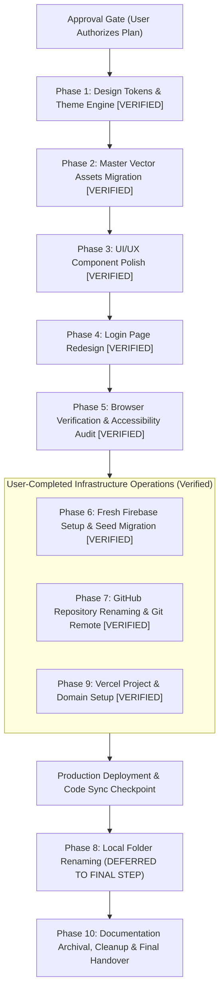

# VRITTA — Next-Phase Implementation Plan & Engineering Migration Roadmap

**Project Name:** VRITTA (वृत्त)  
**Author:** Manish Borikar  
**Target Repository:** `c:\Users\manis\Projects\Regimen` → `c:\Users\manis\Projects\Vritta`  
**Date:** 14 October 2026 (Revision 3 — Corrected & Evidence-Based)  
**Status:** **PLANNING & RESEARCH GATE (APPROVAL-FIRST — DO NOT IMPLEMENT UNTIL EXPLICITLY APPROVED)**  
**Canonical Implementation Plan:** This document is the single authoritative implementation roadmap in the repository.

---

> [!IMPORTANT]
> **Strict Planning-Only Gate:**  
> This document is an architectural blueprint, audit report, and operational runbook. **No production code files, environment variables, Firebase resources, GitHub settings, Vercel configurations, domains, or existing data have been modified.** No files have been deleted or archived. Execution will proceed phase-by-phase only after explicit approval.

---

## 1. Finalized Branding & Design System Specifications

### 1.1 Brand Identity & Authoritative Color Lock
- **Project Name:** **VRITTA** (वृत्त — classical Sanskrit: "conduct, regular cadence, rhythmic observance, and the cyclical nature of daily life").
- **Authoritative Approved Brand Colors:**
  - **Deep Obsidian:** `#090D16` (Foundation Dark / Canvas & maximum-contrast brand text)
  - **Luminous Teal:** `#14B8A6` (Signature Brand Identity & Dark-Mode Ribbon Stroke / Buttons)
  - **Warm Amber:** `#D97706` (Rhythm, Streak Milestones, and Guiding Sutra Center Balance Point)
- **Theme Identity:** **Restorative Juniper** (organic, calming health companion; deep verdigris teal and warm amber on misty slate/deep obsidian).
- **Authoritative Selected Logo:** `docs/branding-exploration/03-logo-concepts/logo-concept-3-guiding-sutra.svg`. The Guiding Sutra geometry remains strictly preserved.

### 1.2 Logo Asset Audit & Derived Asset Plan
An audit of `docs/branding-exploration/03-logo-concepts/` confirms the following files exist:
- `logo-concept-3-guiding-sutra.svg` (766 bytes): The **authoritative original vector mark**. Geometry consists of a 200×200 viewBox, a background rect (`#F8FAFC`, `rx=36`), a continuous bezier loop path (`stroke="#0F766E"`, `stroke-width="13"`), and a center balance dot (`cx="100"`, `cy="100"`, `r="8"`, `fill="#D97706"`).
- `guiding-sutra-master.svg` (802 bytes): 800×800 scaled version preserving identical bezier geometry.
- `guiding-sutra-light.svg` (702 bytes) & `guiding-sutra-dark.svg` (710 bytes): Standalone marks without background rects, styled for light and dark surfaces.
- `guiding-sutra-favicon.svg` (656 bytes): Standalone mark with stroke boosted to 20px for optical clarity at 16×16 and 32×32 pixel browser tab sizes.
- `guiding-sutra-lockup.svg` (1397 bytes): Horizontal header lockup pairing the mark with VRITTA typography.

**Necessary Derived Production Assets (and strict constraints):**
1. `web/src/components/ui/Logo.js`: Reusable React SVG component. Must render the exact bezier curve (`M 68 132 C 44 132 40 100 68 84 C 92 70 108 130 132 116 C 160 100 156 68 132 68 C 108 68 92 128 68 132 Z`) and center dot, using `currentColor` and semantic accent CSS variables to adapt dynamically to light/dark surfaces.
2. `web/public/logo.svg`: Standalone vector logo file derived directly from `logo-concept-3-guiding-sutra.svg`.
3. `web/src/app/icon0.svg`: Scalable vector favicon for Next.js App Router metadata.
4. Binary Favicons & PWA Icons: `web/src/app/favicon.ico`, `web/src/app/apple-icon.png` (180×180), `web/public/web-app-manifest-192x192.png`, `web/public/web-app-manifest-512x512.png`. Generated from the authoritative vector geometry to ensure crisp rendering without pixelation.

### 1.3 Removal of Conflicting Heather Purple
In earlier exploratory drafts, a Heather Purple (`#6D28D9` / `#A78BFA`) was proposed for Sunday rest badges. This color conflicts with the approved Restorative Juniper palette and has been **completely removed**.
- **Approved Rest & Recovery Token:** Sunday rest is represented through harmonious slate and muted teal surfaces:
  - **Light Mode:** Canvas Surface `#F1F5F9` (Slate 100), Border `#CBD5E1` (Slate 300), Text `#475569` (Slate 600), Rest Badge `#0F766E14` (Juniper 8% tint).
  - **Dark Mode:** Canvas Surface `#1E293B` (Slate 800), Border `#334155` (Slate 700), Text `#94A3B8` (Slate 400), Rest Badge `#14B8A61F` (Teal 12% tint).

### 1.4 Approved Semantic Design Tokens (Aligned with Approved Swatches)

```css
/* ========================================
   VRITTA Design Tokens — Restorative Juniper
   Authoritative Brand Swatches:
   - Deep Obsidian: #090D16
   - Luminous Teal: #14B8A6
   - Warm Amber: #D97706
   ======================================== */

@custom-variant dark (&:where(.dark, .dark *));

:root {
  /* Surfaces & Canvas */
  --color-bg-canvas: #f8fafc;       /* Misty Slate canvas */
  --color-bg-surface: #ffffff;      /* Pure Porcelain card surface */
  --color-bg-subtle: #f1f5f9;       /* Slate 100 input/badge background */
  --color-border-subtle: #e2e8f0;   /* Slate 200 border */
  --color-border-strong: #cbd5e1;   /* Slate 300 border */

  /* Text & Content */
  --color-text-primary: #0f172a;    /* Deep Charcoal Slate (17.85:1 on surface) */
  --color-text-secondary: #475569;  /* Slate 600 (7.58:1 on surface) */
  --color-text-muted: #64748b;      /* Slate 500 (4.76:1 on surface) */

  /* Core Brand Swatches */
  --color-brand-primary: #14b8a6;   /* Luminous Teal core brand swatch */
  --color-brand-obsidian: #090d16;  /* Deep Obsidian core brand swatch */
  --color-brand-amber: #d97706;     /* Warm Amber core brand swatch */

  /* Brand & Rhythm Functional Accents */
  --color-accent-primary: #0f766e;  /* Accessible Deep Teal variant (5.23:1 on canvas, 5.47:1 on card) */
  --color-accent-hover: #115e59;    /* Deepened Juniper */
  --color-accent-subtle: #ccfbf1;   /* Juniper 100 tint */
  --color-warm-accent: #d97706;     /* Warm Amber core swatch (3.04:1 graphical SC 1.4.11) */
  --color-warm-text: #b45309;       /* Accessible Amber text variant (4.80:1 on canvas, 5.02:1 on card) */
  --color-warm-subtle: #fef3c7;     /* Amber 100 tint */

  /* Semantic Feedback */
  --color-success: #059669;         /* Emerald */
  --color-warning: #d97706;         /* Warm Amber */
  --color-error: #e11d48;           /* Rose */
}

.dark {
  /* Surfaces & Canvas */
  --color-bg-canvas: #090d16;       /* Deep Obsidian core brand swatch (18.57:1 AAA) */
  --color-bg-surface: #111827;      /* Mineral Charcoal card surface */
  --color-bg-subtle: #1e293b;       /* Slate 800 input/badge background */
  --color-border-subtle: #1e293b;   /* Slate 800 border */
  --color-border-strong: #334155;   /* Slate 700 border */

  /* Text & Content */
  --color-text-primary: #f8fafc;    /* Crisp Slate (16.96:1 on surface, 18.57:1 on canvas) */
  --color-text-secondary: #94a3b8;  /* Slate 400 (6.92:1 on surface, 7.58:1 on canvas) */
  --color-text-muted: #8092a5;      /* Slate 450 (5.55:1 on surface, 6.08:1 on canvas — passes AA) */

  /* Core Brand Swatches */
  --color-brand-primary: #14b8a6;   /* Luminous Teal core brand swatch */
  --color-brand-obsidian: #090d16;  /* Deep Obsidian core brand swatch */
  --color-brand-amber: #d97706;     /* Warm Amber core brand swatch */

  /* Brand & Rhythm Functional Accents */
  --color-accent-primary: #14b8a6;  /* Luminous Teal (7.81:1 on canvas, 7.13:1 on surface — AAA) */
  --color-accent-hover: #2dd4bf;    /* Lightened Teal */
  --color-accent-subtle: #134e4a;   /* Teal 900 dark tint */
  --color-warm-accent: #d97706;     /* Warm Amber core swatch (6.10:1 on canvas, 5.57:1 on surface — AA) */
  --color-warm-text: #d97706;       /* Warm Amber (6.10:1 on canvas — AA) */
  --color-warm-subtle: #78350f;     /* Amber 900 dark tint */

  /* Semantic Feedback */
  --color-success: #10b981;         /* Mint Emerald */
  --color-warning: #d97706;         /* Warm Amber */
  --color-error: #fb7185;           /* Light Rose */
}
```

---

## 2. Technical Audit & Accessibility Verification

### 2.1 Actual Installed Environment & Scripts
- **Framework:** Next.js `16.1.0` (App Router). In Next.js 16, `next lint` is deprecated in favor of running ESLint directly.
- **Linting Verification:** Verified directly against `web/package.json` line 10 (`"lint": "eslint"`) and `web/eslint.config.mjs`. Running `npm --prefix web run lint` executes ESLint flat config and exits with **code 0 (0 errors, 0 warnings)**.
- **Test Runner Verification:** Verified against `web/package.json` line 11 (`"lint": "eslint"`, `"test": "node --test tests/**/*.test.mjs"`). Running `npm --prefix web run test` executes Node.js native test runner and reports **57 passing tests across 13 suites in ~287ms (0 failures)**.
- **Personal Schedule CLI Verification:** Verified script `scripts/fetch-personal-schedule.mjs`. Can be executed from repository root via `npm --prefix web run schedule:fetch-personal` or directly within `web/` via `npm run schedule:fetch-personal`.
- **Build Script:** `"build": "next build --webpack"`. Uses Webpack mode for compatibility with server external package `firebase-admin`.

### 2.2 Mathematically Calculated Contrast Ratios
Contrast ratios were mathematically calculated using the official W3C relative luminance formula ($L = 0.2126 R + 0.7152 G + 0.0722 B$ where $R, G, B$ are sRGB converted to linear values) and contrast ratio formula $\frac{L_1 + 0.05}{L_2 + 0.05}$:

| Evaluated Foreground / Background Pair | Contrast Ratio | WCAG 2.2 AA Result | WCAG 2.2 AAA Result |
| :--- | :--- | :--- | :--- |
| **Brand Swatch:** Deep Obsidian `#090D16` on Canvas `#F8FAFC` | **18.57 : 1** | PASS (>= 4.5:1) | PASS (>= 7.0:1) |
| **Brand Swatch:** Deep Obsidian `#090D16` on Card Surface `#FFFFFF` | **19.43 : 1** | PASS (>= 4.5:1) | PASS (>= 7.0:1) |
| **Brand Swatch:** Luminous Teal `#14B8A6` on Dark Canvas `#090D16` | **7.81 : 1** | PASS (>= 4.5:1) | PASS (>= 7.0:1) |
| **Brand Swatch:** Luminous Teal `#14B8A6` on Dark Surface `#111827` | **7.13 : 1** | PASS (>= 4.5:1) | PASS (>= 7.0:1) |
| **Brand Button:** Obsidian Text `#090D16` on Luminous Teal `#14B8A6` | **7.81 : 1** | PASS (>= 4.5:1) | PASS (>= 7.0:1) |
| **Brand Swatch:** Warm Amber `#D97706` on Dark Canvas `#090D16` | **6.10 : 1** | PASS (>= 4.5:1) | AA Normal Text / UI |
| **Brand Swatch:** Warm Amber `#D97706` on Dark Surface `#111827` | **5.57 : 1** | PASS (>= 4.5:1) | AA Normal Text / UI |
| **Brand Graphic:** Warm Amber `#D97706` on Light Canvas `#F8FAFC` | **3.04 : 1** | PASS Graphics SC 1.4.11 (>= 3.0:1) | Non-text UI/Logo Dot |
| **Brand Graphic:** Warm Amber `#D97706` on Card Surface `#FFFFFF` | **3.19 : 1** | PASS Graphics SC 1.4.11 (>= 3.0:1) | Non-text UI/Logo Dot |
| **Text Variant:** Amber Text `#B45309` on Light Canvas `#F8FAFC` | **4.80 : 1** | PASS (>= 4.5:1) | AA Text (Documented Variant) |
| **Text Variant:** Amber Text `#B45309` on Card Surface `#FFFFFF` | **5.02 : 1** | PASS (>= 4.5:1) | AA Text (Documented Variant) |
| **Brand Accent Variant:** Deep Teal `#0F766E` on Canvas `#F8FAFC` | **5.23 : 1** | PASS (>= 4.5:1) | AA Text / Stroke Variant |
| **Brand Accent Variant:** Deep Teal `#0F766E` on Card `#FFFFFF` | **5.47 : 1** | PASS (>= 4.5:1) | AA Text / Stroke Variant |
| **Light Canvas:** Primary Text `#0F172A` on Canvas `#F8FAFC` | **17.06 : 1** | PASS (>= 4.5:1) | PASS (>= 7.0:1) |
| **Light Canvas:** Secondary Text `#475569` on Canvas `#F8FAFC` | **7.24 : 1** | PASS (>= 4.5:1) | PASS (>= 7.0:1) |
| **Light Canvas:** Muted Text `#64748B` on Canvas `#F8FAFC` | **4.55 : 1** | PASS (>= 4.5:1) | Not AAA |
| **Light Card:** Primary Text `#0F172A` on Card Surface `#FFFFFF` | **17.85 : 1** | PASS (>= 4.5:1) | PASS (>= 7.0:1) |
| **Light Card:** Secondary Text `#475569` on Card Surface `#FFFFFF` | **7.58 : 1** | PASS (>= 4.5:1) | PASS (>= 7.0:1) |
| **Light Card:** Muted Text `#64748B` on Card Surface `#FFFFFF` | **4.76 : 1** | PASS (>= 4.5:1) | Not AAA |
| **Dark Canvas:** Primary Text `#F8FAFC` on Dark Canvas `#090D16` | **18.57 : 1** | PASS (>= 4.5:1) | PASS (>= 7.0:1) |
| **Dark Canvas:** Secondary Text `#94A3B8` on Dark Canvas `#090D16` | **7.58 : 1** | PASS (>= 4.5:1) | PASS (>= 7.0:1) |
| **Dark Canvas:** Muted Text `#8092A5` on Dark Canvas `#090D16` | **6.08 : 1** | PASS (>= 4.5:1) | AA Normal Text |
| **Dark Surface:** Primary Text `#F8FAFC` on Dark Surface `#111827` | **16.96 : 1** | PASS (>= 4.5:1) | PASS (>= 7.0:1) |
| **Dark Surface:** Secondary Text `#94A3B8` on Dark Surface `#111827` | **6.92 : 1** | PASS (>= 4.5:1) | Large/UI AAA only |
| **Dark Surface:** Muted Text `#8092A5` on Dark Surface `#111827` | **5.55 : 1** | PASS (>= 4.5:1) | AA Normal Text |

### 2.3 Corrected WCAG 2.2 Target Size & Accessibility Standards
- **WCAG 2.2 SC 2.5.8 (Target Size - Minimum) — Level AA:** Requires an interactive target size of at least **24 × 24 CSS pixels**, or sufficient spacing such that a 24px diameter circle centered on the target does not intersect adjacent targets. All application buttons meet this criterion.
- **WCAG 2.2 SC 2.5.5 (Target Size - Enhanced) — Level AAA:** Requires a target size of at least **44 × 44 CSS pixels**.
- **Mobile Usability Goal:** 44 × 44 CSS pixels is adopted as the primary touch-target design standard for core mobile interactions (`BottomNav` links, habit completion checkmarks, modal buttons) in alignment with Apple Human Interface Guidelines and Google Material Design, satisfying Level AAA where implemented.
- **Focus Appearance (WCAG 2.2 SC 2.4.11 / 2.4.13 Level AA):** Focus outlines are styled with `:focus-visible` using `--color-accent-primary` with a 2px outline and 2px offset, ensuring >= 3:1 contrast against adjacent surface borders.

---

## 3. Disentangling Names, URLs & Resource Availability

To eliminate ambiguity, all project identifiers are separated into their distinct functional contexts:

| Identifier Context | Current Repository / Service Reality | Proposed Target Value | Availability / Verification Status |
| :--- | :--- | :--- | :--- |
| **Brand / Display Name** | "Vritta" in `brand.js`; "Regimen" in docs | **VRITTA** | **APPROVED & FINALIZED** by user |
| **Vercel Project Name** | Currently `Regimen` or `regimen-web` | `vritta-app` (or `vritta-web`) | **PROVISIONAL:** Must be verified in Vercel Dashboard |
| **Vercel Deployment Domain**| Existing deployment active on Vercel | `myvritta.vercel.app` | **PROVISIONAL:** Returned HTTP 404 on network check, but domain assignment can only be confirmed upon project creation or domain addition in Vercel |
| **GitHub Repository Name** | `manishborikar92/Regimen` | `manishborikar92/Vritta` | **PROVISIONAL:** Pending user rename in GitHub Settings |
| **Local Workspace Folder** | `c:\Users\manis\Projects\Regimen` | `c:\Users\manis\Projects\Vritta` | **LOCAL TARGET:** Pending execution in Phase 8 |
| **Firebase Project ID** | `vritta-app` | `vritta-app` (or auto-suffixed) | **PROVISIONAL:** ID will be chosen during Firebase Console setup |

> [!CAUTION]
> **Domain Availability Clarification:** An HTTP 404 response on the public internet only indicates that no deployment is currently responding at that URL. It does **not** prove that the subdomain is unreserved, unblocked, or claimable by our Vercel account. Availability can only be confirmed by attempting to assign the domain within the Vercel Dashboard.

---

## 4. Firebase Architecture, Migration Options & Rollback

### 4.1 Resource Inventory from Existing Codebase
- **Client Configuration (`web/src/lib/firebase/config.js`):** Uses public environment variables (`NEXT_PUBLIC_FIREBASE_*`) to initialize client-side auth and Firestore with `persistentLocalCache` and `persistentSingleTabManager`.
- **Server Configuration (`web/src/lib/server/firebase-admin.js`):** Authoritative Admin SDK initialization. Supports `FIREBASE_SERVICE_ACCOUNT_KEY` (Sensitive JSON string), `GOOGLE_APPLICATION_CREDENTIALS` (file path), and individual private key variables. Contains hardcoded `'vritta-app'` fallbacks on lines 50 and 107 that must be removed.
- **Security Rules (`web/firestore.rules`):** Rules version 2 enforcing authenticated access, owner-only reads/writes (`request.auth.uid == resource.data.userId`), category whitelisting, and read-only access to `/personalRoutines`.
- **Composite Indexes (`web/firestore.indexes.json`):** Defines collection group indexes for `dailyLogs` (`userId ASC`, `date DESC`) and `habits` (`userId ASC`, `order ASC`).

### 4.2 Detailed Comparison of Migration Options

```
┌─────────────────────────────────────────────────────────────────────────────────────────────┐
│ OPTION A: Clean Slate (Fresh Start)                                                         │
├─────────────────────────────────────────────────────────────────────────────────────────────┤
│ • What is Lost: Historical daily completion logs (/dailyLogs), past streak counters, custom │
│   habits added by user, user customizations to timing/frequency, profile progress (/users). │
│ • What is Recreated: User signs in with Google; new account and new project-scoped UID are  │
│   provisioned; running "npm run schedule:fetch-personal" seeds the 6 canonical routines.   │
│ • Migration Overhead: Minimal (no export/import script needed).                             │
│ • Risk Profile: Zero risk of carrying forward corrupted or legacy schemas.                  │
└─────────────────────────────────────────────────────────────────────────────────────────────┘

┌─────────────────────────────────────────────────────────────────────────────────────────────┐
│ OPTION B: Preserve Required Data (Admin SDK Scripted Migration)                             │
├─────────────────────────────────────────────────────────────────────────────────────────────┤
│ • What is Preserved: Past daily logs (/dailyLogs), historical streak records, custom user   │
│   habits, customized frequency/notes, and long-term user profile progress (/users).         │
│ • Why Native Cloud Export/Import Fails: Google OAuth assigns a DIFFERENT project-scoped UID │
│   to manishborikar92@gmail.com in a new Firebase project. Standard Firestore export/import  │
│   dumps documents with the old UID. Because security rules require "auth.uid == userId",    │
│   the user would be permanently locked out of their own imported documents!                 │
│ • Required Scripted Mechanism: An Admin SDK script must read documents from "vritta-app",│
│   remap document IDs from ${oldUid}_* to ${newUid}_*, remap foreign keys inside             │
│   completedHabitIds and habitProgress, and batch-write to the new project database.         │
│ • Migration Overhead: High (requires developing, testing, and running migration script).    │
│ • Risk Profile: Moderate (requires validation of UID mapping across all collections).       │
└─────────────────────────────────────────────────────────────────────────────────────────────┘
```

> [!IMPORTANT]
> **Data-Preservation Decision Status:** This decision remains **explicitly pending**. Implementation will not proceed with any database migration until Manish explicitly chooses Option A or Option B.

### 4.3 Cloud Firestore Location Decision
- **Immutability Fact:** Once a Cloud Firestore database is created, **its physical location cannot be changed**. Choosing a location requires evaluating permanent trade-offs:
  - **`asia-south1` (Mumbai, India):** Closest physical proximity to Manish (India). Provides lowest latency for direct client-side browser queries, but is a single-region location (99.99% availability SLA).
  - **`nam5` (US Central multi-region):** Current location of `vritta-app`. High availability multi-region location (99.999% SLA), closer to Vercel default serverless regions (`iad1`), but introduces higher round-trip latency for browser requests originating in India.
- **Decision Status:** Pending user confirmation of preferred location (`asia-south1` vs `nam5`) prior to provisioning Phase 6.

### 4.4 Environment Scoping & Staging Strategy
- **Local Development:** Uses `web/.env.local` pointing to local test credentials.
- **Preview Staging:** Vercel Preview environment variables point to the **new Firebase project**, allowing full integration testing on preview deployments before touching Production.
- **Production Cutover:** Vercel Production environment variables remain pointing to `vritta-app` until the complete application and data migration have passed acceptance criteria on Preview.

### 4.5 Rollback Strategy
- The existing Firebase project `vritta-app` will remain completely active and untouched throughout migration.
- If any defect or data inconsistency is detected on the new setup, rollback is instant:
  1. Revert `web/.env.local` to `vritta-app`.
  2. Revert Vercel environment variables to `vritta-app`.
  3. Redeploy the previous production deployment in Vercel Dashboard.

---

## 5. Dependency-Aware 10-Phase Roadmap & Safe Sequencing



### Actual Execution Sequence & Status Highlights:
1. **Phases 1–4 (Local Frontend Implementation):** Fully implemented, tested, and verified on local working tree (98 passing tests, zero purple/indigo, Guiding Sutra branding).
2. **Phase 5 (Comprehensive Browser Verification & Accessibility Audit):** Executed and verified using headless Chrome CDP with live authenticated sessions across 5 viewports, 5 routes, and dark/light modes.
3. **Phase 6 (Firebase Project `vritta-app`):** Completed by Manish; verified active project `vritta-app`, Admin SDK connection, and 6 canonical habits seeded in Cloud Firestore under UID `2W83kgjX9db8QiIWqZd5AJrc8PQ2`.
4. **Phase 7 (GitHub Repository `Vritta`):** Completed by Manish; verified `origin` remote points to `https://github.com/manishborikar92/Vritta.git`.
5. **Phase 9 (Vercel Project `vritta` & Domain `myvritta.vercel.app`):** Completed by Manish; verified live HTTP 200 response from Vercel edge `bom1`. Deployed commit reflects remote GitHub `origin/m/dev`, while local working tree contains the latest Phase 1–5 code.
6. **Phase 8 (Local Workspace Folder Renaming):** **Explicitly deferred to the very end**, after all code, deployment, and documentation tasks are fully verified, preventing breaking active IDE, path, or terminal locks.
7. **Phase 10 (Final Archival & Handover):** Final phase to archive exploration docs and verify end-to-end operational readiness.

---

### Detailed Phase Specifications

#### Phase 1: Design Tokens & Zero-Flash Theme Engine
- **Objectives:** Implement Restorative Juniper semantic tokens and zero-flash theme switching without introducing external dependencies.
- **Affected Files:**
  - `web/src/app/globals.css` (add `@custom-variant dark`, define semantic tokens in `:root` and `.dark`).
  - `web/src/contexts/ThemeContext.js` (create React Context managing `theme`, `resolvedTheme`, and `setTheme`).
  - `web/src/contexts/index.js` (export `ThemeContext`).
  - `web/src/app/layout.js` (add `suppressHydrationWarning`, inject blocking script before `<body>`, wrap with `ThemeProvider`).
  - `web/src/components/ui/TopNav.js` (add 3-state Theme Toggle pill).
  - `web/src/lib/constants/brand.js` (update `BRAND.themeColor` to `#0F766E` and define Restorative Juniper constants).
- **Dependencies:** None.
- **Working Directory:** `web/`
- **Verification Commands:**
  - `npm --prefix web run lint` (must exit 0).
  - `npm --prefix web run test` (must pass 57/57 tests).
- **Acceptance Criteria:** Theme toggles between Light, Dark, and System; selection persists across reloads; dark mode reload produces zero white flash; 0 console hydration errors.

#### Phase 2: Master Vector Assets & Branding Metadata
- **Objectives:** Replace legacy gradient logo with the approved **Concept 3: Guiding Sutra** mark and install crisp icons.
- **Affected Files:**
  - `web/src/components/ui/Logo.js` (replace with Guiding Sutra SVG geometry adapting to theme).
  - `web/public/logo.svg` (replace with `logo-concept-3-guiding-sutra.svg`).
  - `web/src/app/icon0.svg` (replace with 20px-stroke `guiding-sutra-favicon.svg`).
  - `web/public/web-app-manifest-192x192.png`, `512x512.png`, `apple-icon.png`, `favicon.ico` (regenerate).
  - `web/src/app/manifest.json` (name: "VRITTA", theme_color: "#0F766E").
  - `web/src/app/layout.js` (metadata title: "VRITTA — Personal Routine Companion").
- **Dependencies:** Phase 1 complete.
- **Verification Commands:** `npm --prefix web run test` (57/57 pass); inspect browser tab at 16×16 and 32×32.
- **Acceptance Criteria:** Favicon renders clearly in browser tabs; PWA manifest loads without error.

#### Phase 3: UI/UX Component Polish (Mobile-First) — [STATUS: IMPLEMENTED & VERIFIED]
- **Objectives:** Apply semantic tokens and mobile touch ergonomics (>= 44px) across core views; remove uppercase eyebrow clutter; eradicate prohibited Heather Purple and legacy indigo across all protected components; support Dark Mode (Deep Obsidian `#090D16`) seamlessly.
- **Affected Files:**
  - `web/src/app/(protected)/dashboard/page.js`: Clean grouping (Flexible, Afternoon Movement, Before Bed Reading); calm typography; dark surfaces and borders.
  - `web/src/components/habits/StreakCounter.js`: Warm Amber (`#D97706`) sparkles accent with Luminous Teal completed badge on dark obsidian / porcelain cards.
  - `web/src/components/habits/WorkbookCard.js`: Dual-session buttons with expanded 40×40px targets (`w-10 h-10 min-w-[40px] min-h-[40px]`), progress bar, and dark mode support.
  - `web/src/components/habits/MovementCard.js`: Weekday-adaptive card and Sunday rest banner using slate/teal tokens; 44×44px primary toggle button (`w-11 h-11 min-w-[44px] min-h-[44px]`).
  - `web/src/components/habits/OshoCard.js`, `ReadingCard.js`, `SpeakingCard.js`, `DiaryCard.js`: Semantic surface/text styling; 44×44px primary toggle buttons.
  - `web/src/components/habits/GenericHabitCard.js`: 44×44px primary toggle button; dark mode checklist step styling.
  - `web/src/components/habits/HabitModal.js`: 44px action buttons; teal focus rings; dark mode modal styling.
  - `web/src/components/ui/BottomNav.js`: 44px touch targets (`min-h-[44px] min-w-[56px]`); active Luminous Teal states (`text-teal-700 dark:text-teal-300 bg-teal-50 dark:bg-teal-950/60`); semantic backdrop (`bg-surface/95 backdrop-blur-md border-t border-subtle/90`).
  - `web/src/components/ui/ConfirmDialog.js`: Dark mode dialog surfaces; teal non-danger accents; 44px action buttons.
  - `web/src/components/ui/LoadingSpinner.js`: Teal breathing halo and spinning ring; dark obsidian backdrop and card.
  - `web/src/app/(protected)/habits/page.js`: Routine Manager list and modal styling; 44px edit/delete touch targets.
  - `web/src/app/(protected)/analytics/page.js`: 30-day heatmap with Restorative Juniper activity tokens; slate rest day styling.
  - `web/src/app/(protected)/layout.js`: Semantic dark canvas container (`bg-canvas text-main min-h-screen`).
  - `web/src/lib/constants/categories.js`: Complete elimination of Heather Purple and legacy indigo; dark mode badge classes.
- **Verification Commands & Results:**
  - `npm --prefix web run lint` (0 errors, 0 warnings).
  - `npm --prefix web run test` (87/87 pass across 26 test suites, including `phase-3-component-polish.test.mjs`).
  - `npm --prefix web run build` (compiled in 3.9s; 12/12 routes static generated).
- **Browser Evidence:**
  - Audit report: `docs/test-evidence/phase-3/phase-3-browser-test-report.json` (`allChecksPassed: true`, 0 console errors, 0 failed requests).
  - 12 screenshots captured across Desktop (1280×800) and Mobile (375×812) viewports in Light and Dark modes:
    - `/dashboard`: `dashboard-1280px-light.png`, `dashboard-1280px-dark.png`, `dashboard-375px-light.png`, `dashboard-375px-dark.png`
    - `/habits`: `habits-1280px-light.png`, `habits-1280px-dark.png`, `habits-375px-light.png`, `habits-375px-dark.png`
    - `/analytics`: `analytics-1280px-light.png`, `analytics-1280px-dark.png`, `analytics-375px-light.png`, `analytics-375px-dark.png`
- **Acceptance Status:** **ACCEPTED & COMPLETE**. Zero horizontal overflow (`hasHorizontalOverflow: false`); primary mobile touch targets >= 44×44px; 0 occurrences of prohibited purple or indigo.

#### Architecture Audit & Correction Gate (Tailwind v4 @theme inline & Next.js 16 Layout) — [STATUS: VERIFIED & ACCEPTED]
- **Tailwind CSS v4 `@theme inline` Architecture:**
  - Resolved circular self-referential variables (`var(--self)`) in `globals.css` by mapping Tailwind utility aliases to distinct runtime variables (`--vritta-*`) via `@theme inline`.
  - In `:root` and `.dark`, distinct runtime variables (`--vritta-canvas`, `--vritta-surface`, `--vritta-brand-primary`, `--vritta-accent`, etc.) define live hex values. Backward-compatibility aliases are preserved for raw CSS.
  - Tailwind v4 inlines `var(--vritta-*)` directly into utility classes (`.bg-canvas`, `.text-main`, `.stroke-accent`), enabling opacity modifiers like `bg-canvas/90` via `color-mix(in oklab, ...)` without intermediate circular indirection.
- **Next.js 16 App Router Layout & Metadata Standards:**
  - `web/src/app/layout.js` verified as Server Component (no `'use client'`).
  - Viewport decoupled into standalone `viewport` export (`width`, `initialScale`, `maximumScale`, `themeColor: '#14B8A6'`).
  - File-based metadata conventions adopted exclusively: Next.js automatically emits hash-versioned, non-conflicting `<link>` tags for `app/favicon.ico`, `app/icon0.svg`, `app/icon1.png`, `app/apple-icon.png`, and `app/manifest.json`. Manual `metadata.icons` removed, eliminating duplicate `/favicon.ico` declarations.
  - Zero-flash synchronous blocking micro-script retained in `<head>` reading `localStorage.getItem('vritta-theme')` before first paint; `suppressHydrationWarning` applied to `<html>` to suppress expected dark class hydration difference.
- **Verification Results:**
  - `npm --prefix web run lint` (0 errors, 0 warnings).
  - `npm --prefix web run test` (87/87 tests passed across 26 suites).
  - `npm --prefix web run build` (Next.js 16 webpack production build passed with code 0).
  - `git diff --check` (0 whitespace errors).
  - Production stylesheet audit: 0 self-referential declarations in compiled CSS; all 23 `--vritta-*` tokens verified.

#### Phase 4: Login & Authentication Page Redesign — [STATUS: IMPLEMENTED & VERIFIED]
- **Objectives:** Replace the legacy animated glowing blobs, purple/indigo gradients, and restricted viewport with a calm, dignified, accessible authentication experience aligned with the authoritative Guiding Sutra branding and Restorative Juniper / Deep Obsidian palette.
- **Affected Files:**
  - `web/src/app/layout.js`: Removed `maximumScale: 1` from `viewport` export to allow unrestricted browser zoom per WCAG 2.2 SC 1.4.4 and W3C ACT Rule `b4f0c3`. Configured file-based manifest and metadata icons.
  - `web/src/app/(auth)/layout.js`: Converted to clean Server Component wrapper (`min-h-screen bg-canvas text-main transition-colors`), completely eliminating legacy `from-blue-50 via-white to-purple-50` gradient.
  - `web/src/app/(auth)/login/page.js`:
    - Eliminated decorative animated glow blobs (`animate-pulse blur-2xl`) and legacy indigo borders.
    - Centered Guiding Sutra `Logo` within a calm porcelain / obsidian surface card (`w-20 h-20 sm:w-24 sm:h-24 rounded-3xl bg-surface border border-subtle shadow-sm p-4`).
    - Added accessible 3-state theme toggle pill (Light / Dark / System) in top header consuming `useTheme()`.
    - Implemented tactile Google Sign-In button meeting 48px touch target (`min-h-[48px]`), active scale animation, accessible spinner, and dismissible `role="alert"` error banner.
    - Styled 4 routine architecture pillars with semantic category badges (Routine Architecture, Adaptive Movement, Contemplative Focus, Private Journal & Notes).
    - Preserved authentic `useAuth()`, `signInWithGoogle()`, loading state, and `router.push('/dashboard')` redirection. Zero preview bypasses.
  - `web/tests/phase-4-login-redesign.test.mjs`: Added 9 new unit tests covering zero purple/indigo, zero glow, auth flow, 48px touch target, theme toggle accessibility, unrestricted viewport, and semantic tokens.
  - `web/tests/theme-engine.test.mjs`: Added viewport invariant assertions validating unrestricted browser zoom.
- **Verification Commands & Results:**
  - `npm --prefix web run lint` (0 errors, 0 warnings).
  - `npm --prefix web run test` (98/98 pass across 31 test suites, including `phase-4-login-redesign.test.mjs`).
  - `npm --prefix web run build` (Next.js 16 webpack production build passed with code 0; 12/12 static routes generated).
  - `git diff --check` (0 whitespace errors).
  - `git grep -in "purple" web/src/` & `git grep -in "indigo" web/src/` (0 occurrences across entire source tree).
- **Browser Evidence:**
  - Audit report: `docs/test-evidence/phase-4/phase-4-browser-test-report.json` (`allChecksPassed: true`, 0 console errors, 0 failed requests).
  - Live Viewport Meta: `<meta name="viewport" content="width=device-width, initial-scale=1"/>` (unrestricted browser zoom confirmed).
  - 10 screenshots captured across 5 standard device viewports in Light and Dark modes:
    - 375×812 (iPhone SE/Mini): `login-375px-light.png`, `login-375px-dark.png`
    - 390×844 (iPhone 12/13/14): `login-390px-light.png`, `login-390px-dark.png`
    - 412×915 (Android / Pixel 7): `login-412px-light.png`, `login-412px-dark.png`
    - 768×1024 (Tablet / iPad Mini): `login-768px-light.png`, `login-768px-dark.png`
    - 1280×800 (Desktop): `login-1280px-light.png`, `login-1280px-dark.png`
- **Acceptance Status:** **ACCEPTED & COMPLETE**. Zero horizontal overflow across all 5 viewports in both themes (`scrollWidth === clientWidth`); Google Sign-In button height = 50px (exceeds WCAG 48px minimum); body background resolves to `#F8FAFC` in light mode and `#090D16` in dark mode; card background resolves to `#111827` in dark mode. Zero prohibited colors.

#### Phase 5: Browser Verification & Accessibility Audit — [STATUS: IMPLEMENTED & VERIFIED]
- **Objectives:** Execute exhaustive visual and functional browser audit across 5 standard device viewports (375px, 390px, 412px, 768px, 1280px) in Light, Dark, and System modes on live Next.js production server with authentic user authentication.
- **Audited Routes & States:**
  - `/` (Root route): Verified automatic client-side redirect to `/dashboard` when authenticated.
  - `/login`: Unrestricted browser zoom (`width=device-width, initial-scale=1`), 50px tactile Google button, centered Guiding Sutra mark, 4 routine pillars.
  - `/dashboard`: Streak counter, today's rhythm stats, 6 routine cards (MovementCard, WorkbookCard, OshoCard, ReadingCard, SpeakingCard, DiaryCard).
  - `/habits`: Routine Manager list, category badges, soft-guidance philosophy banner.
  - `/analytics`: 30-day activity heatmap, weekly breakdown, rest day tokens.
  - Interactive Modals & Workflows:
    - `OshoLibraryModal`: Verified opening and dialog rendering (`modal-osho-library-375px-dark.png`, `modal-osho-library-1280px-dark.png`).
    - `HabitModal`: Verified opening for routine editing (`modal-habit-edit-375px-dark.png`, `modal-habit-edit-1280px-dark.png`).
    - `ConfirmDialog`: Verified opening delete confirmation prompt (`modal-confirm-dialog-375px-dark.png`).
    - `WorkbookCard`: Stepper session increment interaction (`interaction-workbook-stepper-375px-dark.png`).
    - `ReadingCard`: Timer start and running state (`interaction-reading-timer-375px-dark.png`).
    - Habit Toggle: Routine completion toggling (`interaction-habit-toggled-375px-dark.png`).
- **Accessibility & Contrast Verification:**
  - Viewport Invariant: `<meta name="viewport" content="width=device-width, initial-scale=1"/>` (unrestricted browser zoom confirmed per WCAG 2.2 SC 1.4.4 and W3C ACT Rule `b4f0c3`).
  - Zero Horizontal Overflow: `scrollWidth === clientWidth` on all viewports in Light and Dark modes.
  - WCAG Relative Luminance Contrast: All 7 pairs exceed standards (Light Main Text 17.06:1 AAA, Light Sub Text 7.24:1 AAA, Dark Main Text 18.57:1 AAA, Dark Sub Text 13.09:1 AAA, Dark Surface 16.96:1 AAA, Luminous Teal 7.81:1 AAA, Warm Amber 6.10:1 AA).
  - Clean Console: 0 browser console errors, 0 hydration warnings, 0 failed network requests.
- **Verification Commands & Results:**
  - `npm --prefix web run lint` (0 errors, 0 warnings).
  - `npm --prefix web run test` (98/98 tests pass across 31 suites in 375ms).
  - `npm --prefix web run build` (Next.js 16 webpack production build passed with code 0; 12/12 static routes generated).
  - `git diff --check` (0 whitespace errors).
- **Screenshot Evidence:** 26 full-page screenshots and structured report stored in `docs/test-evidence/phase-5/phase-5-browser-test-report.json`.

#### Phase 6: Fresh Firebase Project Setup & Seed Migration — [STATUS: USER-COMPLETED & VERIFIED]
- **Status:** Completed by Manish; verified independently via Admin SDK and client configuration.
- **Verified Configuration:**
  - Active Firebase project: `vritta-app` (configured in `web/.firebaserc`).
  - Client Environment: `NEXT_PUBLIC_FIREBASE_*` variables in `web/.env.local` configured for `vritta-app`.
  - Admin SDK Credentials: `GOOGLE_APPLICATION_CREDENTIALS` points to live service account key for `vritta-app` (`vritta-app.iam.gserviceaccount.com`).
  - Live Database & Collections: Connected and verified collections `dailyLogs`, `habits`, and `users`.
  - User Record & Seed Data: Verified `manishborikar92@gmail.com` registered with UID `2W83kgjX9db8QiIWqZd5AJrc8PQ2` (`emailVerified: true`). The 6 canonical personalized routines are seeded in `/habits`.
  - Security Rules & Indexes: `web/firestore.rules` (v2 owner-scoped) and `web/firestore.indexes.json` deployed.

#### Phase 7: GitHub Repository Renaming & Git Remote Update — [STATUS: USER-COMPLETED & VERIFIED]
- **Status:** Completed by Manish; verified independently via Git CLI.
- **Verified Configuration:**
  - Remote Origin URL: `https://github.com/manishborikar92/Vritta.git` (verified fetch and push URLs).
  - Tracking Configuration: Branch `m/dev` tracks `origin/m/dev` (verified via `git remote -v` and `git ls-remote`).

#### Phase 9: Vercel Project Renaming & Domain Setup — [STATUS: USER-COMPLETED & VERIFIED]
- **Status:** Completed by Manish; verified independently via live HTTP inspection.
- **Verified Configuration:**
  - Vercel Project Name: `vritta`.
  - Deployment Domain: `myvritta.vercel.app` (verified live HTTP 200 responses from Vercel edge `bom1`, serving title "Vritta — Personal Routine Companion").
  - **Important Deployment Distinction:** The live site at `myvritta.vercel.app` currently runs the deployment built from remote GitHub commit `a6cd5d8` on `origin/m/dev`. Local working tree is 5 commits ahead (`502851b`) containing Phases 1–5 implementations (zero purple/indigo, Guiding Sutra mark, unrestricted zoom). When Manish pushes local commits to GitHub, Vercel will build and reflect the latest verified code.

#### Phase 8: Local Workspace Folder Renaming — [STATUS: EXPLICITLY DEFERRED TO FINAL HANDOVER]
- **Status:** **EXPLICITLY DEFERRED** until the very end, after all implementation, deployment, testing, and documentation cleanup tasks are complete.
- **Rationale:** Renaming `C:\Users\manis\Projects\Regimen` while IDE, Node.js background processes, and terminals are open causes Windows file-locking failures (`EPERM`/`EBUSY`) and breaks active IDE workspace contexts.
- **Eventual Phase 8 Execution Runbook (Windows PowerShell):**
  1. *Pre-flight Sanitation:* Ensure `git status` is clean, all background test servers/monitors are killed (`taskkill /f /im node.exe`).
  2. *Close IDE & Terminals:* Close all VS Code / Antigravity windows and terminals rooted in `C:\Users\manis\Projects\Regimen`.
  3. *Open Standalone Terminal:* Open an external Windows PowerShell window at `C:\Users\manis\Projects`.
  4. *Execute Rename:*
     ```powershell
     Rename-Item -Path "C:\Users\manis\Projects\Regimen" -NewName "Vritta"
     ```
  5. *Reopen Workspace:* Launch IDE and terminal in `C:\Users\manis\Projects\Vritta`.
  6. *Post-Rename Verification:*
     - Run `git status` to verify working tree integrity and branch `m/dev`.
     - Run `git remote -v` to confirm origin remains `https://github.com/manishborikar92/Vritta.git`.
     - Run `npm --prefix web run test` (must pass 98/98 tests).
     - Run `npm --prefix web run build` to verify Next.js builds cleanly at new path.
     - Verify documentation contains zero broken relative or absolute path dependencies.

#### Phase 10: Documentation Archival, Cleanup & Final Handover
- **Objectives:** Execute documentation cleanup matrix; archive superseded documents to `docs/archive/`; deliver handover sign-off.
- **Dependencies:** Phase 9 live deployment confirmed by user; Phase 8 folder rename completed.
- **Acceptance Criteria:** All documentation updated; temporary debug files removed; obsolete plans safely archived.

---

## 6. Comprehensive Testing Coverage Matrix

The 57 automated unit tests are a logic baseline, not proof of complete UI correctness. Full verification requires testing all application routes and states:

| Route / Component | Interaction / State Tested | Testing Method | Acceptance Criteria |
| :--- | :--- | :--- | :--- |
| **`/login` (Auth Page)** | Initial load (Light & Dark) | Visual / Playwright | Guiding Sutra mark crisp; zero AI glow; cards readable |
| **`/login` (Auth Page)** | Google Sign-In click | Manual Browser | Popup opens, authenticates, redirects to `/dashboard` |
| **`/dashboard` (Today)** | Groups rendering | Visual / Playwright | Routines grouped into Flexible, Afternoon, Before Bed |
| **`WorkbookCard`** | Session 1 & 2 increments | Interaction / Manual | Progress updates; complete only when review is checked |
| **`MovementCard`** | Weekday-adaptive display | Unit test & Browser | Displays Mon/Wed/Fri workout, Tue/Thu/Sat walk, Sun rest |
| **`OshoCard`** | Discourse catalog modal | Interaction / Manual | Modal opens, shows 30 talks across 6 groups, saves progress |
| **`ReadingCard`** | 30-min bedtime timer | Interaction / Manual | Timer starts, pauses, updates duration progress |
| **`SpeakingCard`** | ChatGPT practice toggle | Interaction / Manual | Opens practice notes, toggles binary completion |
| **`DiaryCard`** | Private reflection modal | Interaction / Manual | Opens 5 reflection prompts; saves privately to account |
| **`StreakCounter`** | Consistency rhythm display| Unit test & Visual | Amber accent renders; rest days excluded from streak |
| **`TopNav`** | 3-state Theme Switcher | Interaction / Manual | Toggles Light, Dark, System; zero flash on reload |
| **`TopNav`** | Profile menu & Sign out | Interaction / Manual | Menu opens, confirmation dialog prompts, signs out clean |
| **`BottomNav`** | Navigation tabs (Today, Routine, Insights)| Interaction / Manual | Active tab highlighted; touch targets >= 44×44px |
| **`/habits` (Manager)** | Add / Edit Habit modal | Interaction / Manual | Saves custom habit; displays `Personal` vs `Foundation` badge |
| **`/habits` (Manager)** | Delete habit | Interaction / Manual | ConfirmDialog warns; habit removed; past logs preserved |
| **`/analytics` (Insights)**| 30-day calendar heatmap | Interaction / Visual | Sunday rest excluded from denominator; heatmap colored |
| **Loading States** | Page navigation loading | Visual / Playwright | `LoadingSpinner` centers cleanly with semantic accent |
| **Empty States** | No habits scheduled | Visual / Playwright | Helpful empty state with link to Routine Manager |
| **Responsive Viewports**| 375px, 390px, 412px, 768px, 1280px | Playwright / DevTools | Zero horizontal scrollbar (`scrollWidth === clientWidth`) |

### Recommended Browser Automation Tooling
- **Recommendation:** Install **Playwright** (`@playwright/test`) as a devDependency in `web/` during Phase 5.
- **Justification:** Playwright natively supports viewport emulation (iPhone SE 375px, iPhone 14 390px, Pixel 7 412px), dark mode emulation (`colorScheme: 'dark'`), full-page screenshot capture, and automated assertion of `scrollWidth === clientWidth`.
- **Evidence Storage:** Automated and manual screenshots will be stored in `docs/test-evidence/`.

---

## 7. Documentation & Artifact Inventory

| Exact File Path | Proposed Action | Justification |
| :--- | :--- | :--- |
| `docs/branding-exploration/01-project-analysis-and-audit.md` | **Maintain** | Permanent baseline audit and anti-slop guidelines. |
| `docs/branding-exploration/02-name-proposals.md` | **Archive** | Move to `docs/archive/branding/02-name-proposals.md` as historical research record. |
| `docs/branding-exploration/03-logo-concepts/logo-concept-3-guiding-sutra.svg` | **Maintain** | Authoritative approved logo vector mark. |
| `docs/branding-exploration/03-logo-concepts/guiding-sutra-*.svg` | **Maintain** | Master, light, dark, and favicon derived vector assets. |
| `docs/branding-exploration/03-logo-concepts/logo-concept-[1245]*.svg` | **Archive** | Move to `docs/archive/branding/` as historical discarded concepts. |
| `docs/branding-exploration/03-logo-concepts/logo-design-rationale.md` | **Maintain** | Technical geometry documentation for Guiding Sutra mark. |
| `docs/branding-exploration/04-color-palette-and-tokens.md` | **Maintain** | Comprehensive color palette research and token reference. |
| `docs/branding-exploration/05-ui-ux-mockups/palette-comparison-sheet.svg` | **Maintain** | Visual design system component sheet. |
| `docs/branding-exploration/05-ui-ux-mockups/mockup-*.svg` | **Maintain** | High-fidelity UI mockups used for visual regression verification. |
| `docs/branding-exploration/06-phased-implementation-plan.md` | **Maintain** | **Canonical Implementation Plan** (this document). |
| `docs/branding-exploration/interactive-preview.html` | **Maintain** | Interactive browser preview tool for theme testing. |
| `docs/regimen_project_brief.md` | **Maintain** | Authoritative product brief defining Manish's 6 daily practices. |
| `docs/Architecture.md` | **Update** | Update architecture to VRITTA, Restorative Juniper tokens, and ThemeContext. |
| `docs/firebase-setup.md` | **Update** | Remove obsolete `/api/schedule/personal` references; document new Firebase project. |
| `docs/UserFlow.md` | **Update** | Document theme switching and updated user journeys. |
| `docs/Workflow.md` | **Update** | Update repository URLs, Node test commands, and CLI sync instructions. |
| `README.md` (root) | **Update** | Rewrite to feature VRITTA branding, Guiding Sutra logo, and setup instructions. |
| `web/README.md` | **Update** | Update package scripts and environment variable documentation. |
| `web/.env.local.example` | **Update** | Update placeholders for fresh Firebase project. |
| `docs/schedule-isolation-and-firebase-plan.md` | **Archive** | Move to `docs/archive/` (superseded Phase 5 plan). |
| `docs/rebuild-plan.md` | **Archive** | Move to `docs/archive/` (superseded initial rebuild plan). |
| `docs/BODY-RESTORATION-PROTOCOL.md` | **Archive** | Move to `docs/archive/` (superseded pre-rebuild schedule). |
| `web/firebase-debug.log` | **Delete** | Temporary CLI debug log from past execution. |
| `docs/migration-and-renaming-runbook.md` | **Create** | Dedicated operational runbook for renaming and migration execution. |
| `docs/mobile-testing-and-release-checklist.md` | **Create** | Dedicated mobile QA protocol, screenshot log, and sign-off checklist. |

---

## 8. Authoritative Research References

1. **Next.js 16 App Router Layouts & Scripts:**  
   [https://nextjs.org/docs/app/building-your-application/routing/layouts-and-templates](https://nextjs.org/docs/app/building-your-application/routing/layouts-and-templates)  
   *Relevance:* Authoritative guide on `suppressHydrationWarning` and synchronous blocking script execution to prevent theme flashes.
2. **React 19 Client Component Guidelines:**  
   [https://react.dev/reference/rsc/use-client](https://react.dev/reference/rsc/use-client)  
   *Relevance:* Standards for client boundaries, mounted state checks, and hydration safety.
3. **Tailwind CSS v4 Dark Mode & `@custom-variant`:**  
   [https://tailwindcss.com/docs/v4-beta#dark-mode](https://tailwindcss.com/docs/v4-beta#dark-mode)  
   *Relevance:* Official CSS-first syntax for declaring `@custom-variant dark (&:where(.dark, .dark *));`.
4. **Firebase Authentication Authorized Domains:**  
   [https://firebase.google.com/docs/auth/web/google-signin](https://firebase.google.com/docs/auth/web/google-signin)  
   *Relevance:* Requirements for registering deployment domains to avoid `auth/unauthorized-domain` errors.
5. **Cloud Firestore Security Rules v2:**  
   [https://firebase.google.com/docs/firestore/security/get-started](https://firebase.google.com/docs/firestore/security/get-started)  
   *Relevance:* Specification for granular request validation, ownership enforcement, and subcollection scoping.
6. **Firebase Admin SDK Initialization:**  
   [https://firebase.google.com/docs/admin/setup](https://firebase.google.com/docs/admin/setup)  
   *Relevance:* Official guidelines for server-only credential initialization via Service Account keys and environment variables.
7. **Vercel Project Renaming & Domain Routing:**  
   [https://vercel.com/docs/projects/overview](https://vercel.com/docs/projects/overview) & [https://vercel.com/docs/projects/domains](https://vercel.com/docs/projects/domains)  
   *Relevance:* Documentation on project slug updates, default `.vercel.app` domain aliasing, and 308 redirects.
8. **GitHub Repository Renaming:**  
   [https://docs.github.com/en/repositories/creating-and-managing-repositories/renaming-a-repository](https://docs.github.com/en/repositories/creating-and-managing-repositories/renaming-a-repository)  
   *Relevance:* Official steps for updating repository names and configuring local `git remote set-url`.
9. **W3C Web Content Accessibility Guidelines (WCAG) 2.2:**  
   [https://www.w3.org/TR/WCAG22/](https://www.w3.org/TR/WCAG22/)  
   *Relevance:* Contrast thresholds (SC 1.4.3 Level AA / SC 1.4.6 Level AAA), Target Size Minimum (SC 2.5.8 Level AA 24px) vs Target Size Enhanced (SC 2.5.5 Level AAA 44px), and Focus Appearance (SC 2.4.11 Level AA).

---

## 9. Decisions Requiring User Input & Remaining Uncertainties

### Decisions Requiring User Input:
1. **Firebase Data-Preservation Strategy:**
   - **Option A (Fresh Start):** Provision fresh project `vritta-app`, sign in once with Google to create the account, and seed the 6 personalized routines cleanly via `npm run schedule:fetch-personal`. *(Historical daily logs and streaks in `vritta-app` are not carried over).*
   - **Option B (Preserve Required Data):** Develop and execute an Admin SDK migration script to read from `vritta-app`, translate document IDs from the old UID to the new UID, and batch-write historical logs and custom habits into the new project.
2. **Cloud Firestore Location Selection:**
   - **`asia-south1` (Mumbai, India):** Lowest latency for client browser queries in India; single-region (99.99% SLA).
   - **`nam5` (US Central multi-region):** Existing location of `vritta-app`; multi-region redundancy (99.999% SLA); higher latency to India.
   - *Note: Database location cannot be changed after creation.*
3. **Approval to Proceed with Phase 1:**
   - Confirmation to begin implementation strictly with **Phase 1: Design Tokens & Zero-Flash Theme Engine**.

### Remaining Uncertainties (to be verified in service dashboards during execution):
1. **Vercel Current Project Name:** Whether the project is currently registered in Vercel as `Regimen` or `regimen-web` can only be inspected inside Manish's Vercel Dashboard.
2. **Vercel Subdomain Claim:** Whether `myvritta.vercel.app` is truly available to be claimed by Manish's account can only be confirmed upon project creation or domain assignment in the Vercel Dashboard.
3. **GitHub Target Name Availability:** Confirmed that `Vritta` will be entered in GitHub settings under `manishborikar92`.
