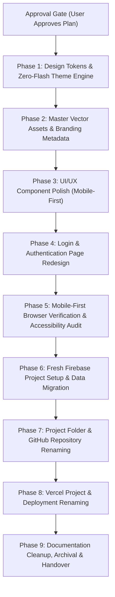

# VRITTA — Next-Phase Implementation Plan & Engineering Migration Roadmap

**Project Name:** VRITTA (वृत्त)  
**Author:** Manish Borikar  
**Target Repository:** `c:\Users\manis\Projects\Regimen` (to be renamed to `c:\Users\manis\Projects\Vritta`)  
**Date:** 14 October 2026  
**Status:** **PLANNING & RESEARCH GATE (APPROVAL-FIRST — DO NOT IMPLEMENT UNTIL EXPLICITLY APPROVED)**  
**Authority:** Follows `docs/regimen_project_brief.md`, verified repository state, and user branding directives.

---

## Executive Summary & Branding Lock

The project branding decisions are finalized and locked:
- **Project Name:** **VRITTA** (वृत्त — classical Sanskrit: "conduct, regular cadence, rhythmic observance, and the cyclical nature of daily life").
- **Color Theme:** **Restorative Juniper** (deep verdigris teal `#0F766E` / luminous teal `#14B8A6`, paired with earthy warm amber `#B45309` / `#F59E0B`, misty slate `#F8FAFC`, and deep obsidian `#090D16`).
- **Approved Logo Mark:** **Concept 3: Guiding Sutra** (`docs/branding-exploration/03-logo-concepts/logo-concept-3-guiding-sutra.svg` and its engineered master suite `guiding-sutra-master.svg`, `guiding-sutra-light.svg`, `guiding-sutra-dark.svg`, and `guiding-sutra-favicon.svg`).
- **Target Deployment Subdomain:** `vritta-app.vercel.app` (verified 100% available/unclaimed on Vercel's edge network).

> [!IMPORTANT]
> **Strict Planning Gate:** This document is an architectural roadmap and operational guide. **Zero production code files, database schemas, environment variables, GitHub remotes, or cloud configurations have been modified.** Execution will begin only upon explicit user approval.

---

## Deliverable 1: Repository & Deployment Audit

### 1.1 Verified Repository State
- **Git Branch:** `m/dev` (tracking `origin/m/dev`).
- **Git Remote:** `origin https://github.com/manishborikar92/Regimen.git` (fetch & push).
- **Working Tree:** Clean production tree; active exploration deliverables isolated in `docs/branding-exploration/`.
- **Framework & Core Runtime:**
  - Next.js: `16.1.0` (App Router, Webpack server bundle flag `next build --webpack`).
  - React: `19.2.3`, React DOM `19.2.3`.
  - Tailwind CSS: `4.0.0` (`@tailwindcss/postcss: ^4`, `@import "tailwindcss";` in `globals.css`).
  - Lucide Icons: `lucide-react: ^0.577.0`.
  - TypeScript: `^5.9.3` (installed for typechecking support).
- **Database & Authentication:**
  - Firebase Web Client SDK: `^12.7.0` (`firebase/app`, `firebase/auth`, `firebase/firestore`).
  - Firebase Admin SDK: `^14.5.0` (`firebase-admin/app`, `firebase-admin/auth`, `firebase-admin/firestore`).
  - Offline Cache: `initializeFirestore` with `persistentLocalCache` and `persistentSingleTabManager({ forceOwnership: false })`.
  - Existing Firebase Project ID: `regimen-e32a8`.
  - Firestore Configuration: Region `nam5`, database `(default)`, rules in `web/firestore.rules`, indexes in `web/firestore.indexes.json`.
- **Automated Test Suite:**
  - Node.js built-in test runner (`node --test tests/**/*.test.mjs`).
  - Test count: **57 passing unit tests across 13 test suites** (0 failures, 287ms execution duration).
  - Test coverage: Date/timezone handling, category whitelist conformance, default routine seeding, diary privacy, 12-week movement schedule, Osho library integrity, schedule isolation, backend authorization, and seed idempotency.

### 1.2 Existing Deficiencies & Technical Debt
1. **Branding Assets Outdated:**
   - `web/src/components/ui/Logo.js` and `web/public/logo.svg` still render the outdated concentric purple/cyan gradient mark.
   - Favicon (`icon0.svg`, `favicon.ico`, `apple-icon.png`) lacks the approved Guiding Sutra mark.
   - `web/src/lib/constants/brand.js` still references legacy Tailwind Indigo `#4f46e5` tokens.
2. **Zero Dark Mode Support in Production:**
   - `web/src/app/globals.css` defines only light mode `:root` variables without a `.dark` variant or dark color values.
   - `web/src/app/layout.js` hardcodes `bg-slate-50 text-gray-900` on `<body>` and lacks `suppressHydrationWarning`.
   - No `ThemeContext` or theme switcher exists in the application chrome.
3. **AI-Slop Visual Tells on Login Screen:**
   - `web/src/app/(auth)/login/page.js` contains an animated purple glowing blob (`animate-pulse blur-2xl bg-indigo-300 opacity-25`).
   - Feature cards have hardcoded Indigo/Slate badges instead of semantic design system tokens.
4. **Hardcoded Fallbacks in Backend Code:**
   - `web/src/lib/server/firebase-admin.js` (lines 50 & 107) contains hardcoded `'regimen-e32a8'` fallbacks if environment variables are unset.
5. **Documentation Drift:**
   - `docs/firebase-setup.md` still documents an obsolete `/api/schedule/personal` Route Handler which was intentionally removed during Phase 5 dead code simplification.
   - `docs/BODY-RESTORATION-PROTOCOL.md` documents an obsolete pre-rebuild schedule (Chunky Monkey shake, voice exercises) that contradicts the 12-week body restoration plan in `docs/regimen_project_brief.md`.

---

## Deliverable 2: Final Implementation Roadmap



---

### Phase 1: Design Tokens & Zero-Flash Theme Engine
- **Objectives:** Establish the semantic design token architecture for **Restorative Juniper** in both Light and Dark modes with zero visual flash (FOUC) and zero hydration errors.
- **Issues Addressed:** Absence of dark mode; blinding white screens during evening reading or diary reflections; lack of semantic token abstraction.
- **Affected Files:**
  - `web/src/app/globals.css` (add `@custom-variant dark`, define full semantic tokens in `:root` and `.dark`).
  - `web/src/contexts/ThemeContext.js` (new zero-dependency React Context managing `theme`, `resolvedTheme`, and `setTheme`).
  - `web/src/contexts/index.js` (export `ThemeContext` and `useTheme`).
  - `web/src/app/layout.js` (add `suppressHydrationWarning` to `<html>`, inject blocking inline theme script before `<body>`, wrap with `ThemeProvider`).
  - `web/src/components/ui/TopNav.js` (add accessible 3-state Theme Toggle pill: Light, Dark, System).
  - `web/src/lib/constants/brand.js` (update primary themeColor to `#0F766E` and define Restorative Juniper color constants).
- **Dependencies:** None (foundation phase).
- **Risks & Mitigation:**
  - *Risk:* React hydration mismatch warning on `<html>` class.  
    *Mitigation:* Add `suppressHydrationWarning` to `<html>` per official Next.js documentation and mount the toggle UI only after client-side hydration.
  - *Risk:* Tailwind v4 not honoring `.dark` class.  
    *Mitigation:* Explicitly declare `@custom-variant dark (&:where(.dark, .dark *));` in `globals.css`.
- **Outputs:** Working zero-flash theme engine supporting Light, Dark, and System modes.
- **Acceptance Criteria:**
  - Toggling theme updates the `dark` class on `<html>` and persists selection to `localStorage`.
  - Reloading page in dark mode produces zero white flash before first paint.
  - Console shows 0 hydration mismatch warnings.
  - All 57 existing unit tests pass cleanly.

---

### Phase 2: Brand Identity & Vector Assets Migration
- **Objectives:** Replace all legacy Regimen/provisional assets with the finalized **VRITTA** brand identity and **Concept 3: Guiding Sutra** master vector graphics.
- **Issues Addressed:** Outdated concentric gradient logo; low favicon legibility at 16px/32px; inconsistent metadata.
- **Affected Files:**
  - `web/src/components/ui/Logo.js` (replace with Guiding Sutra SVG geometry, using currentColor and semantic accent fills).
  - `web/public/logo.svg` (replace with `guiding-sutra-master.svg`).
  - `web/src/app/icon0.svg` (replace with optically boosted `guiding-sutra-favicon.svg`, 20px stroke).
  - `web/public/web-app-manifest-192x192.png` and `web-app-manifest-512x512.png` (regenerate crisp icons from Guiding Sutra master).
  - `web/src/app/apple-icon.png` and `web/src/app/favicon.ico` (update).
  - `web/src/app/manifest.json` (name: "VRITTA", short_name: "VRITTA", theme_color: "#0F766E", background_color: "#F8FAFC").
  - `web/src/app/layout.js` (metadata title: "VRITTA — Personal Routine Companion", description, icons).
- **Dependencies:** Phase 1 complete.
- **Risks & Mitigation:**
  - *Risk:* Tiny browser tabs blur the monoline mark.  
    *Mitigation:* Use the optically boosted favicon asset (`guiding-sutra-favicon.svg`) with 20px stroke and enlarged amber anchor dot.
- **Outputs:** Fully unified vector identity across browser tabs, PWA install prompts, and UI headers.
- **Acceptance Criteria:**
  - Browser tab renders the crisp Guiding Sutra mark at 16×16 and 32×32 resolutions.
  - PWA manifest validates in Chrome DevTools Application tab without icon errors.
  - `Logo.js` renders sharply across mobile (24px), header (32px), and hero (80px).

---

### Phase 3: UI/UX Component Polish (Mobile-First)
- **Objectives:** Apply the Restorative Juniper semantic tokens and mobile-first ergonomic improvements to all application cards and navigation views.
- **Issues Addressed:** Hardcoded Tailwind Indigo classes; floaty touch targets (<44px); redundant uppercase eyebrow labels; lack of tactile active states.
- **Affected Files:**
  - `web/src/app/(protected)/dashboard/page.js`: Group routines cleanly into Flexible, Afternoon (Movement), and Before Bed (Reading); replace hardcoded gradients with semantic tokens; remove excessive uppercase eyebrow styling.
  - `web/src/components/habits/WorkbookCard.js`: Polish dual-session buttons, review checkbox, and session counter with tactile `:active` state.
  - `web/src/components/habits/MovementCard.js`: Style weekday-adaptive cards and Sunday rest banner with Heather recovery tokens (`#7C3AED` / `#A78BFA`).
  - `web/src/components/habits/OshoCard.js`, `ReadingCard.js`, `SpeakingCard.js`, `DiaryCard.js`: Apply semantic surface and text tokens.
  - `web/src/components/habits/StreakCounter.js`: Update with Warm Amber rhythm accent (`#B45309` / `#F59E0B`).
  - `web/src/components/ui/BottomNav.js`: Normalize icon strokes to 2.0px, ensure touch targets >= 44×44px, update active tab indicator.
  - `web/src/components/ui/TopNav.js`: Style profile dropdown and branding header with semantic surface tokens.
  - `web/src/app/(protected)/habits/page.js`: Polish Routine Manager list, badge chips (`Personal` vs `Foundation`), and modal dialogs.
  - `web/src/app/(protected)/analytics/page.js`: Style 30-day calendar heatmap with Restorative Juniper activity levels and rest day badges.
- **Dependencies:** Phases 1 and 2 complete.
- **Risks & Mitigation:**
  - *Risk:* Regressions in custom habit editing or completion toggles.  
    *Mitigation:* Retain all existing event handlers and state hooks (`useData`, `useHabits`, `useDailyLogs`); verify with unit tests.
- **Outputs:** Cohesive, tactile, distraction-free mobile UI in both Light and Dark modes.
- **Acceptance Criteria:**
  - Zero horizontal scrollbar or element overflow across 375px–430px viewports.
  - Every interactive element has a minimum touch target of 44×44px.
  - All 57 unit tests pass.

---

### Phase 4: Login & Authentication Page Redesign
- **Objectives:** Replace the animated AI glow effect with a dignified, calm, distraction-free authentication experience.
- **Issues Addressed:** AI-slop pulse glow; hardcoded Indigo background tints; lack of dark mode styling on auth view.
- **Affected Files:**
  - `web/src/app/(auth)/login/page.js`:
    - Remove the `animate-pulse blur-2xl bg-indigo-300` glow element.
    - Render the Guiding Sutra master mark inside a clean porcelain/obsidian surface container.
    - Update the 4 core pillars with Restorative Juniper badges and semantic typography.
    - Style Google Sign-In button with subtle border, shadow, and tactile `:active` scale state.
    - Add complete dark mode styling.
- **Dependencies:** Phases 1–3 complete.
- **Risks & Mitigation:**
  - *Risk:* OAuth popup blocked or failing.  
    *Mitigation:* Keep existing `signInWithGoogle()` flow untouched; verify Google button keyboard navigability.
- **Outputs:** Dignified, calm login experience matching the philosophical spirit of VRITTA.
- **Acceptance Criteria:**
  - Zero animated blur blobs or distracting glows.
  - Google Sign-In functions seamlessly in both Light and Dark modes.

---

### Phase 5: Mobile-First Browser Verification & Accessibility Audit
- **Objectives:** Execute exhaustive visual and functional verification across mobile, tablet, and desktop viewports, auditing contrast, keyboard navigation, and touch ergonomics.
- **Issues Addressed:** Visual clipping, uninspected mobile layouts, contrast regressions.
- **Affected Files / Environment:**
  - Local dev server (`npm --prefix web run dev` at `http://localhost:3000`).
  - Viewport matrix: 375×667 (iPhone SE), 390×844 (iPhone 14), 412×915 (Android), 768×1024 (Tablet), 1280×800 (Desktop).
  - Evidence output directory: `docs/test-evidence/`.
- **Dependencies:** Phases 1–4 complete.
- **Risks & Mitigation:**
  - *Risk:* Subtle CSS overflow causing page wobble on mobile devices.  
    *Mitigation:* Run automated viewport inspection asserting `document.documentElement.scrollWidth === window.innerWidth`.
- **Outputs:** Comprehensive test report with screenshot evidence across light and dark modes.
- **Acceptance Criteria:**
  - All viewports render with zero horizontal overflow and zero clipping.
  - WCAG 2.2 AA contrast verified: text >= 4.5:1, UI components >= 3:1.
  - Focus indicators (`:focus-visible`) clear and visible on all interactive elements.
  - Production build (`npm --prefix web run build`) compiles with 0 errors.

---

### Phase 6: Fresh Firebase Project Setup & Data Migration
- **Objectives:** Provision and configure a clean, dedicated Firebase project for VRITTA, configure Google Authentication, deploy security rules and indexes, establish least-privilege Admin SDK credentials, and preserve user routine data.
- **Issues Addressed:** Legacy project naming (`regimen-e32a8`); unorganized credentials; potential data contamination.
- **Affected Files & Resources:**
  - New Firebase Project (e.g. `vritta-app` or `vritta-routine-XXXX`).
  - Google Cloud IAM Service Account & key file (`%USERPROFILE%\.credentials\vritta-firebase-adminsdk.json`).
  - `web/.firebaserc` (update default project ID).
  - `web/.env.local` (update client credentials and `GOOGLE_APPLICATION_CREDENTIALS`).
  - `web/src/lib/server/firebase-admin.js` (remove hardcoded `'regimen-e32a8'` fallback).
  - `web/firestore.rules` and `web/firestore.indexes.json` (deploy to new project).
- **Dependencies:** Phase 5 verified. Existing `regimen-e32a8` remains running and untouched as rollback baseline.
- **Risks & Mitigation:**
  - *Risk:* New Firebase project issues a different UID for `manishborikar92@gmail.com` on first Google Sign-In.  
    *Mitigation:* Admin CLI sync tool resolves user by email via `adminAuth.getUserByEmail('manishborikar92@gmail.com')`. Signing in once on the new project provisions the account, after which `npm run schedule:fetch-personal` seeds the 6 personalized routines with the new UID automatically.
- **Outputs:** Operational Firebase project with verified auth, deployed rules, and synchronized routines.
- **Acceptance Criteria:**
  - Google Sign-In works on `localhost:3000` with the new Firebase project.
  - `npm run schedule:fetch-personal` synchronizes 6 routines to Firestore `/habits` with 0 errors.
  - Firestore security rules deny unauthorized client reads/writes.

---

### Phase 7: Project Folder & GitHub Repository Renaming
- **Objectives:** Safely rename the local directory from `Regimen` to `Vritta` and the GitHub repository from `manishborikar92/Regimen` to `manishborikar92/Vritta`, updating local Git remotes without corrupting history.
- **Issues Addressed:** Outdated repository name; directory name mismatch.
- **Affected Resources:**
  - GitHub Repository settings (`https://github.com/manishborikar92/Regimen/settings`).
  - Local directory path (`C:\Users\manis\Projects\Regimen` -> `C:\Users\manis\Projects\Vritta`).
  - Local Git remote URL (`git remote set-url origin`).
  - `web/package.json` (`"name": "vritta-web"`).
- **Dependencies:** Phase 6 complete.
- **Risks & Mitigation:**
  - *Risk:* Windows folder lock (`ResourceInUse`) if terminals or dev servers have open file handles.  
    *Mitigation:* Stop all Node processes; perform folder rename from an external PowerShell terminal located at `C:\Users\manis\Projects`.
- **Outputs:** Renamed GitHub repository and clean local workspace at `C:\Users\manis\Projects\Vritta`.
- **Acceptance Criteria:**
  - `git remote -v` outputs `https://github.com/manishborikar92/Vritta.git`.
  - `git status` shows clean branch `m/dev`.
  - `git fetch origin` succeeds without authentication or redirect errors.

---

### Phase 8: Vercel Project & Deployment Renaming
- **Objectives:** Update the Vercel project name to `vritta-app`, configure the production deployment domain `vritta-app.vercel.app`, update Sensitive environment variables, and verify live edge routing.
- **Issues Addressed:** Old deployment URL referencing Regimen; broken Google OAuth if authorized domains are missing.
- **Affected Resources:**
  - Vercel Project Settings > General (Project Name: `vritta-app`).
  - Vercel Project Settings > Domains (Domain: `vritta-app.vercel.app`).
  - Vercel Project Settings > Environment Variables (`FIREBASE_SERVICE_ACCOUNT_KEY` Sensitive, `NEXT_PUBLIC_FIREBASE_*`).
  - Firebase Authentication > Settings > Authorized Domains (add `vritta-app.vercel.app`).
- **Dependencies:** Phases 6 and 7 complete.
- **Risks & Mitigation:**
  - *Risk:* Google Sign-In throws `auth/unauthorized-domain` on Vercel.  
    *Mitigation:* Add `vritta-app.vercel.app` to Firebase Console Authorized Domains **before** testing live sign-in.
- **Outputs:** Live, production-deployed web application running at `https://vritta-app.vercel.app`.
- **Acceptance Criteria:**
  - Production build on Vercel succeeds in `--webpack` mode.
  - Visiting `https://vritta-app.vercel.app` loads the application over HTTPS with zero console errors.
  - Google Sign-In authenticates successfully on production.
  - Theme switcher toggles Light and Dark modes flawlessly on production.

---

### Phase 9: Documentation Cleanup, Archival & Handover
- **Objectives:** Execute the documentation inventory plan, archive superseded historical records, update core operational runbooks, and deliver the final handover package.
- **Issues Addressed:** Obsolete documentation; clutter of rejected concepts; stale command references.
- **Affected Files:**
  - Update: `README.md`, `web/README.md`, `docs/Architecture.md`, `docs/UserFlow.md`, `docs/Workflow.md`, `docs/firebase-setup.md`.
  - Archive: `docs/rebuild-plan.md`, `docs/schedule-isolation-and-firebase-plan.md`, `docs/BODY-RESTORATION-PROTOCOL.md`, rejected logo concepts.
  - Delete: `web/firebase-debug.log`.
  - Create: `docs/migration-and-renaming-runbook.md`, `docs/mobile-testing-and-release-checklist.md`.
- **Dependencies:** All previous phases verified.
- **Outputs:** Clean, professional, maintainable repository documentation.
- **Acceptance Criteria:**
  - Every link and command in `README.md` and `docs/` is verified accurate.
  - No temporary debug files remain.
  - All historical records safely preserved in `docs/archive/`.

---

## Deliverable 3: Operation Sequencing & Migration Plan

The implementation sequence is structured around strict safety dependencies:

```
[Phase 1-4: Frontend & Tokens] ──► [Phase 5: Browser QA] ──► [Phase 6: Fresh Firebase]
                                                                     │
[Phase 9: Final Cleanup] ◄── [Phase 8: Vercel Deploy] ◄── [Phase 7: Rename Git & Folder]
```

### Why This Order is Safest:
1. **Frontend First (Phases 1–4):** Implemented on the working local environment. If any styling or UI issues arise, they are resolved immediately without external network or service interference.
2. **Local Verification Before Cloud Changes (Phase 5):** Guarantees zero regression on existing functionality before touching databases, repositories, or deployments.
3. **Firebase Migration Before GitHub/Vercel (Phase 6):** Creating and validating the new Firebase project locally ensures that credentials and security rules are 100% operational. The existing `regimen-e32a8` project remains active as a zero-downtime rollback baseline.
4. **GitHub & Folder Renaming Before Vercel (Phase 7):** Updating the GitHub repository URL ensures that when Vercel triggers its next build, it is already pointing to the canonical `manishborikar92/Vritta` repository.
5. **Vercel Deployment as Capstone (Phase 8):** Deployed only after frontend code, Firebase project, and GitHub repo are fully aligned.
6. **Documentation Cleanup Last (Phase 9):** Ensures all actual final URLs, project IDs, and paths are documented accurately.

---

## Deliverable 4: Documentation & Artifact Inventory

| Exact Path | Recommended Action | Justification |
| :--- | :--- | :--- |
| `docs/branding-exploration/01-project-analysis-and-audit.md` | **Maintain** | Core architecture and anti-slop design audit. |
| `docs/branding-exploration/02-name-proposals.md` | **Maintain** | Authoritative record of VRITTA etymology, subdomain audits, and candidate research. |
| `docs/branding-exploration/03-logo-concepts/guiding-sutra-*.svg` | **Maintain** | Authoritative production vector assets for Guiding Sutra master, light, dark, and favicon. |
| `docs/branding-exploration/03-logo-concepts/logo-concept-[1245]*.svg` | **Archive** | Historical discarded logo concepts (Move to `docs/archive/branding/`). |
| `docs/branding-exploration/03-logo-concepts/logo-design-rationale.md` | **Maintain** | Construction geometry, aspect ratios, and stroke mathematics. |
| `docs/branding-exploration/04-color-palette-and-tokens.md` | **Maintain** | Authoritative token specifications for Restorative Juniper and WCAG audits. |
| `docs/branding-exploration/05-ui-ux-mockups/*.svg` | **Maintain** | Visual mockups and component comparison sheet. |
| `docs/branding-exploration/06-phased-implementation-plan.md` | **Maintain** | Master technical roadmap (this document). |
| `docs/branding-exploration/interactive-preview.html` | **Maintain** | Standalone browser preview tool for visual regression testing. |
| `docs/regimen_project_brief.md` | **Maintain** | Authoritative baseline specification for Manish's 6 daily practices. |
| `docs/Architecture.md` | **Update** | Update branding to VRITTA, document Restorative Juniper tokens, ThemeContext, and current SDK versions. |
| `docs/firebase-setup.md` | **Update** | Remove obsolete `/api/schedule/personal` Route Handler references; document new Firebase project credentials. |
| `docs/UserFlow.md` | **Update** | Document Theme switching flow, updated brand name, and simplified navigation. |
| `docs/Workflow.md` | **Update** | Update repository URLs, Node test commands, and CLI sync instructions. |
| `README.md` (root) | **Update** | Full rewrite featuring VRITTA branding, Guiding Sutra logo, tech stack, and setup guide. |
| `web/README.md` | **Update** | Update package instructions, script references, and environment configuration. |
| `web/.env.local.example` | **Update** | Update placeholder variables for fresh Firebase project. |
| `docs/schedule-isolation-and-firebase-plan.md` | **Archive** | Superseded planning document for Phase 5 (Move to `docs/archive/`). |
| `docs/rebuild-plan.md` | **Archive** | Superseded initial rebuild plan (Move to `docs/archive/`). |
| `docs/BODY-RESTORATION-PROTOCOL.md` | **Archive** | Obsolete pre-rebuild schedule (Chunky Monkey shake, etc.) superseded by `regimen_project_brief.md`. |
| `web/firebase-debug.log` | **Delete** | Temporary CLI debug log from past execution. |
| `docs/migration-and-renaming-runbook.md` | **Create** | Step-by-step operational runbook for renaming and migration execution. |
| `docs/mobile-testing-and-release-checklist.md` | **Create** | Complete mobile QA matrix, screenshot log, and release sign-off checklist. |

---

## Deliverable 5: Project Folder & GitHub Repository Renaming Guide

### Step 5.1: Prerequisites
- Ensure all local changes are saved and unit tests pass (`npm --prefix web run test`).
- Ensure no terminal, IDE, or Node process has `C:\Users\manis\Projects\Regimen` open as its current working directory.

### Step 5.2: Renaming the GitHub Repository
1. Open browser and visit: `https://github.com/manishborikar92/Regimen/settings`
2. Under the **General** tab > **Repository Name** field:
   - Enter: `Vritta` (or `vritta`)
   - Click **Rename**
3. GitHub automatically establishes web and git redirects, but local remote must be updated immediately.

### Step 5.3: Safely Renaming the Local Directory on Windows
1. Open a new PowerShell window outside the project directory:
   ```powershell
   cd C:\Users\manis\Projects
   ```
2. Verify no locks exist on the folder:
   ```powershell
   Get-Process | Where-Object { $_.Path -like "*Regimen*" }
   ```
3. Rename the directory:
   ```powershell
   Rename-Item -Path "C:\Users\manis\Projects\Regimen" -NewName "Vritta"
   ```
4. Change into the renamed directory:
   ```powershell
   cd C:\Users\manis\Projects\Vritta
   ```

### Step 5.4: Updating the Local Git Remote URL
1. Check current remote:
   ```powershell
   git remote -v
   ```
2. Set the updated repository URL:
   ```powershell
   git remote set-url origin https://github.com/manishborikar92/Vritta.git
   ```
3. Verify updated remote:
   ```powershell
   git remote -v
   ```
   *Expected output:*
   ```
   origin  https://github.com/manishborikar92/Vritta.git (fetch)
   origin  https://github.com/manishborikar92/Vritta.git (push)
   ```
4. Test fetch and working branch:
   ```powershell
   git fetch origin
   git status
   ```
   *Expected output:* On branch `m/dev`, up to date with `origin/m/dev`.

---

## Deliverable 6: Vercel Project & Deployment Renaming Guide

### Step 6.1: Vercel Project Renaming
1. Log in to the [Vercel Dashboard](https://vercel.com/dashboard).
2. Select project **Regimen** (or `regimen-web`).
3. Navigate to **Settings** > **General**.
4. In the **Project Name** field:
   - Enter: `vritta-app` (Note: `vritta.vercel.app` is occupied by a 3rd party; `vritta-app.vercel.app` is verified 100% available).
   - Click **Save**.

### Step 6.2: Domain Configuration
1. Navigate to **Settings** > **Domains**.
2. Verify `vritta-app.vercel.app` is added as the Primary Production Domain.
3. If a custom domain (e.g. `vritta.life` or `vritta.me`) is purchased later, add it here and configure DNS CNAME `cname.vercel-dns.com`.
4. Keep the legacy `regimen-*.vercel.app` domain temporarily configured with a 308 permanent redirect to `vritta-app.vercel.app` to prevent broken bookmarks.

### Step 6.3: Updating Vercel Environment Variables
1. Navigate to **Settings** > **Environment Variables**.
2. Update the following variables for **Production** and **Preview**:
   - `NEXT_PUBLIC_FIREBASE_API_KEY`: New Firebase Web API Key.
   - `NEXT_PUBLIC_FIREBASE_AUTH_DOMAIN`: `vritta-app.firebaseapp.com` (or new project ID).
   - `NEXT_PUBLIC_FIREBASE_PROJECT_ID`: New project ID.
   - `NEXT_PUBLIC_FIREBASE_STORAGE_BUCKET`: `vritta-app.firebasestorage.app`.
   - `NEXT_PUBLIC_FIREBASE_MESSAGING_SENDER_ID`: New sender ID.
   - `NEXT_PUBLIC_FIREBASE_APP_ID`: New app ID.
   - `NEXT_PUBLIC_FIREBASE_MEASUREMENT_ID`: New measurement ID.
   - `FIREBASE_SERVICE_ACCOUNT_KEY` (**Sensitive**): Full JSON string of the new service account key.
3. Trigger a fresh deployment: **Deployments** > **...** > **Redeploy**.

---

## Deliverable 7: Fresh Firebase Project Setup & Migration Guide

### 7.1 Resource Inventory Matrix

| Firebase Resource | Current Configuration (`regimen-e32a8`) | Target Configuration (`vritta-app`) | Migration Method |
| :--- | :--- | :--- | :--- |
| **Project ID** | `regimen-e32a8` | e.g. `vritta-app` or `vritta-routine-XXXX` | Create fresh in Firebase Console |
| **Auth Providers** | Google OAuth | Google OAuth | Enable in Authentication Console |
| **Authorized Domains**| `localhost`, `regimen-e32a8.firebaseapp.com` | `localhost`, `127.0.0.1`, `vritta-app.vercel.app`, `<new-id>.firebaseapp.com` | Add in Auth Settings |
| **User Account** | `manishborikar92@gmail.com` (Old UID) | `manishborikar92@gmail.com` (New UID) | Sign in with Google on new app to provision |
| **Firestore DB** | `(default)` in `nam5` | `(default)` in `asia-south1` (Mumbai) or `nam5` | Provision in Firestore Console |
| **Security Rules** | `web/firestore.rules` (v2) | `web/firestore.rules` (v2) | Deploy via `firebase deploy --only firestore:rules` |
| **Indexes** | `web/firestore.indexes.json` (2 indexes) | `web/firestore.indexes.json` (2 indexes) | Deploy via `firebase deploy --only firestore:indexes` |
| **Habits Data** | 6 personalized routines in `/habits` | 6 personalized routines in `/habits` | **Option A:** Re-seed via CLI `npm run schedule:fetch-personal` |
| **DailyLogs Data** | Historical completion logs | Historical completion logs | **Option A:** Clean slate OR **Option B:** Data migration script |
| **Admin Credentials**| `%USERPROFILE%\.credentials\regimen-e32a8...` | `%USERPROFILE%\.credentials\vritta-adminsdk.json` | Generate new private key in GCP/Firebase Console |

### 7.2 Step-by-Step Setup
1. **Create Firebase Project:**
   - Go to [Firebase Console](https://console.firebase.google.com/) > **Add project** > Name: `vritta-app`.
   - Enable Google Analytics (optional).
2. **Enable Google Authentication:**
   - Authentication > Get Started > Sign-in method > Google > Enable.
   - Project support email: `manishborikar92@gmail.com`.
3. **Configure Authorized Domains:**
   - Authentication > Settings > Authorized domains > Add:
     - `vritta-app.vercel.app`
     - `localhost`
     - `127.0.0.1`
4. **Provision Cloud Firestore:**
   - Firestore Database > Create database > Production mode.
   - Location: Select `asia-south1` (Mumbai, India) for lowest latency (~20ms vs ~250ms), or `nam5` (US Central).
5. **Deploy Security Rules & Indexes:**
   ```powershell
   npm install -g firebase-tools
   firebase login
   firebase use --add <new-project-id>
   firebase deploy --only firestore:rules,firestore:indexes
   ```
6. **Generate Admin SDK Service Account Key:**
   - Project Settings > Service accounts > Firebase Admin SDK > **Generate new private key**.
   - Save securely to: `C:\Users\manis\.credentials\vritta-app-firebase-adminsdk.json`.
7. **Configure Local Environment (`web/.env.local`):**
   - Populate `NEXT_PUBLIC_FIREBASE_*` variables from Firebase Console Web App settings.
   - Set `GOOGLE_APPLICATION_CREDENTIALS="C:/Users/manis/.credentials/vritta-app-firebase-adminsdk.json"`.
8. **Initial Synchronization:**
   - Start local dev server (`npm --prefix web run dev`).
   - Sign in with Google using `manishborikar92@gmail.com` to provision the auth user record in the new project.
   - Run the synchronization CLI tool:
     ```powershell
     npm --prefix web run schedule:fetch-personal
     ```
   - All 6 personalized routines are now seeded into Cloud Firestore under the new user's UID!

### 7.3 Data Preservation & Rollback Plan
- **Zero Interruption:** The existing project `regimen-e32a8` remains 100% active and untouched.
- **Instant Rollback:** If any issue occurs during testing of the new Firebase project, simply revert the environment variables in `web/.env.local` back to `regimen-e32a8`.

---

## Deliverable 8: Mobile-First Testing & Release Checklist

### 8.1 Viewport Matrix

| Category | Viewport (W × H) | Device Representation | Key Verification Focus |
| :--- | :--- | :--- | :--- |
| **Narrow Mobile** | 375 × 667 px | iPhone SE, iPhone 8 | Compact card padding, button stacking, zero text clipping |
| **Standard Mobile**| 390 × 844 px | iPhone 12/13/14/15 | Bottom navigation reachability, touch target spacing |
| **Large Mobile** | 412 × 915 px | Pixel 7/8, Samsung Galaxy | Fluid typography, card borders, no awkward whitespace |
| **Tablet Portrait**| 768 × 1024 px | iPad Mini, Tablet | Two-column grid transitions, modal centering |
| **Desktop Display**| 1280 × 800 px | Laptop / Desktop browser | Max content width constraint (`42rem`), top nav balance |

### 8.2 Full Verification Checklist

#### A. Static Checks & Builds
- [ ] `npm --prefix web run lint` passes with 0 errors.
- [ ] `npm --prefix web run build` compiles with 0 errors in `--webpack` mode.
- [ ] All 57 automated unit tests pass in `web/tests/`.

#### B. Visual & Theme Verification
- [ ] Guiding Sutra mark displays crisply at 16px favicon, 32px top nav, and 80px login hero.
- [ ] Light mode matches Restorative Juniper palette tokens (Misty Slate `#F8FAFC`, Porcelain `#FFFFFF`, Juniper `#0F766E`).
- [ ] Dark mode matches Restorative Juniper dark tokens (Deep Obsidian `#090D16`, Mineral Slate `#111827`, Luminous Teal `#14B8A6`).
- [ ] Zero white flash on dark mode page reload.
- [ ] Contrast ratios meet WCAG 2.2 AA (>= 4.5:1 text, >= 3:1 UI components).

#### C. Mobile Ergonomics & Layout
- [ ] Zero horizontal overflow (`document.documentElement.scrollWidth === window.innerWidth`).
- [ ] All touch targets (BottomNav tabs, habit completion checks, modal buttons) >= 44×44px.
- [ ] Focus outlines visible on keyboard navigation (`:focus-visible`).

#### D. Core User Flows (End-to-End)
- [ ] **Login Flow:** Google Sign-In popup authenticates and redirects to `/dashboard`.
- [ ] **Workbook Tracker:** Incrementing sessions updates progress, requires previous-day review check for completion.
- [ ] **Movement Plan:** Renders weekday-appropriate workout/walk card; displays planned rest banner on Sunday.
- [ ] **Osho Library:** Modal opens, shows 30 talks across 6 groups, remembers completion state.
- [ ] **Bedtime Reading:** Timer starts, pauses, records 30-min duration target.
- [ ] **Private Diary:** Opens reflection modal with 5 prompts, saves privately under user document path.
- [ ] **Routine Manager:** Add, edit, and delete custom habits; displays `Personal` badge for system seed routines.
- [ ] **Insights & Heatmap:** Heatmap renders accurately with rest-day excluded denominator.

---

## Deliverable 9: Authoritative Research References

1. **Next.js 16 App Router Layouts & Script Injection:**  
   [https://nextjs.org/docs/app/building-your-application/routing/layouts-and-templates](https://nextjs.org/docs/app/building-your-application/routing/layouts-and-templates)  
   *Relevance:* Authoritative guide on `suppressHydrationWarning` and synchronous blocking script execution to prevent theme flashes.
2. **React 19 Client Component Guidelines:**  
   [https://react.dev/reference/rsc/use-client](https://react.dev/reference/rsc/use-client)  
   *Relevance:* Standards for client boundaries, mounted state checks, and hydration safety.
3. **Tailwind CSS v4 Dark Mode & `@custom-variant`:**  
   [https://tailwindcss.com/docs/v4-beta#dark-mode](https://tailwindcss.com/docs/v4-beta#dark-mode)  
   *Relevance:* Official CSS-first syntax for declaring `@custom-variant dark (&:where(.dark, .dark *));`.
4. **Firebase Authentication Authorized Domains:**  
   [https://firebase.google.com/docs/auth/web/google-signin](https://firebase.google.com/docs/auth/web/google-signin)  
   *Relevance:* Requirements for registering deployment domains to avoid `auth/unauthorized-domain` errors.
5. **Cloud Firestore Security Rules v2:**  
   [https://firebase.google.com/docs/firestore/security/get-started](https://firebase.google.com/docs/firestore/security/get-started)  
   *Relevance:* Specification for granular request validation, ownership enforcement, and subcollection scoping.
6. **Firebase Admin SDK Initialization:**  
   [https://firebase.google.com/docs/admin/setup](https://firebase.google.com/docs/admin/setup)  
   *Relevance:* Official guidelines for server-only credential initialization via Service Account keys and environment variables.
7. **Vercel Project Renaming & Domain Routing:**  
   [https://vercel.com/docs/projects/overview](https://vercel.com/docs/projects/overview) & [https://vercel.com/docs/projects/domains](https://vercel.com/docs/projects/domains)  
   *Relevance:* Documentation on project slug updates, default `.vercel.app` domain aliasing, and 308 redirects.
8. **GitHub Repository Renaming:**  
   [https://docs.github.com/en/repositories/creating-and-managing-repositories/renaming-a-repository](https://docs.github.com/en/repositories/creating-and-managing-repositories/renaming-a-repository)  
   *Relevance:* Official steps for updating repository names and configuring local `git remote set-url`.
9. **W3C Web Content Accessibility Guidelines (WCAG) 2.2:**  
   [https://www.w3.org/TR/WCAG22/](https://www.w3.org/TR/WCAG22/)  
   *Relevance:* Contrast thresholds (SC 1.4.3 / 1.4.11), touch target sizes (SC 2.5.8), and focus appearance (SC 2.4.11).
