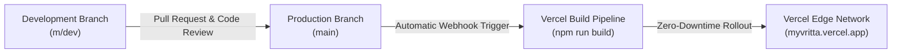

# Vritta Deployment & Release Guide

**Document Role:** How-to & Operations Guide (Diátaxis)  
**Hosting Platform:** Vercel (Edge Network & Serverless)  
**Production Domain:** `myvritta.vercel.app` (Project: `vritta`)  
**Production Branch:** `main` (Development Branch: `m/dev`)  

---

## 1. Hosting Architecture & Workflow

Vritta is hosted on Vercel and deployed globally across edge locations:

- **Static Pages & PWA Assets:** Prerendered at build time and served directly from the Vercel Edge Network with aggressive caching.
- **Client Application:** SPA loaded in the user's browser, communicating directly with Firebase Authentication and Cloud Firestore.
- **Continuous Deployment (CI/CD):** Vercel connects directly to the GitHub repository (`https://github.com/manishborikar92/Vritta.git`). Pushes to the production branch trigger automated builds and zero-downtime atomic rollouts.



---

## 2. Vercel Environment Variables Configuration

Configure the following environment variables in the [Vercel Dashboard](https://vercel.com) under **Project Settings** > **Environment Variables**:

| Variable Name | Type | Environments | Description |
| :--- | :---: | :--- | :--- |
| `FIREBASE_SERVICE_ACCOUNT_KEY` | **Sensitive** | Production, Preview | Minified JSON string of Firebase service account credentials. Masked in UI and build logs. |
| `NEXT_PUBLIC_FIREBASE_API_KEY` | Plaintext | Production, Preview | Public Web API key for client-side authentication. |
| `NEXT_PUBLIC_FIREBASE_AUTH_DOMAIN` | Plaintext | Production, Preview | Firebase Auth domain (e.g., `your-project.firebaseapp.com`). |
| `NEXT_PUBLIC_FIREBASE_PROJECT_ID` | Plaintext | Production, Preview | Google Cloud / Firebase project ID (`vritta-app`). |
| `NEXT_PUBLIC_FIREBASE_STORAGE_BUCKET` | Plaintext | Production, Preview | Cloud Storage bucket (`your-project.firebasestorage.app`). |
| `NEXT_PUBLIC_FIREBASE_MESSAGING_SENDER_ID` | Plaintext | Production, Preview | Firebase Cloud Messaging sender ID. |
| `NEXT_PUBLIC_FIREBASE_APP_ID` | Plaintext | Production, Preview | Firebase Web Application ID. |
| `NEXT_PUBLIC_FIREBASE_MEASUREMENT_ID` | Plaintext | Production, Preview | Optional Google Analytics measurement ID. |

> [!IMPORTANT]
> Environment variable modifications on Vercel take effect **only on new deployments**. After modifying variables, trigger a redeployment via the Vercel dashboard or push a commit to the tracked branch.

---

## 3. Pre-Release Verification Protocol

Before merging development work to `main` or triggering a production deployment, run all automated quality gates locally:

```bash
# 1. Run full unit and integration test suite (must report 100% pass)
npm --prefix web run test

# 2. Run linter (must report 0 errors, 0 warnings)
npm --prefix web run lint

# 3. Test production build compilation
npm --prefix web run build

# 4. Verify clean formatting with zero whitespace errors
git diff --check
```

---

## 4. Production Release Procedure

When quality gates pass and release readiness is approved:

### Step 1: Push Verified Commits to GitHub
Ensure all local work on `m/dev` is pushed to GitHub:
```bash
git push origin m/dev
```

### Step 2: Create and Merge Pull Request
1. Open a Pull Request on GitHub from `m/dev` into `main`.
2. Review the final diff, confirming no unexpected file modifications.
3. Merge the Pull Request into `main`.

### Step 3: Monitor Vercel Deployment
1. Open the [Vercel Dashboard](https://vercel.com) for project **vritta**.
2. Navigate to the **Deployments** tab.
3. Verify that the build triggered by the merge completes with status **Ready**.

---

## 5. Post-Deployment Verification Checklist

After deployment completes, verify live production behavior at `https://myvritta.vercel.app`:

1. **HTTP Status:** Verify the site serves `HTTP 200 OK` from edge nodes.
2. **Page Title & Branding:** Inspect the page title to confirm canonical capitalization:
   `<title>Vritta — Personal Routine Companion</title>`.
3. **Web Manifest:** Confirm exactly one manifest link tag is present:
   `<link rel="manifest" href="/manifest.json"/>`.
4. **Theme Toggle Verification:**
   - On the live login page, verify the theme toggle button renders at `>= 44×44px`.
   - Click the toggle to confirm smooth alternation between Light mode (porcelain canvas) and Dark mode (Deep Obsidian canvas `#090D16`).
   - Reload the page in both themes to verify zero-flash pre-paint initialization.
5. **Authentication Flow:** Verify Google Sign-In prompts correctly and redirects authenticated sessions to `/dashboard`.
6. **Console Hygiene:** Open browser developer tools and confirm zero runtime console errors, zero hydration mismatches, and zero failed network requests.

---

## 6. Rollback Protocol

If a critical issue is discovered post-release:

1. **Instant Vercel Rollback:**
   - In the Vercel Dashboard, go to **Deployments**.
   - Locate the previous stable production deployment.
   - Click the three-dots menu (`...`) and select **Promote to Production** (or **Rollback**).
   - Vercel instantly routes traffic back to the prior deployment without rebuilding.
2. **Git Branch Synchronization:**
   - Revert the problematic merge commit on `main`.
   - Push the revert to GitHub to ensure repository history reflects the active production state.
