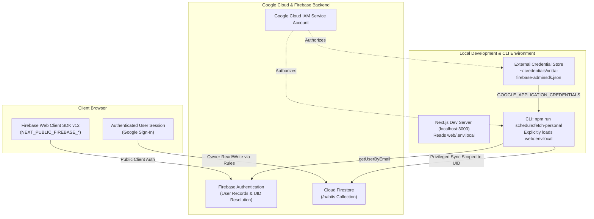

# Firebase Setup & Operations Runbook

**Document Role:** Operations & Setup Runbook (Diátaxis)  
**System:** Vritta — Personal Routine Companion  
**Stack:** Next.js 16 (App Router), Firebase Web SDK v12, Firebase Admin SDK v14, Cloud Firestore  

---

## 1. Overview & Architectural Boundaries

Vritta uses a dual Firebase architecture with strict boundaries between client execution and administrative synchronization:

1. **Client-Side (Firebase Web SDK v12):**
   - Configured in `web/src/lib/firebase/config.js` via public variables prefixed with `NEXT_PUBLIC_FIREBASE_*`.
   - Executes in the user's browser for Google Sign-In authentication, session persistence, and client-side Firestore reads and updates.
   - Strictly governed by Cloud Firestore Security Rules (`web/firestore.rules`).
2. **Server-Side & Admin CLI (Firebase Admin SDK v14):**
   - Configured in `web/src/lib/server/firebase-admin.js` via server-only credentials (`FIREBASE_SERVICE_ACCOUNT_KEY` or `GOOGLE_APPLICATION_CREDENTIALS`).
   - Executes in the administrative CLI script (`scripts/fetch-personal-schedule.mjs`, run via `npm run schedule:fetch-personal`) to perform direct synchronization of personalized routines directly to the `/habits` collection in Cloud Firestore.
   - Bypasses client security rules with least-privilege credentials, strictly scoped to the designated administrator account.



---

## 2. Credential Security & Repository Hygiene

- **Source Control Policy:** Service account private keys and `.env.local` files must **never be tracked or committed** to source control.
- **Git Exclusions:** The root `.gitignore` and `web/.gitignore` enforce strict wildcard exclusions:
  ```gitignore
  # Firebase Admin SDK Service Account Keys
  *firebase-adminsdk*.json
  *-adminsdk-*.json
  service-account*.json
  .env*.local
  ```
- **External Storage Requirement:** For local development, working service account JSON files must be stored in a directory external to the repository workspace (e.g., `~/.credentials/`).

---

## 3. Local Development Setup

### Step 3.1: Storing Credentials Outside the Repository
Store the Firebase service-account JSON key in your user profile directory, outside all Git repositories:

1. Create the external credentials directory:
   - **Linux / macOS:**
     ```bash
     mkdir -p ~/.credentials
     ```
   - **Windows (PowerShell):**
     ```powershell
     New-Item -ItemType Directory -Path "$HOME\.credentials" -Force
     ```
2. Place your downloaded Firebase Admin SDK service account key file inside that directory:
   ```
   ~/.credentials/vritta-firebase-adminsdk.json
   ```
3. Ensure file permissions restrict read access exclusively to your user account.

> [!CAUTION]
> Never place service-account JSON files inside the repository directory or any of its subfolders.

---

### Step 3.2: Configuring `web/.env.local`

Create and edit `web/.env.local`. Populate the client-side Firebase variables and add the pointer to your external service-account key:

```env
# Public Client Configuration (Firebase Console > Project Settings)
NEXT_PUBLIC_FIREBASE_API_KEY="your_api_key_here"
NEXT_PUBLIC_FIREBASE_AUTH_DOMAIN="your_project_id.firebaseapp.com"
NEXT_PUBLIC_FIREBASE_PROJECT_ID="your_project_id"
NEXT_PUBLIC_FIREBASE_STORAGE_BUCKET="your_project_id.firebasestorage.app"
NEXT_PUBLIC_FIREBASE_MESSAGING_SENDER_ID="your_messaging_sender_id"
NEXT_PUBLIC_FIREBASE_APP_ID="your_app_id"
NEXT_PUBLIC_FIREBASE_MEASUREMENT_ID="your_measurement_id"

# Server-Side CLI Credential Pointer (Local Development)
GOOGLE_APPLICATION_CREDENTIALS="C:/Users/<username>/.credentials/vritta-firebase-adminsdk.json"
```

> [!TIP]
> Use forward slashes (`/`) in `GOOGLE_APPLICATION_CREDENTIALS` even on Windows. Forward slashes are natively parsed by Node.js and prevent backslash escape issues.

---

### Step 3.3: Environment Variable Loading Mechanics

- **Next.js Server (`npm --prefix web run dev`):** Next.js automatically loads `web/.env.local` at startup into `process.env`.
- **Standalone Administrative CLI (`scripts/fetch-personal-schedule.mjs`):** Standalone Node.js scripts executed outside Next.js parse `web/.env.local` explicitly at startup before dynamically importing Firebase Admin modules. This ensures identical behavior whether run from root or via `npm --prefix web run schedule:fetch-personal`.

---

### Step 3.4: Running and Verifying Operations

#### 1. Verifying Administrative Schedule Synchronization
Run the administrative CLI tool to synchronize personalized routines to Firestore:
```bash
npm --prefix web run schedule:fetch-personal
```

**Expected Successful Output:**
```
======================================================
 Vritta: Personalized Schedule Synchronization (CLI) 
======================================================

[Target Account] user@example.com
[Auth] Resolving user account via Firebase Admin SDK...
[Success] Verified user: User Name (UID: <userId>)

[Sync] Synchronizing 6 personalized routines to Cloud Firestore...

[Complete] Successfully synchronized 6 routines:
  ✓ Practice English Workbook      [English Learning] (ID: <userId>_canonical_english_workbook)
  ✓ Exercise / Movement Plan       [Movement & Strength] (ID: <userId>_canonical_exercise_plan)
  ✓ Listen to Osho                 [Listening & Awareness] (ID: <userId>_canonical_listen_osho)
  ✓ Read Books                     [Reading] (ID: <userId>_canonical_read_books)
  ✓ Practice English Speaking      [Communication] (ID: <userId>_canonical_english_speaking)
  ✓ Maintain a Diary               [Reflection] (ID: <userId>_canonical_maintain_diary)

[Integrity Guarantees Applied]
  • User customizations preserved (custom times, notes, frequencies)
  • Routine stable keys isolated from generic foundation routines
  • Custom user habits preserved
  • Daily completion history and streak logs (/dailyLogs) unmodified
```

#### 2. Verifying the Web Application
Start the development server:
```bash
npm --prefix web run dev
```
Open `http://localhost:3000` and complete Google Sign-In to verify client authentication and Firestore listeners.

---

## 4. Vercel Production Configuration

### Step 4.1: Sensitive Environment Variable Configuration
On Vercel, serverless function containers are ephemeral. Storing server credentials as a **Sensitive Environment Variable** provides optimal security:

1. Copy the full JSON content of your service account key file.
2. In the Vercel Dashboard, navigate to **Project Settings** > **Environment Variables**.
3. Add `FIREBASE_SERVICE_ACCOUNT_KEY`:
   - **Key:** `FIREBASE_SERVICE_ACCOUNT_KEY`
   - **Value:** Paste the full minified JSON content.
   - **Type:** **Sensitive** (masks value permanently).
   - **Scope:** **Production** and **Preview** (uncheck Development).
4. Configure all required `NEXT_PUBLIC_FIREBASE_*` variables for Production and Preview.
5. Trigger a redeployment for environment variable changes to take effect on new build artifacts.

---

## 5. Security Rules & Index Deployment

### 5.1 Deploying Cloud Firestore Security Rules
When updating authorization rules in `web/firestore.rules`:

1. Run the local test suite to confirm rule compatibility:
   ```bash
   npm --prefix web run test
   ```
2. Deploy the rules using the Firebase CLI from `web/`:
   ```bash
   firebase deploy --only firestore:rules --project your_project_id
   ```
3. Rule updates take effect immediately across all active client connections.

### 5.2 Deploying Firestore Indexes
When adding composite queries to `web/firestore.indexes.json`:

1. Deploy the indexes:
   ```bash
   firebase deploy --only firestore:indexes --project your_project_id
   ```
2. Cloud Firestore builds indexes in the background (typically 2–5 minutes). Queries succeed automatically once index status transitions to `ENABLED`.

---

## 6. Service Account Key Rotation Procedure

To rotate service account keys with zero downtime:

1. **Generate New Key:** In Firebase Console > Project Settings > **Service accounts**, click **Generate new private key**.
2. **Update External Local File:** Replace the key at `~/.credentials/vritta-firebase-adminsdk.json`.
3. **Update Vercel:** Paste the new JSON into `FIREBASE_SERVICE_ACCOUNT_KEY` in Vercel Project Settings, then redeploy.
4. **Verify:** Run `npm --prefix web run schedule:fetch-personal` locally to confirm authentication with the new key.
5. **Revoke Old Key:** In Google Cloud Console > IAM & Admin > **Service Accounts**, delete the retired key.

---

## 7. Change Impact & Risk Reference

| Operation | Command / Location | Deployment Needed? | Reversible? | Risk Level |
| :--- | :--- | :---: | :---: | :---: |
| Deploy Security Rules | `firebase deploy --only firestore:rules` | No (Instant) | Yes | Medium |
| Deploy Composite Indexes | `firebase deploy --only firestore:indexes` | No (Instant) | Yes | Low |
| Update Vercel Env Vars | Vercel Project Settings | **Yes (Redeploy)** | Yes | Low |
| Rotate Service Account Key | GCP IAM + Vercel Settings | **Yes (Redeploy)** | Yes | Low |
| Add Authorized Auth Domain | Firebase Console | No (Instant) | Yes | Low |
